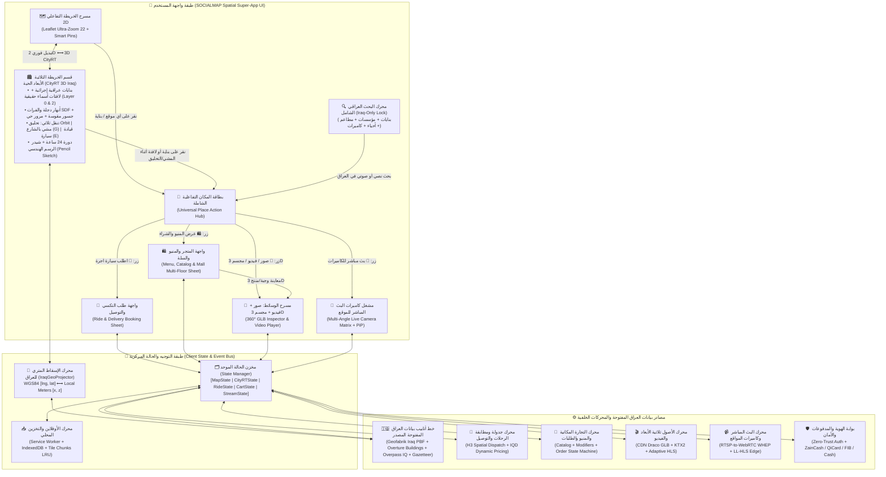
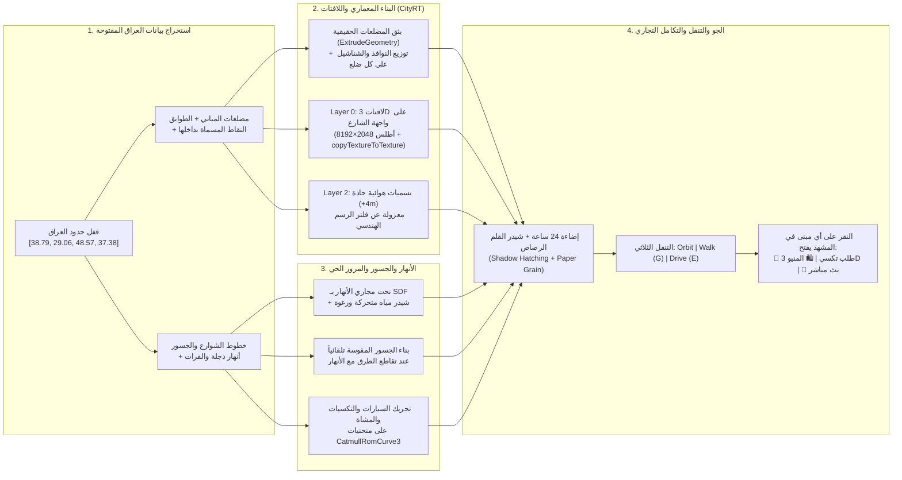

# 🌐 المخطط الهندسي الشامل والغرافات المعمارية الكاملة لمنظومة SOCIALMAP (نسخة العراق الشاملة)
### **الوثيقة المرجعية العليا (00): Master Blueprint, CityRT 3D Live Iraq Engine, Complete System Graphs & 39,400+ Specifications Matrix**
**الإصدار المعماري:** `SOCIALMAP v11.5 — Spatial Super-App & CityRT 3D Live Iraq Architecture`  
**المصمم والمبتكر:** بشار تويج ([BasharTwaij.com](https://BasharTwaij.com))  
**النطاق الجغرافي الحصري:** **جمهورية العراق فقط (`ISO 3166-1: IQ` — 18 محافظة — `BBox: [38.79, 29.06, 48.57, 37.38]`)**

---

## 1. 🎯 التحول الاستراتيجي: من خريطة تفاعلية (OMI) إلى منظومة فائقة (SOCIALMAP + CityRT 3D Iraq)

تمثل منظومة **SOCIALMAP** الجيل الجديد من تطبيقات الخرائط الفائقة المخصصة لدولة العراق (**Iraq Spatial Super-App**)، حيث تندمج الخريطة التفاعلية ثنائية الأبعاد مع **قسم الخريطة الثلاثية الأبعاد الحية بأسلوب CityRT (`skylines-sketch`)** المبنية فوق بيانات العراق الحقيقية المفتوحة المصدر، لتدور المنظومة حول **ست ركائز مترابطة لحظياً** فوق كل بناية وشارع ومؤسسة في العراق:

1. **🏙️ الركيزة الأولى: قسم الخريطة ثلاثية الأبعاد الحية بأسلوب CityRT لمدن العراق (CityRT 3D Procedural Live Iraq Map)**
   - تحويل مضلعات البنايات العراقية الحقيقية (`GeoJSON Polygons` من `OpenStreetMap Iraq` و `Overture Maps`) عبر محرك `IraqGeoProjector` (`1 وحدة = 1 متر`) إلى عمارة ثلاثية الأبعاد حية بطراز عراقي/عربي أصيل (شناشيل خشبية، مشربيات، قباب فيروزية ومذهبة، بوابات إيوان، وأبراج تجارية زجاجية للمولات والفنادق).
   - **نظام التسميات واللافتات المزدوج على البنايات:**
     - **Layer 0 (`DynamicSignGenerator` — `2048×8192 Canvas Atlas`):** تثبيت لافتات ثلاثية الأبعاد مضيئة ليلاً على أطول ضلع للبناية مواجه للشارع تحمل الاسم الحقيقي للمبنى أو المؤسسة بالعربية (`tags['name:ar'] || tags['name']`).
     - **Layer 2 (`Sharp Floating Billboard Labels`):** لوحات تسمية هوائية حادة على ارتفاع `+4m` فوق قمم المعالم والمؤسسات موضوعة على `mesh.layers.set(2)` ومعزولة عن فلتر الرسم الهندسي لتبقى النصوص العربية حادة 100%.
   - **أنهار العراق الحقيقية والجسور المقوسة (`SDF Rivers & Arched Bridges`):** نحت مجاري نهر دجلة والفرات وشط العرب والروافد بمنحنيات `CatmullRomCurve3` وحقول المسافة الموقعة (`SDF` + `Spatial Hash Grid`) مع شيدر مياه متحركة وتشييد جسور مقوسة تلقائياً عند تقاطع الطرق (`bridge=yes`).
   - **الحياة المرورية وأنماط التنقل الثلاثة (`Orbit` / `Street Walk [G]` / `Car Drive [E]`):** حركة سيارات وتكسيات عراقية ومشاة وقوارب نهرية على مسارات الطرق والأنهار الحقيقية، مع تعاقب الليل والنهار (`00:00 – 24:00`)، وفلتر الرسم الهندسي القابل للتبديل (`Pencil Sketch Cross-Hatching`), وإمكانية المشي الميداني في شوارع العراق (`G`) أو قيادة سيارة (`E`).
2. **🗺️ الركيزة الثانية: محرك البيانات الجغرافية المفتوحة المصدر للعراق حصراً (Iraq-Only Open-Source Geodata Pipeline)**
   - قفل جغرافي صارم على حدود جمهورية العراق (`ISO3166-1=IQ`) وجلب شامل لأسماء ومضلعات كافة البنايات، الطرق، المؤسسات، الجامعات، المدارس (مثل *"مجموعة العميد التعليمية"*)، المستشفيات، المولات، والأحياء السكنية (مثل *"العطيشي"*) عبر `Geofabrik Iraq PBF`, `Overture Maps`, `Overpass API`, `Photon`, و `Nominatim`.
3. **🚕 الركيزة الثالثة: منظومة طلب سيارات الأجرة والتوصيل المدمجة بالمكان (Pin-Triggered Ride-Hailing & Delivery)**
   - عند النقر على أي مكان أو بناية في الخريطة (2D أو 3D CityRT) أو أثناء المشي في الشارع الثلاثي الأبعاد، يظهر فوراً زر **"اطلب سيارة أجرة إلى هنا / من هنا"** مع احتساب المسار والتسعيرة بالدينار العراقي وتتبع سيارة الكابتن كمجسم ثلاثي الأبعاد حي يتحرك في الشارع الفعلي.
4. **🛍️ الركيزة الرابعة: التجارة المكانية وقوائم المطاعم والأسواق والمولات (Spatial E-Commerce, Menus & Instant Ordering)**
   - عند النقر على أي مطعم، كافيه، سوق، سوبرماركت، أو مول (سواء من الخريطة العلوية أو بالنقر على لافتة المطعم ثلاثية الأبعاد أثناء التجول في الشارع)، يفتح درج المنيو الكامل لعرض القطع والأسعار بالدينار العراقي، الشراء المباشر، وتتبع المندوب.
5. **🧊 الركيزة الخامسة: العرض البصري الفائق بالصور، الفيديو، والمجسمات ثلاثية الأبعاد (Rich Media & 3D/AR Object Inspection)**
   - كل مكان وكل وجبة أو منتج داخل المنيو يُعرض عبر معرض صور عالية الدقة، فيديو استعراضي، ومجسم ثلاثي الأبعاد تفاعلي (`360° GLB`) يوضح الحجم الحقيقي للقطعة.
6. **🔴 الركيزة السادسة: البث المباشر وكاميرات المواقع الحية (Real-Time Live Location Cameras & Streams)**
   - زر بارز **"🔴 بث مباشر"** في كل مكان يفتح الكاميرات الحية التي تبث من داخل الموقع أو أمامه (`WebRTC / LL-HLS`) بزوايا متعددة ومؤشر ازدحام حي ووضع صورة داخل صورة (`PiP`).

---

## 2. 📊 المخطط المعماري الشامل للمنظومة (Master System Architecture Graph — SOCIALMAP + CityRT 3D Iraq)

---

## 3. 🏙️ مخطط تدفق تحويل خريطة العراق الحية إلى مدينة CityRT ثلاثية الأبعاد (CityRT Live Iraq Pipeline Graph)

---

## 4. 📑 الفهرس المرجعي الشامل لوثائق العمل الـ 21 (Master Documentation Architecture)

تم تفكيك متطلبات وتفاصيل منظومة **SOCIALMAP + CityRT 3D Iraq** (بإجمالي **39,420 تفصيلاً هندسياً ذرياً** عبر مراحل المشروع؛ أكثر من **5,000 إلى 6,400 تفصيل لكل مرحلة**) على الوثائق الـ 21 التالية داخل مجلد `وثائق العمل/`:

| رقم الوثيقة | اسم الملف | محتوى الوثيقة التفصيلي |
| :--- | :--- | :--- |
| **00** | `00_SOCIALMAP_MASTER_BLUEPRINT_AND_GRAPHS.md` | المخطط الهندسي الرئيسي، دمج `CityRT 3D Iraq`، وغرافات التدفق والتتابع وآلات الحالة الشاملة |
| **01** | `01_VISION_AND_PRD.md` | الرؤية الاستراتيجية ومتطلبات المنتج الشاملة (PRD) والركائز الـ 6 وقصص المستخدم |
| **02** | `02_SYSTEM_ARCHITECTURE.md` | المعمارية التقنية وحزمة الـ Tech Stack وتكامل المحركات الستة (بما فيها `CityRT3DIraqEngine`) |
| **03** | `03_DATA_MODELS_AND_STORAGE.md` | نمذجة البيانات الشاملة (ERD) وجداول الخرائط والتكسي والمتاجر والـ 3D والبث الحي وقطاعات `CityRT` |
| **04** | `04_API_AND_INTEGRATION_SPEC.md` | عقود الـ APIs، قنوات WebSocket اللحظية، بوابات الدفع العراقية، وبروتوكولات البث |
| **05** | `05_UI_UX_DESIGN_SPEC.md` | تصميم الواجهات، البطاقة الشاملة، واجهة `CityRT 3D`، أزرار المشي والقيادة، المنيو، ومشغل البث |
| **06** | `06_SECURITY_AND_PRIVACY.md` | الأمان السيبراني، حماية المدفوعات، منع تزوير الـ GPS، وخصوصية الكاميرات |
| **07** | `07_OFFLINE_AND_CACHE_STRATEGY.md` | استراتيجية العمل أوفلاين وتخزين الخرائط وقطاعات `CityRT 3D` والقوائم والمجسمات |
| **08** | `08_TESTING_AND_QA_PLAN.md` | خطة الاختبارات الشاملة، محاكاة الأسطول، واختبارات أداء `CityRT WebGL 60FPS` |
| **09** | `09_DEPLOYMENT_AND_INFRASTRUCTURE.md` | البنية التحتية السحابية، خوادم البث، بلاطات `PMTiles` العراق، وشبكة `Cloudflare Edge` |
| **10** | `10_ACCESSIBILITY_AND_I18N.md` | الوصولية الشاملة (WCAG 2.2 AA)، التوطين العراقي، هندسة الأقواس، والأوامر الصوتية |
| **11** | `11_PERFORMANCE_AND_OPTIMIZATION.md` | تحسين الأداء، `BatchedMesh & InstancedMesh`، أطلس اللافتات `2048×8192`، وفهرسة `H3` |
| **12** | `12_MAP_LAYERS_AND_GEO_DATA.md` | طبقات الخرائط، التقريب `Zoom 22`، وطبقات البنايات واللافتات والأنهار والمرور الحي |
| **13** | `13_RISK_AND_MITIGATION.md` | تحليل المخاطر التشغيلية والتقنية والمالية وخطط الطوارئ البديلة |
| **14** | `14_ROADMAP_AND_MILESTONES.md` | خارطة الطريق التنفيذية المفصلة (**39,420 تفصيلاً هندسياً ذرياً** عبر 7 مراحل بناء متكاملة) |
| **15** | `15_OFFLINE_GPS_FEASIBILITY_STUDY.md` | دراسة الجدوى الهندسية لتتبع الـ GPS الفضائي وثبات البوصلة الحقيقية |
| **16** | `16_RIDE_HAILING_AND_LOGISTICS_SPEC.md` | الدليل الهندسي الكامل لمنظومة طلب سيارات الأجرة والتوصيل على الخريطة (2D & 3D) |
| **17** | `17_LIVE_STREAMING_AND_CAMERAS_SPEC.md` | الدليل الهندسي الكامل لمنظومة كاميرات البث المباشر للمواقع على الخريطة |
| **18** | `18_SPATIAL_COMMERCE_AND_3D_MENUS_SPEC.md` | الدليل الهندسي الكامل للتجارة المكانية، المنيو، المولات، الشراء، وعارض الـ 3D والفيديو |
| **19** | `19_CITYRT_3D_IRAQ_LIVE_MAP_ENGINE_SPEC.md` | **الدليل الهندسي والخوارزمي الشامل لقسم الخريطة ثلاثية الأبعاد الحية بأسلوب CityRT للعراق** |
| **20** | `20_IRAQ_OPEN_SOURCE_GEODATA_PIPELINE_SPEC.md` | **الدليل الهندسي لخط أنابيب جلب وفهرسة بيانات البنايات والطرق والمؤسسات المفتوحة للعراق حصراً** |
