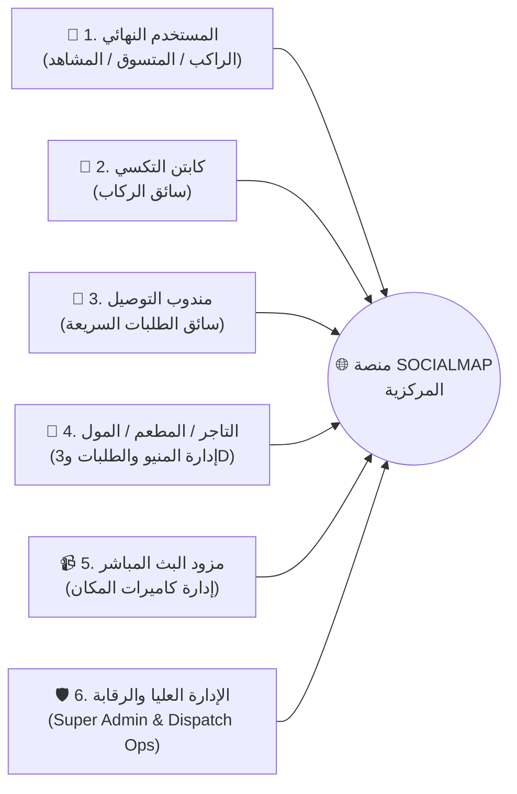

# 📋 وثيقة 01: الرؤية الاستراتيجية ومتطلبات المنتج الشاملة (Vision & Comprehensive PRD)
### **النظام: SOCIALMAP — المنظومة الجغرافية الاجتماعية والتجارية واللوجستية الفائقة**
**المصمم والمبتكر:** بشار تويج ([BasharTwaij.com](https://BasharTwaij.com))

---

## 1. 🌟 الرؤية الجوهرية للمنتج (Product Vision)

تحويل الخريطة الجغرافية من أداة عرض صامتة إلى **بيئة حياة رقمية وتجارية ولوجستية متكاملة (Spatial Super-App)** تتيح للمستخدم من خلال شاشة خريطة واحدة القيام بأربع عمليات رئيسية مترابطة عند النقر على أي مكان أو البحث عنه:
1. **التنقل وطلب سيارات الأجرة فورياً (Pin-to-Ride):** طلب سيارة أجرة أو وسيلة نقل مباشرة إلى الموقع المؤشر عليه على الخريطة أو منه، مع تتبع حي ثلاثي الأبعاد للمركبة.
2. **التسوق وعرض المنيو والشراء المباشر (Pin-to-Shop & Dine):** فتح المنيو الخاص بأي مطعم، كافيه، سوق، أو مول على الخريطة، وتصفح الأصناف والمنتجات وشراؤها مع توصيل فوري أو استلام مباشر.
3. **الاستعراض البصري الغامر (Immersive Media: Photos + 3D Models + Video):** معاينة أي مكان أو أي منتج/وجبة داخل المنيو عبر صور عالية الدقة، ومقاطع فيديو حية، ومجسمات ثلاثية الأبعاد (`3D Interactive Models`) قابلة للتدوير `360°`.
4. **المشاهدة الحية عبر كاميرات البث المباشر (Pin-to-Live-Cam):** الضغط على زر **"🔴 بث مباشر"** في أي موقع لفتح الكاميرات الحية التي تبث من ذلك المكان في اللحظة الفعلية لمعرفة الأجواء وحالة الازدحام والفعاليات الجارية قبل الذهاب إليه.

---

## 2. 👥 منظومة الأدوار والفاعلين في التطبيق (6 Core Actors & Personas)

### 2.1 المستخدم النهائي (End-User / Explorer / Shopper / Passenger)
- يبحث عن أي منطقة، بناية، مطعم، سوق، أو مول على الخريطة أو ينقر عليه مباشرة.
- يشاهد صور الموقع، الفيديو التعريفي، والمجسم ثلاثي الأبعاد.
- يفتح **البث المباشر (Live Cam)** ليرى المكان حياً بالصوت والصورة.
- يطلب **سيارة أجرة** لتقله من موقعه الحالي إلى المكان المحدد (أو العكس).
- يفتح **المنيو / المتجر** الخاص بالمكان، يعاين الأطباق والمنتجات بتقنية `3D` والفيديو، يضيفها إلى السلة، يدفع إلكترونياً أو نقداً، ويتتبع مندوب التوصيل على الخريطة حتى باب منزله.

### 2.2 كابتن سيارة الأجرة (Taxi Captain / Driver)
- يستقبل طلبات الركاب القريبين ضمن نطاقه الجغرافي (`H3 Spatial Zone`).
- يرى نقطة انطلاق الراكب ونقطة وجهته والمسار الأسرع والأجرة المحسوبة مسبقاً.
- يظهر موقعه واتجاه سيارته للراكب كمجسم سيارة ثلاثي الأبعاد يتحرك بسلاسة على الخريطة.

### 2.3 مندوب التوصيل اللوجستي (Delivery Courier)
- يستقبل طلبات توصيل الطعام والمشتريات من المطاعم والأسواق والمولات إلى موقع المستخدم على الخريطة.
- يدعم التوصيل عبر الدراجة النارية، الدراجة الهوائية، أو السيارة.

### 2.4 التاجر / إدارة المطعم أو السوق أو المول (Merchant / Store Partner)
- يمتلك دبوساً تجارياً موثقاً وبناية ثلاثية الأبعاد على خريطة `SOCIALMAP`.
- يرفع المنيو والأقسام والمنتجات مع الأسعار، الخيارات، الصور، مقاطع الفيديو، وملفات المجسمات ثلاثية الأبعاد (`.glb` / `.usdz`).
- يستقبل الطلبات الحية، يحدث حالتها (`قيد التحضير` -> `جاهز للاستلام`)، ويربط كاميرات العرض الحي الخاصة بمعرضه أو مطعمه.

### 2.5 مزود البث المباشر (Live Camera Host / Venue Operator)
- يربط كاميرات البث العام الخاصة بالمول، المطعم، الساحة العامة، الكورنيش، أو الشارع التجاري ببوابة `SOCIALMAP Live`.
- يحدد زوايا الكاميرات المسموح ببثها للجمهور وأوقات عملها، مع تفعيل فلاتر الخصوصية الآلية.

### 2.6 مدير المنظومة وغرفة العمليات (Super Admin & Operations Center)
- يراقب خريطة العراق الحية: حركة الأسطول، الطلبات الجارية، المتاجر النشطة، حالة الكاميرات الحية، والتسويات المالية.

---

## 3. 🧩 المتطلبات الوظيفية التفصيلية لكل وحدة (Exhaustive Functional Requirements)

### 3.1 وحدة الخريطة التفاعلية وبطاقة المكان الموحدة (`FR-MAP & FR-HUB`)
1. **`FR-MAP-001` (النقر الحر الذكي):** عند نقر المستخدم على أي نقطة أو بناية في الخريطة، يقوم النظام خلال أقل من `150ms` باستدعاء محرك الاكتشاف المكاني (`Spatial Resolver`) وإظهار **بطاقة المكان الشاملة (`Universal Place Hub`)**.
2. **`FR-MAP-002` (البحث الموحد متعدد الأنماط):** شريط البحث العلوي يدعم البحث عن:
   - أسماء المناطق والأحياء والشوارع (مثل: `العطيشي`، `المنصور`، `الجادرية`).
   - أسماء المطاعم والمولات والأسواق (مثل: `بغداد مول`، `مول العفاف`، `مجموعة العميد`).
   - أسماء الوجبات أو المنتجات مباشرة (مثل: `برغر مشوي`، `سمك مسكوف`، `قهوة مختصة`، `ساعات`) حيث يظهر للمستخدم المتاجر التي تبيع هذا الصنف على الخريطة مع سعره!
   - المواقع التي تحتوي على **بث مباشر نشط الآن (`🔴 مباشر الآن`)**.
3. **`FR-HUB-001` (الهيكل القياسي لبطاقة المكان):** كل مكان يُفتح على الخريطة يجب أن يعرض في بطاقته العناصر التالية بترتيب بصري واضح:
   - **رأس البطاقة:** اسم المكان، التصنيف، التقييم بالنجوم، حالة الفتح (`مفتوح الآن / مغلق`)، ومؤشر الازدحام الحي (`هادئ / متوسط / مزدحم`).
   - **شريط الوسائط الغامر (`Immersive Media Stage`):** تبويبات سريعة في أعلى البطاقة للتبديل الفوري بين:
     - `🖼️ الصور (Photos)`
     - `🧊 مجسم 3D (360° 3D View)`
     - `🎬 فيديو (Video Tour)`
     - `🔴 بث مباشر (Live Cam)`
   - **شريط الإجراءات الرباعي (`Quad Action Bar`):**
     1. **زر `🚕 اطلب تكسي إلى هنا` (أو `من هنا`)**: يفتح واجهة حجز الرحلة مباشرة.
     2. **زر `🛍️ المنيو والشراء` (للمطاعم والأسواق والمولات)**: يفتح قائمة الطعام أو المتجر الكامل مع سلة الشراء.
     3. **زر `🔴 بث مباشر` (زر نابض باللون الأحمر)**: يفتح شاشة الكاميرات الحية في هذا الموقع.
     4. **زر `🧭 مسار وملاحة`**: يرسم المسار على الخريطة لحركة المستخدم الشخصية.

---

### 3.2 وحدة طلب سيارات الأجرة والتنقل المدمجة (`FR-TAXI`)
1. **`FR-TAXI-001` (التحديد التلقائي للانطلاق والوجهة):** بمجرد الضغط على `🚕 اطلب تكسي` من بطاقة أي مكان، يتم اعتماد موقع المستخدم الحالي عبر الـ `GPS` كنقطة انطلاق (`Pickup A`) والمكان المختار كنقطة وجهة (`Dropoff B`)، مع إمكانية عكسهما (`اطلب تكسي من هذا المكان إلى منزلي`) أو سحب الدبابيس بحرية على الخريطة.
2. **`FR-TAXI-002` (فئات المركبات المتعددة):**
   - **توصيلة اقتصادية (`OMI Saver / Economy`):** سيارات صالون حديثة بسعر اقتصادي يومي.
   - **توصيلة مريحة (`OMI Comfort`):** سيارات حديثة واسعة ومكيفة بالكامل.
   - **توصيلة عائلية (`OMI Family XL`):** سيارات دفع رباعي أو فان عائلي (7 ركاب).
   - **تكسي نسائي/عائلي مخصص (`OMI Safe Family`):** خيار مخصص للعائلات والطالبات.
   - **موتور/دراجة توصيل طلبات سريعة (`OMI Moto Express`):** لإرسال واستلام الطرود والطلبات السريعة.
3. **`FR-TAXI-003` (التسعيرة الشفافة والمسار المضيء):** عرض السعر التقديري بالدينار العراقي (مثلاً: `4,500 د.ع`) مع تفصيل (فتحة العداد + سعر الكيلومتر + سعر الدقيقة + معامل الذروة إن وجد) ورسم المسار الفعلي على الشوارع مع الوقت المتوقع للوصول.
4. **`FR-TAXI-004` (التتبع الحي ثلاثي الأبعاد للسيارة):** بعد قبول الكابتن، تتحرك سيارته كمجسم ثلاثي الأبعاد حقيقي (`Three.js 3D Car`) على شوارع الخريطة باتجاه المستخدم، مع بطاقة تعرض: صورة الكابتن، اسمه، نوع ولون السيارة، رقم اللوحة العراقية، تقييمه، أزرار الاتصال الدارك أو المحادثة الفورية، وزر مشاركة رابط تتبع الرحلة مع العائلة.

---

### 3.3 وحدة المنيو، الأسواق، المولات، والشراء المباشر (`FR-COMMERCE`)
1. **`FR-COMM-001` (دليل المولات متعددي الطوابق والمتاجر):**
   - إذا نقر المستخدم على **مول تجاري** (مثل `بغداد مول` أو `مول المنصور` أو `مول العفاف`)، يمكنه تصفح **قائمة المتاجر والمطاعم الموجودة داخل المول** مصنفة حسب الطابق (`GF, F1, F2, Food Court`)، والدخول لمنيو أي مطعم أو متجر بداخل المول والشراء منه!
2. **`FR-COMM-002` (عرض المنيو التفاعلي للمطاعم والأسواق):**
   - شريط أقسام أفقي سريع (المقبلات، المشويات، البرغر، البيتزا، الحلويات، المشروبات — أو في الأسواق: الفواكه، الألبان، المخبوزات، المنظفات، الإلكترونيات).
   - كل بطاقة عنصر في المنيو تعرض: الاسم، الوصف، السعر بالدينار العراقي، السعرات الحرارية/الوزن، التقييم، وشارات تفاعلية (`🧊 عرض 3D` | `🎬 فيديو` | `📷 صور`).
3. **`FR-COMM-003` (تخصيص الصنف والقطع):**
   - إمكانية تحديد الحجم (صغير، وسط، كبير، عائلي)، الإضافات الاختيارية، الملاحظات الخاصة (مثلاً: بدون بصل، زيادة صوص)، وتحديد الكمية.
4. **`FR-COMM-004` (سلة المشتريات الذكية وإتمام الطلب):**
   - سلة مشتريات عائمة تحسب المجموع الفرعي، أجور التوصيل (المحسوبة جغرافياً حسب المسافة بين المتجر ودبوس المستخدم)، الخصومات/الكوبونات، والمجموع النهائي.
   - خيارات الاستلام: **توصيل إلى موقعي على الخريطة (`Delivery`)**، أو **استلام من الفرع/السيارة (`Pickup / Curbside`)**، أو **الحجز وتناول الطعام داخل المطعم (`Dine-in Reservation`)**.

---

### 3.4 وحدة العرض البصري الثلاثي: صور + مجسم 3D + فيديو (`FR-MEDIA3D`)
1. **`FR-MEDIA-001` (معرض الصور عالي الدقة):** عارض صور يدعم السحب (`Swipe`)، التكبير باللمس (`Pinch-to-Zoom`)، والصور البانورامية `360°` لداخل المطعم أو المتجر أو المعلم.
2. **`FR-MEDIA-002` (عارض المجسمات ثلاثية الأبعاد `3D Object & Dish Viewer`):**
   - محرك `Three.js WebGL` مدمج داخل بطاقة المكان وداخل نافذة تفاصيل المنتج/الوجبة.
   - يعرض مجسماً ثلاثي الأبعاد حقيقياً (`.glb` مضغوط بـ `Draco/KTX2`) للوجبة أو المنتج أو البناية مع إضاءة استوديو (`HDRI Environment`)، تدوير كامل بالماوس أو الإصبع `360°`، تقريب وتبعيد، وزر **عرض في الواقع المعزز (`AR View on Table`)** لمعاينة حجم الطبق أو المنتج الحقيقي.
3. **`FR-MEDIA-003` (مشغل الفيديو التفاعلي):**
   - تشغيل مقاطع فيديو قصيرة (`Reels / Shorts` بصيغة `MP4 / HLS`) توضح شكل المكان من الداخل أو طريقة تحضير وتقديم الوجبة أو استعراض المنتج، مع تحكم بالصوت والسرعة وملء الشاشة.

---

### 3.5 وحدة البث المباشر وكاميرات المواقع الحية (`FR-LIVECAM`)
1. **`FR-LIVE-001` (زر البث المباشر `🔴 بث مباشر`):**
   - يظهر في بطاقة أي مكان مغطى بكاميرات البث، كما يظهر كشارة حمراء نابضة فوق دبوس المكان على الخريطة (`🔴 LIVE`).
2. **`FR-LIVE-002` (مصفوفة الكاميرات متعددة الزوايا `Multi-Cam Grid`):**
   - عند فتح البث المباشر لمول أو شارع أو معلم أو مطعم، يمكن للمستخدم التبديل بين عدة كاميرات في نفس الموقع:
     - مثال للمطعم/الكافيه: `كاميرا الصالة الداخلية`، `كاميرا الجلسة الخارجية/الحديقة`، `كاميرا ركن التحضير الحي`.
     - مثال للمول/الشارع: `كاميرا البوابة الرئيسية`، `كاميرا الساحة الوسطى`، `كاميرا حركة الشارع وموقف السيارات`.
3. **`FR-LIVE-003` (مؤشرات الحالة الحية فوق البث `Live HUD Overlay`):**
   - يعرض مشغل البث المباشر فوق الفيديو: شارة `🔴 مباشر الآن`، الوقت والتاريخ الفعلي بالثانية، عدد المشاهدين الحاليين، مؤشر حالة الازدحام (`خفيف 🟢 / متوسط 🟡 / مزدحم 🔴`)، وأزرار سريعة أسفل البث: **`🚕 اطلب تكسي إلى هنا الآن`** و **`🛍️ افتح منيو هذا المكان`**.

---

## 4. 📊 مؤشرات الأداء ومعايير القبول القياسية (KPIs & Acceptance Criteria)

| المؤشر الهندسي | الهدف القياسي المعتمد في SOCIALMAP |
| :--- | :--- |
| **زمن فتح بطاقة المكان عند النقر على الخريطة** | أقل من `100ms` للبيانات الأساسية وأقل من `400ms` لتحميل المنيو الكامل |
| **زمن احتساب مسار وأجرة التكسي** | أقل من `350ms` عبر محرك التوجيه والتسعير المكاني |
| **زمن تحميل المجسم ثلاثي الأبعاد (3D Model)** | أقل من `1.2 ثانية` بفضل ضغط `Draco` والتحميل التدريجي (`Progressive LOD`) |
| **زمن بدء تشغيل البث المباشر للكاميرا (Live Cam)** | أقل من `1.5 ثانية` وبزمن تأخير (`Latency`) يتراوح بين `0.5s` و `2.0s` |
| **معدل الإطارات لحركة السيارات والمجسمات على الخريطة** | `60 FPS` ثابتة على الحواسيب والهواتف الذكية الحديثة |
| **التوافق والاستجابة للشاشات (Responsiveness)** | `100%` متوافق مع الهواتف (`iOS / Android PWA`) والأجهزة اللوحية والحواسيب |

---

## 6. متطلبات قسم الخريطة ثلاثية الأبعاد الحية بأسلوب CityRT وبيانات العراق المفتوحة (`FR-CITYRT3D` & `FR-IRAQDATA`)

| المعرف | المتطلب الوظيفي التفصيلي | الأولوية | معيار القبول (Acceptance Criteria) |
|---|---|---|---|
| `FR-CITYRT-01` | **قسم الخريطة الثلاثية الأبعاد الحية بأسلوب CityRT (`CityRT 3D Live Map Section`)** | P0 | تحويل مضلعات البنايات الحقيقية في العراق (`Polygon / MultiPolygon`) إلى مبانٍ ثلاثية الأبعاد غنية بالنوافذ، الشرفات، الشناشيل، القباب، والمظلات الأرضية بمقياس `1 وحدة = 1 متر` عبر `createGeoProjector`. |
| `FR-CITYRT-02` | **اللافتات المعمارية والتسميات الحقيقية المزدوجة على البنايات (`Layer 0 Signboards + Layer 2 Crisp Labels`)** | P0 | استخراج الاسم الحقيقي لكل بناية أو مؤسسة (`name:ar` / `name` / `brand`) ورسمه على لافتة ثلاثية الأبعاد في أطول ضلع مواجه للشارع عبر أطلس `2048×8192` (`copyTextureToTexture`)، مع وضع تسميات المعالم الحادة على `Layer 2` المعزولة عن التمويه. |
| `FR-CITYRT-03` | **حفر أنهار العراق بـ SDF وتشييد الجسور المقوسة تلقائياً (`SDF Rivers & Bridges`)** | P0 | تحويل مسارات نهر دجلة والفرات وشط العرب والقنوات إلى منحنيات `CatmullRomCurve3` وحفر مجراها بـ `Signed Distance Fields` مع شيدر مياه متحركة، وبناء جسور مقوسة تلقائياً عند تقاطع الطرق مع الأنهار. |
| `FR-CITYRT-04` | **حركة السيارات والمشاة والقوارب على شوارع وأنهار العراق الحقيقية** | P0 | تحريك المركبات والتكسيات العراقية على منحنيات الشوارع الحقيقية (`highway=*`) والمشاة على الأرصفة والحدائق (`THREE.InstancedMesh`). |
| `FR-CITYRT-05` | **تعاقب الليل والنهار (24 ساعة) وفلتر الرسم الهندسي (`Pencil Sketch Shader`)** | P0 | شريط زمني (`00:00 – 24:00`) يتحكم في زاوية الشمس ولون السماء وإضاءة النوافذ واللافتات ليلاً، مع زر تفعيل/إيقاف شيدر الرسم الهندسي بالقلم الرصاص والحبر (`Shadow Cross-Hatching`). |
| `FR-CITYRT-06` | **أنماط التنقل الثلاثة المتكاملة (`Orbit` / `Street Walk [G]` / `Car Drive [E]`)** | P0 | دعم التحليق الحر فوق الخريطة (`Orbit`)، النزول للمشي في شوارع العراق الحقيقية (`مفتاح G`) مع تتبع ارتفاع الأرض والجسور، وقيادة السيارة داخل الشوارع (`مفتاح E`) مع إمكانية النقر على أي مبنى لطلب تكسي أو فتح المنيو أو مشاهدة البث المباشر. |
| `FR-IRAQ-01` | **القفل الجغرافي الحصري على دولة العراق وموسوعة البنايات والمؤسسات المفتوحة** | P0 | حصر جميع عمليات الجلب والبحث والفهرسة داخل حدود جمهورية العراق (`BBox: [38.79, 29.06, 48.57, 37.38]` و `ISO3166-1=IQ`) ودمج بيانات `OSM Iraq PBF` + `Overture Maps` + `Overpass` + `Gazetteer` مع خوارزمية وراثة الأسماء المكانية (`Point-in-Polygon`). |
