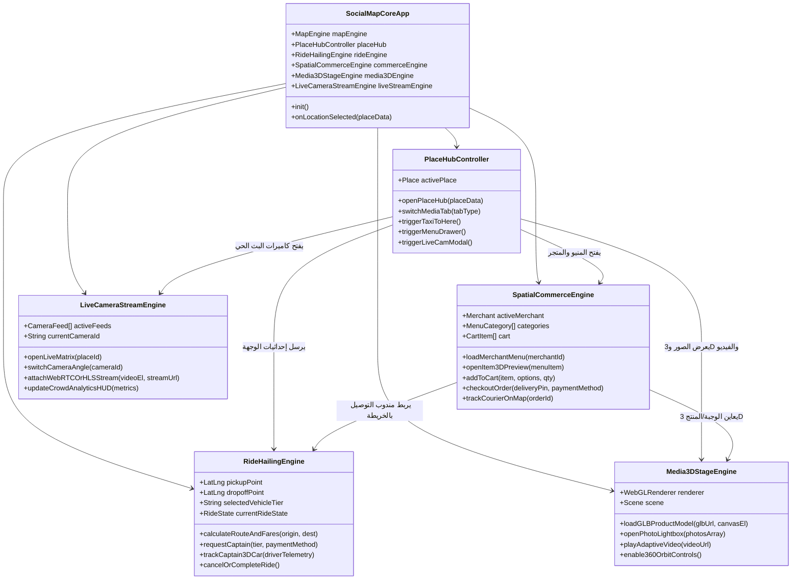
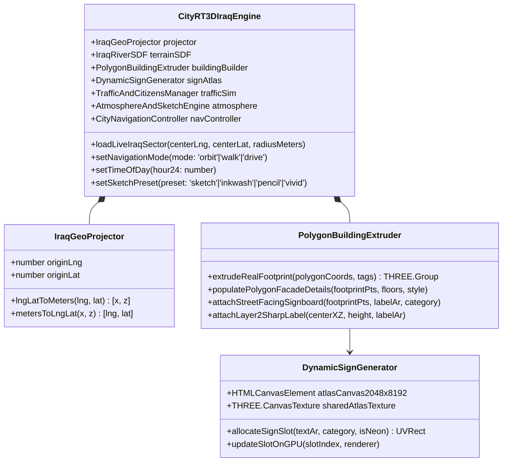

# 🏗️ وثيقة 02: المعمارية الهندسية الشاملة وحزمة التقنيات (System Architecture & Tech Stack Specification)
### **النظام: SOCIALMAP — المنظومة الجغرافية الاجتماعية والتجارية واللوجستية الفائقة**

---

## 1. 🏛️ الفلسفة المعمارية (Architectural Paradigm)

تعتمد منظومة **SOCIALMAP** معمارية **الطبقات الهجينة الموزعة على الحافة (`Edge-First Modular Micro-Engines Architecture`)**، والتي تضمن:
1. **واجهة أمامية فائقة الخفة والسرعة (`Zero-Bloat Spatial Frontend`)**: تعمل في المتصفح وكتطبيق ويب تقدمي (`PWA`) وتطبيق هجين (`Capacitor / React Native WebView Ready`) بسرعة 60 إطاراً في الثانية دون تجمد، حتى أثناء عرض الخريطة ثلاثية الأبعاد، وتحريك سيارات الأجرة، وتشغيل البث المباشر في وقت واحد.
2. **فصل تام للمسؤوليات بين المحركات الخمسة (`5 Decoupled Core Engines`)**:
   - `Spatial Map & Gazetteer Engine` (محرك الخرائط والبحث الجغرافي)
   - `Ride-Hailing & Fleet Dispatch Engine` (محرك طلبات التكسي والتوصيل)
   - `Spatial Commerce, Menu & Cart Engine` (محرك المنيو والمتاجر والسلة والطلبات)
   - `Immersive 3D, Photo & Video Engine` (محرك المجسمات ثلاثية الأبعاد والوسائط)
   - `Live Camera Streaming & Telemetry Engine` (محرك البث المباشر لكاميرات المواقع)

---

## 2. 🛠️ حزمة التقنيات المعتمدة (Complete Technology Stack Matrix)

### 2.1 طبقة الواجهة الأمامية والمحركات البصرية (Frontend & Spatial Rendering Stack)

| المجال التقني | التقنية / المكتبة المعتمدة | الدور الهندسي الدقيق في SOCIALMAP |
| :--- | :--- | :--- |
| **البنية الأساسية للواجهة** | `HTML5 Semantic` + `ES2024 Modules` + `Web Components` | هيكل معياري سريع التحميل، مع عزل مكونات التكسي والمنيو والبث المباشر |
| **نظام التصميم والأنماط** | `Modern CSS3 (Variables, Grid, Flexbox, Container Queries, Glassmorphism RTL)` | تصميم عربي أصيل `RTL` متجاوب 100% مع الوضعين الليلي والنهاري وحركات فيزيائية ناعمة |
| **محرك الخرائط الجغرافية** | `Leaflet.js 1.9.4+` + `Custom 3D Extrusion Layer` + `Uber H3-js` | عرض الخرائط حتى `Zoom 22`، تجسيم المباني `3D`، وتقسيم العراق لخلايا سداسية لتتبع الأسطول |
| **محرك الثلاثي الأبعاد (3D)** | `Three.js v0.160+ (WebGL2)` + `GLTFLoader` + `DRACOLoader` + `OrbitControls` | رندر الشخصيات، سيارات التكسي المتحركة، وعارض المنتجات والوجبات ثلاثي الأبعاد `360°` |
| **محرك البث المباشر والفيديو** | `WebRTC (WHEP Client)` + `HLS.js (Low-Latency HLS)` + `HTML5 Media MSE` | تشغيل كاميرات البث المباشر للمواقع بتأخير أقل من ثانيتين، وتشغيل فيديوهات المنتجات |
| **الاتصال اللحظي بالخادم** | `WebSockets (Native / Socket.io)` + `Server-Sent Events (SSE)` | بث مواقع سيارات الأجرة والمندوبين كل ثانية، وتحديث حالة الطلبات وعداد مشاهدي البث الحي |
| **التخزين المحلي والأوفلاين** | `IndexedDB` + `Cache Storage API` + `Service Worker v10+` | حفظ الموسوعة الجغرافية العراقية، سلة التسوق، القوائم المزارة، وبلاطات الخرائط للعمل أوفلاين |

### 2.2 طبقة الخلفية، قواعد البيانات، والبث الحي (Backend, Cloud & Streaming Stack)

| المجال التقني | التقنية / الخدمة السحابية | الدور الهندسي الدقيق في SOCIALMAP |
| :--- | :--- | :--- |
| **الحوسبة السحابية والحافة** | `Cloudflare Pages + Cloudflare Workers / Node.js (Fastify)` | استضافة الواجهة على حافة العراق (بغداد/أربيل/البصرة) وتشغيل الـ APIs بزمن استجابة `< 30ms` |
| **قاعدة البيانات المكانية** | `PostgreSQL 16 + PostGIS` (أو `Supabase Spatial + Cloudflare D1`) | تخزين المواقع، المتاجر، المنيو، الطلبات، والرحلات مع استعلامات المسافة المكانية `ST_DWithin` |
| **الذاكرة اللحظية وتتبع الأسطول** | `Redis Geo / Upstash Redis + Cloudflare Durable Objects` | تخزين الإحداثيات الحية لآلاف سيارات التكسي والمندوبين ومطابقة أقرب كابتن في أجزاء من الثانية |
| **خادم البث المباشر للكاميرات** | `MediaMTX / SRS (Simple Realtime Server)` + `Cloudflare Stream (WebRTC/HLS)` | استقبال بث الكاميرات (`RTSP / RTMP / SRT`) وتحويله فوراً إلى `WebRTC` و `LL-HLS` للمتصفح |
| **تخزين المجسمات 3D والصور** | `Cloudflare R2 Object Storage` + `CDN Brotli Compression` | تخزين ملفات `.glb` ثلاثية الأبعاد، صور الوجبات والأماكن، ومقاطع الفيديو بدون رسوم باندويث |
| **محركات التوجيه والبحث الجغرافي** | `Iraq Gazetteer` + `OSRM Routing` + `ArcGIS / Nominatim / Overpass` | حساب مسارات التكسي والتوصيل على شوارع العراق، واكتشاف أسماء البنايات والأحياء |

---

## 3. 📐 المخطط الهيكلي لطبقات النظام والوحدات البرمجية (Modular Codebase Architecture)

يوضح المخطط التالي الهيكلة الهندسية للوحدات البرمجية داخل مشروع `SOCIALMAP`:

---

## 4. ⚡ هندسة التدفقات اللحظية وتزامن المحركات (Real-Time Concurrency & Event Bus)

### 4.1 ناقل الأحداث المركزي (`SocialMapEventBus`)
لضمان عدم حدوث أي تشابك برمجي (`Spaghetti Code`) بين الخريطة، ونظام التكسي، والمنيو، وعارض الـ 3D، والبث المباشر، تتخاطب جميع الوحدات عبر أحداث قياسية موثقة:

| اسم الحدث (Event Name) | المصدر (Publisher) | المستمع (Subscriber) | البيانات الممررة (Payload) |
| :--- | :--- | :--- | :--- |
| `place:selected` | `MapEngine` / `SearchBar` | `PlaceHubController` | `{ id, name, type, lat, lng, hasMenu, hasLiveCam, media, models3d }` |
| `ride:initiate` | `PlaceHub` / `LiveCamHUD` | `RideHailingEngine` | `{ originLatLng, destLatLng, destName, mode: 'to_place' \| 'from_place' }` |
| `ride:driver_telemetry` | `RealtimeSocket` | `MapEngine (3D Car)` | `{ rideId, driverId, lat, lng, headingDeg, speedKmh, etaSeconds }` |
| `commerce:open_menu` | `PlaceHub` / `SearchBar` | `SpatialCommerceEngine` | `{ merchantId, placeId, categoryFilter }` |
| `media:inspect_3d` | `PlaceHub` / `MenuCard` | `Media3DStageEngine` | `{ title, glbUrl, posterUrl, videoUrl, scale, dimensions }` |
| `cart:updated` | `SpatialCommerceEngine` | `FloatingCartBar` | `{ itemsCount, subtotalIQD, deliveryFeeIQD, totalIQD }` |
| `order:status_changed` | `RealtimeSocket` | `OrderTrackerUI` | `{ orderId, status, courierLatLng, courierHeading, etaMinutes }` |
| `stream:open_live` | `PlaceHub` / `MapLivePin` | `LiveCameraStreamEngine` | `{ placeId, placeName, cameras: [...], crowdLevel, viewersCount }` |

### 4.2 إدارة دورة حياة الموارد البصرية (`Resource & GPU Lifecycle Management`)
بما أن المنظومة تجمع بين **خريطة 3D** + **مجسمات سيارات وشخصيات 3D** + **عارض وجبات ومنتجات 3D** + **بث فيديو مباشر للكاميرات**:
1. **قاعدة السياق الرسومي النشط (`Active WebGL Context Pool`):**
   - لا يتم تشغيل عارض الـ 3D للمنتجات (`Product 3D Viewer`) إلا عندما تكون نافذة المعاينة مفتوحة أمام المستخدم، وفور إغلاقها يتم تحرير الذاكرة (`geometry.dispose()`, `material.dispose()`, `renderer.dispose()`).
2. **قاعدة إيقاف البث الخلفي (`Stream Auto-Suspend`):**
   - عند إغلاق نافذة البث المباشر للكاميرا أو تصغيرها، يتم إيقاف تدفق الفيديو (`video.pause()`, `hls.stopLoad()`, `pc.close()`) فوراً لعدم استهلاك باقة إنترنت المستخدم أو بطارية الهاتف.

---

## 5. معمارية محرك الخريطة ثلاثية الأبعاد الحية بأسلوب CityRT (`CityRT3DIraqEngine Architecture`)

يعمل قسم الخريطة ثلاثية الأبعاد في **SOCIALMAP** كمحرك متكامل (`js/services/cityrt-iraq-engine.js`) مبني على الأنماط المرجعية المستخلصة من `CityRT` ومقترن مباشرة ببيانات العراق الحية:

