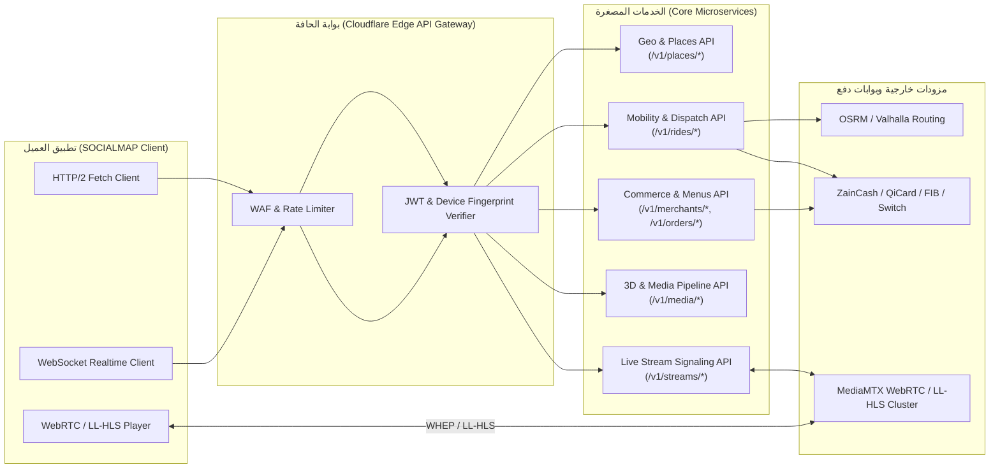

# 04 — مواصفات الواجهات البرمجية والتكاملات والاتصال اللحظي (API & Integration Specification)
## منظومة SOCIALMAP — عقود REST، GraphQL، WebSockets، WebRTC، وبوابات الدفع

> **معرف الوثيقة:** `SM-DOC-04`  
> **الإصدار المعماري:** `v11.0-SOCIALMAP-BLUEPRINT`  
> **الوكيل المسؤول:** `[عماد - @emad-api-shield] (16)` بالتعاون مع `[معمار - @integrative-architect] (09)`  
> **النطاق:** تحديد كافة نقاط النهاية (Endpoints)، بروتوكولات البث اللحظي ثنائي الاتجاه (`WebSockets`)، بروتوكولات الفيديو الحي (`WebRTC WHEP / LL-HLS`)، وتكامل بوابات الدفع العراقية والعالمية.

---

## 1. المبادئ الحاكمة لواجهات البرمجة (API Governance Principles)

1. **بنية RESTful + JSON-Schema الصارمة:** جميع استجابات الخادم تتبع مظروفاً موحداً (`Standard Response Envelope`) يحتوي على `success`, `data`, `meta`, `error`, و `traceId`.
2. **التكرار الآمن (Idempotency Keys):** جميع طلبات إنشاء الرحلات (`POST /v1/rides/request`) وإنشاء الطلبات التجارية (`POST /v1/orders/checkout`) وعمليات الدفع المالي تتطلب ترويسة إلزامية `X-Idempotency-Key: <UUIDv4>` لمنع التنفيذ المزدوج أو الخصم المتكرر عند انقطاع الشبكة.
3. **التقييد الذكي لمعدل الطلبات (Tiered Rate Limiting):**
   - واجهات البحث الجغرافي والمينيو: `120 req/min` لكل IP/User.
   - واجهات طلب التكسي وإتمام الشراء: `10 req/min` لكل حساب موثق.
   - واجهات تحديث إحداثيات الكابتن (`Telemetry`): `60 msg/min` عبر `WebSocket`.

---

## 2. مخطط تدفق التكاملات الشامل (API & Gateway Topology)



---

## 3. المظروف القياسي للاستجابات والأخطاء (Standard Response & Error Envelope)

### 3.1 استجابة ناجحة (`200 OK` / `201 Created`)
```json
{
  "success": true,
  "statusCode": 200,
  "traceId": "trc_01J9Z8Y7X6W5V4U3T2S1R0",
  "timestamp": "2026-10-28T10:15:30.120Z",
  "data": { ... },
  "meta": {
    "page": 1,
    "limit": 20,
    "total": 145,
    "h3Index": "892a1072b5fffff",
    "latencyMs": 18
  }
}
```

### 3.2 استجابة خطأ معيارية (`4xx` / `5xx`)
```json
{
  "success": false,
  "statusCode": 409,
  "traceId": "trc_01J9Z8Y7X6W5V4U3T2S1R9",
  "timestamp": "2026-10-28T10:15:32.400Z",
  "error": {
    "code": "RIDE_PRICE_EXPIRED",
    "messageAr": "انتهت صلاحية تسعيرة الرحلة بسبب تغير حركة المرور، يرجى تحديث التسعيرة.",
    "messageEn": "Ride quote has expired due to traffic changes. Please refresh the quote.",
    "details": {
      "quoteId": "qt_88120",
      "expiredAt": "2026-10-28T10:15:00.000Z"
    }
  }
}
```

---

## 4. تفصيل نقاط النهاية حسب النطاق (REST API Endpoints Catalog)

### 4.1 نطاق الجغرافيا والأماكن (`Geo & Places API — /v1/places`)

| الطريقة | المسار (Endpoint) | الوصف الوظيفي | المعاملات الأساسية (Params / Body) |
|---|---|---|---|
| `GET` | `/v1/places/search` | بحث هجين فوري (Gazetteer + PostGIS + Nominatim + Photon) | `?q=العطيشي&lat=32.616&lng=44.032&radius=25000&lang=ar` |
| `GET` | `/v1/places/reverse` | تحويل أي نقرة على الخريطة (`Lat, Lng`) إلى بطاقة مكان متكاملة | `?lat=33.3128&lng=44.3615&zoom=18` |
| `GET` | `/v1/places/viewport` | جلب الأماكن النشطة ضمن حدود الشاشة الحالية (مع تصفية الطبقات) | `?bbox=44.30,33.28,44.42,33.35&zoom=16&layers=food,cams,3d` |
| `GET` | `/v1/places/:placeId/hub` | جلب بيانات **البطاقة الشاملة (Universal Place Hub)** للمكان المحدد | يشمل: تفاصيل المكان، توفر التكسي، ملخص المينيو، المجسمات 3D، وحالة الكاميرات الحية |
| `GET` | `/v1/places/:placeId/floors` | جلب خريطة الطوابق والمحلات الداخلية للمولات والمجمعات | يعيد مصفوفة الطوابق (`G`, `1`, `2`) مع مضلعات `GeoJSON` لكل متجر |

---

### 4.2 نطاق طلب سيارات الأجرة والتوصيل (`Mobility & Dispatch API — /v1/rides`)

| الطريقة | المسار (Endpoint) | الوصف الوظيفي | المعاملات الأساسية (Params / Body) |
|---|---|---|---|
| `POST` | `/v1/rides/quote` | حساب المسار، المسافة، الوقت المتوقع، والتسعيرة لكل فئات السيارات | `{"origin": {"lat":33.31,"lng":44.36}, "destination": {"lat":33.34,"lng":44.40}, "placeId": "plc_..."}` |
| `GET` | `/v1/rides/nearby-drivers` | جلب مواقع واتجاهات السيارات المتاحة في الخلايا السداسية المحيطة | `?lat=33.3128&lng=44.3615&h3Res=9&vehicleType=ECONOMY` |
| `POST` | `/v1/rides/request` | تأكيد طلب سيارة أجرة إلى/من الدبوس المحدد وإطلاق محرك المطابقة | `{"quoteId": "qt_991", "vehicleType": "COMFORT", "paymentMethod": "CASH"}` |
| `POST` | `/v1/rides/:rideId/cancel` | إلغاء الرحلة مع ذكر السبب وحساب رسوم الإلغاء إن وجدت | `{"reasonCode": "CHANGED_MIND", "notes": "..."}` |
| `POST` | `/v1/rides/:rideId/verify-pin` | التحقق من رمز الأمان الرباعي (`4-Digit PIN`) عند صعود الراكب | `{"pinCode": "4829"}` |
| `POST` | `/v1/rides/:rideId/sos` | تفعيل نداء الطوارئ الفوري وإرسال الموقع الحي لمركز العمليات وجهات الاتصال | `{"lat": 33.32, "lng": 44.37, "audioClipUrl": "..."}` |
| `POST` | `/v1/rides/:rideId/rate` | تقييم الكابتن والمركبة بعد انتهاء الرحلة | `{"stars": 5, "tags": ["CLEAN_CAR", "POLITE"], "tipIqd": 2000}` |

#### نموذج استجابة `/v1/rides/quote`:
```json
{
  "quoteId": "qt_01J9Z9A0B1C2",
  "expiresInSeconds": 90,
  "route": {
    "distanceMeters": 6420,
    "durationSeconds": 780,
    "encodedPolyline": "}_ilE~g~mG_@cA...",
    "trafficLevel": "MODERATE"
  },
  "tiers": [
    {
      "vehicleType": "ECONOMY",
      "nameAr": "توفير (Economy)",
      "etaSeconds": 180,
      "fareIqd": 4500,
      "surgeMultiplier": 1.0,
      "model3dUrl": "https://cdn.socialmap.iq/3d/vehicles/sedan_economy.glb"
    },
    {
      "vehicleType": "VIP",
      "nameAr": "درجة رجال أعمال (VIP)",
      "etaSeconds": 300,
      "fareIqd": 8500,
      "surgeMultiplier": 1.0,
      "model3dUrl": "https://cdn.socialmap.iq/3d/vehicles/suv_vip.glb"
    },
    {
      "vehicleType": "MOTO_COURIER",
      "nameAr": "مندوب توصيل سريع",
      "etaSeconds": 120,
      "fareIqd": 3000,
      "surgeMultiplier": 1.0,
      "model3dUrl": "https://cdn.socialmap.iq/3d/vehicles/moto_delivery.glb"
    }
  ]
}
```

---

### 4.3 نطاق التجارة المكانية والمنيو والطلبات (`Spatial Commerce API — /v1/merchants & /v1/orders`)

| الطريقة | المسار (Endpoint) | الوصف الوظيفي | المعاملات الأساسية (Params / Body) |
|---|---|---|---|
| `GET` | `/v1/merchants/:merchantId/menu` | جلب المنيو/الكتالوج الكامل للمطعم أو السوق مع روابط صور HD والمجسمات 3D | `?lang=ar&includeOutOfStock=false` |
| `GET` | `/v1/merchants/:merchantId/items/:itemId` | جلب التفاصيل الكاملة لقطعة/وجبة معينة مع خيارات التخصيص ومجسم `.glb` | يشمل: المكونات، السعرات، الإضافات، أبعاد المجسم 3D، وفيديو التحضير |
| `POST` | `/v1/cart/validate` | التحقق من توفر القطع في السلة، صحة الأسعار، وحساب رسوم التوصيل والضرائب | `{"merchantId": "mrc_10", "items": [...], "deliveryCoord": {...}}` |
| `POST` | `/v1/orders/checkout` | إنشاء طلب شراء فعلي، حجز المبلغ أو تفعيل الدفع عند الاستلام، وإشعار المتجر | `{"cartId": "crt_55", "fulfillmentType": "DELIVERY", "paymentMethod": "ZAINCASH"}` |
| `GET` | `/v1/orders/:orderId/track` | جلب الحالة الحية للطلب وموقع مندوب التوصيل على الخريطة | يعيد: مرحلة التحضير، بيانات المندوب، المسار المتبقي، والوقت المتوقع |

---

### 4.4 نطاق المجسمات ثلاثية الأبعاد والوسائط (`3D & Rich Media API — /v1/media`)

| الطريقة | المسار (Endpoint) | الوصف الوظيفي | المعاملات الأساسية (Params / Body) |
|---|---|---|---|
| `GET` | `/v1/media/:placeId/gallery` | جلب مصفوفة الوسائط الكاملة للمكان (صور، فيديو، مجسمات 3D، جولات 360°) | `?deviceTier=HIGH` (يحدد دقة `LOD` للمجسمات ثلاثية الأبعاد) |
| `GET` | `/v1/media/3d/:assetId/manifest` | جلب ملف توصيف المجسم ثلاثي الأبعاد (Draco GLB + KTX2 Textures + Hotspots) | يعيد روابط موقعة (`Signed CDN URLs`) وإعدادات الإضاءة والظلال |

---

### 4.5 نطاق الكاميرات والبث المباشر (`Live Cameras & Streaming API — /v1/streams`)

| الطريقة | المسار (Endpoint) | الوصف الوظيفي | المعاملات الأساسية (Params / Body) |
|---|---|---|---|
| `GET` | `/v1/streams/active-pins` | جلب كافة دبابيس الكاميرات الحية النشطة ضمن الخريطة مع عدد المشاهدين | `?bbox=44.30,33.28,44.42,33.35` |
| `GET` | `/v1/streams/:placeId/cameras` | جلب قائمة الكاميرات المتوفرة في المكان المحدد (زوايا متعددة) | يعيد: اسم الزاوية، حالة البث (`LIVE`/`OFFLINE`)، ومستوى الازدحام |
| `POST` | `/v1/streams/:cameraId/session` | طلب تذكرة مشاهدة مشفرة (`Playback Token`) ورابط `WHEP` / `LL-HLS` | يتحقق من صلاحية المشاهدة ويعيد `whepEndpoint` و `hlsManifestUrl` بصلاحية 15 دقيقة |
| `POST` | `/v1/streams/:cameraId/heartbeat` | إرسال نبضة استمرار المشاهدة كل 30 ثانية لتحديث عداد المشاهدين الحقيقي | `{"sessionId": "stm_sess_9921"}` |

---

## 5. بروتوكول الاتصال اللحظي عبر WebSockets (`wss://realtime.socialmap.iq/v1/ws`)

يعتمد النظام قناة `WebSocket` موحدة ومضغوطة (`permessage-deflate`) مع آلية إعادة اتصال تلقائية (`Exponential Backoff + Jitter`).

### 5.1 جدول قنوات الاشتراك والأحداث (WebSocket Channels & Events)

| القناة (Topic/Channel) | اسم الحدث (Event) | الاتجاه | الحمولة (Payload Summary) | معدل التحديث |
|---|---|---|---|---|
| `ride:{rideId}` | `ride:driver_assigned` | Server → Client | بيانات الكابتن، المركبة، المجسم 3D، ورمز PIN | فوري عند القبول |
| `ride:{rideId}` | `ride:driver_telemetry` | Server → Client | `[lat, lng, bearing, speedKmh, etaSec]` | كل `1000ms` (1Hz) |
| `ride:{rideId}` | `ride:status_changed` | Server → Client | `ARRIVED_PICKUP`, `IN_PROGRESS`, `COMPLETED` | عند تغير الحالة |
| `driver:telemetry` | `driver:location_push` | Driver → Server | `[lat, lng, bearing, speed, accuracy, battery]` | كل `1000ms` - `2000ms` |
| `order:{orderId}` | `order:stage_updated` | Server → Client | `ACCEPTED`, `PREPARING`, `HANDED_TO_COURIER`, `DELIVERED` | عند تغير المرحلة |
| `order:{orderId}` | `order:courier_location` | Server → Client | `[lat, lng, bearing, remainingMeters, etaSec]` | كل `1500ms` |
| `stream:{cameraId}` | `stream:viewer_metrics` | Server → Client | `{"concurrentViewers": 342, "crowdLevel": "MODERATE"}` | كل `5000ms` |
| `cell:{h3Index}` | `cell:Ambient_fleet` | Server → Client | مصفوفة مضغوطة للسيارات المتجولة في الخلية السداسية | كل `3000ms` |

---

## 6. تكامل بوابات الدفع العراقية والعالمية (Payment Gateways Integration)

يدعم `SOCIALMAP` منظومة دفع هجينة مصممة خصيصاً للسوق العراقي:

1. **زين كاش (ZainCash Wallet API):** إنشاء معاملة عبر `POST /transaction/init` مع إعادة توجيه أو فتح نافذة دفع مدمجة (`In-App WebView / DeepLink`) والتحقق من التوقيع الرقمي `JWT HS256`.
2. **كي كارد والبطاقات المصرفية العراقية (QiCard / Switch Gateway):** دعم بطاقات الدفع الإلكتروني المحلية عبر بوابة ثلاثية الأمان (`3D Secure 2.0`).
3. **مصرف العراق الأول (FIB — First Iraqi Bank):** توليد رمز استجابة سريعة (`QR Code`) فوري مع رابط تطبيق `FIB` للدفع بلمسة واحدة، والاستماع لإشعار `Webhook` المؤمن بتوقيع `HMAC-SHA256`.
4. **الدفع النقدي الذكي (Smart Cash on Delivery / Ride):** تسوية آلية مع المحفظة الإلكترونية للكابتن أو المندوب وإمكانية تحويل الباقي (`Change`) إلى رصيد داخل محفظة المستخدم في `SOCIALMAP`.
