# 05 — مواصفات تصميم واجهة وتجربة المستخدم الشاملة (Exhaustive UI/UX Design Specification)
## منظومة SOCIALMAP — الشاشات، الأزرار، الفيزياء الحركية، بطاقة المكان الشاملة، المنيو، والمسرح ثلاثي الأبعاد

> **معرف الوثيقة:** `SM-DOC-05`  
> **الإصدار المعماري:** `v11.0-SOCIALMAP-BLUEPRINT`  
> **الوكيل المسؤول:** `[@design-system-master] (12)` بالتعاون مع `[@cinematic-director] (11)` و `[@responsive-layout] (13)` و `[@ux-researcher] (27)`  
> **النطاق:** التوصيف الهندسي والبصري الدقيق لكل بكسل، زر، أيقونة، بطاقة، حركة، وانتقال داخل تطبيق **SOCIALMAP** على الحواسيب والهواتف الذكية.

---

## 1. الفلسفة البصرية ونظام التصميم (Spatial Glass & Precision UI Philosophy)

تعتمد واجهة **SOCIALMAP** فلسفة **"الخريطة هي المسرح الكامل" (The Map IS The Interface)**؛ حيث تظل الخريطة التفاعلية (2D/3D) مرئية ونشطة بنسبة 100% في الخلفية، بينما تنبثق جميع الوظائف (طلب التكسي، تصفح منيو المطاعم، استعراض المجسمات 3D، ومشاهدة البث المباشر للكاميرات) عبر **طبقات زجاجية مكانية ذكية (Spatial Glass Sheets & Floating HUDs)** لا تحجب وعي المستخدم بموقعه الجغرافي.

### 1.1 الالتزام الصارم بمعايير المجلس (Anti-AI Slop & Pure Typography)
- **حظر الكبسولات الفوقية (No Hero Pills):** تُمنع أي شارات عائمة مصطنعة فوق العناوين. العناوين صريحة ومباشرة بتايبوغرافيا عربية هندسية نخبوية (`Cairo` للعناوين، `Tajawal` للنصوص، و `JetBrains Mono` للإحداثيات والأسعار والعدادات).
- **التباين اللوني الدلالي (Semantic Color Tokens — HSL):**
  - `--sm-surface-glass`: `hsla(222, 47%, 11%, 0.84)` مع `backdrop-filter: blur(20px) saturate(180%)`.
  - `--sm-border-subtle`: `hsla(210, 40%, 98%, 0.12)`.
  - `--sm-accent-primary`: `#38BDF8` (أزرق سماوي مكاني للملاحة والتحديد).
  - `--sm-accent-taxi`: `#F59E0B` (كهرماني ذهبي لطلبات سيارات الأجرة والكباتن).
  - `--sm-accent-commerce`: `#10B981` (زمردي حيوي للمطاعم، الأسواق، المنيو، والسلة).
  - `--sm-accent-live`: `#EF4444` (أحمر نبضي للبث المباشر للكاميرات الحية `🔴 LIVE`).
  - `--sm-accent-3d`: `#A855F7` (بنفسجي طيفي للمجسمات ثلاثية الأبعاد `3D GLB`).

---

## 2. الهيكلة الفراغية للشاشة ونظام الطبقات (Z-Index & Spatial Viewport Hierarchy)

```mermaid
flowchart TD
    subgraph Viewport["شاشة العرض الكاملة (100vw × 100dvh — overflow: hidden)"]
        Z0["z-index: 1 — طبقة الخريطة الأساسية 2D / 3D WebGL Canvas"]
        Z10["z-index: 10 — طبقة الدبابيس الذكية والسيارات المتحركة ونبضات الكاميرات"]
        Z20["z-index: 20 — الشريط العلوي المدمج (Search + Smart Filter Chips)"]
        Z25["z-index: 25 — القوائم القابلة للطي (Collapsible Top & Side Action Docks)"]
        Z30["z-index: 30 — البطاقة المكانية الشاملة (Universal Place Hub Sheet)"]
        Z40["z-index: 40 — درج طلب التكسي (Taxi Drawer) / درج المنيو والمتجر (Commerce Drawer)"]
        Z50["z-index: 50 — مسرح الوسائط التفاعلي (3D Model / Video / Photo Lightbox Stage)"]
        Z60["z-index: 60 — مشغل البث المباشر متعدد الكاميرات (Live Stream HUD)"]
        Z70["z-index: 70 — شريط تتبع النشاط الحي العائم (Active Ride & Order Live Pill)"]
        Z90["z-index: 90 — نوافذ الدفع الآمن ونداء الطوارئ (Checkout & SOS Modals)"]
    end
    Z0 --> Z10 --> Z20 --> Z25 --> Z30 --> Z40 --> Z50 --> Z60 --> Z70 --> Z90
```



---

## 3. تفصيل المكونات والأزرار والتفاعلات (Component-by-Component Micro-Specs)

### 3.1 الشريط العلوي الموحد وشرائح التصفية السريعة (Omni-Search & Mode Chips)
1. **حقل البحث الشامل (`#smOmniSearch`):**
   - يعرض أيقونة عدسة بحث، حقل إدخال يدعم العربية والإنجليزية والكردية، زر مسح سريع (`×`)، وزر البحث الصوتي (`🎙️`).
   - أثناء الكتابة (`Debounce 180ms`)، تنسدل قائمة النتائج الذكية مقسمة بصرياً بشارات واضحة:
     - شارة `🚖 اطلب تكسي إلى هنا` بجانب كل نتيجة.
     - شارة `🍽️ المنيو متاح` للمطاعم والأسواق.
     - شارة `🔴 بث مباشر` للأماكن المزودة بكاميرات حية.
     - شارة `🧊 مجسم 3D` للأماكن المزودة بمجسم ثلاثي الأبعاد.
2. **شرائح التصفية المكانية (`#smLayerChips`):**
   - صف أفقي قابل للتمرير اللمسي السلس تحت شريط البحث يضم:
     - `[الكل]` · `[🍽️ مطاعم وكافيهات]` · `[🛒 أسواق ومولات]` · `[🔴 كاميرات مباشر]` · `[🧊 معالم 3D]` · `[🚖 كباتن متاحون]`.

---

### 3.2 البطاقة المكانية الشاملة (Universal Place Hub — المكون المركزي)
تظهر هذه البطاقة فور **الضغط على أي نقطة أو بناية على الخريطة** أو **اختيار أي مكان من البحث**:

```
+-----------------------------------------------------------------------+
|  [شريط السحب اللمسي ──]                                       [× إغلاق] |
|  +-----------------------------------------------------------------+  |
|  |  مسرح المعاينة المصغر (Media Carousel Header - 210px height)     |  |
|  |  [🖼️ صور HD (12)]   [🧊 مجسم 3D تفاعلي]   [🎬 فيديو]   [🔴 مباشر] |  |
|  +-----------------------------------------------------------------+  |
|  اسم المكان الرئيسي (مثال: مطعم ومول المنصور الترفيهي)        ⭐ 4.8   |
|  بغداد، المنصور - شارع 14 رمضان • يبعد 1.8 كم (6 دقائق بالسيارة)      |
|  [مفتوح الآن • يغلق 12:00 ص]  [ازدحام متوسط 👥]  [كاميرات حية: 3 🔴]   |
|                                                                       |
|  +-----------------------------------------------------------------+  |
|  | ⚡ شريط الإجراءات المكانية الرباعي (Primary Action Matrix)       |  |
|  |                                                                 |  |
|  |  +---------------------------+  +----------------------------+  |  |
|  |  | 🚖 اطلب سيارة أجرة لهنا    |  | 🛍️ عرض المنيو والشراء      |  |  |
|  |  | خلال 3 د • من 4,500 د.ع   |  | 85 صنف متاح • توصيل 25 د   |  |  |
|  |  +---------------------------+  +----------------------------+  |  |
|  |  +---------------------------+  +----------------------------+  |  |
|  |  | 🔴 مشاهدة البث المباشر     |  | 🧊 استعراض المجسم 3D / 360 |  |  |
|  |  | 3 كاميرات حية • 142 مشاهد |  | تدوير وتكبير كامل بالأبعاد |  |  |
|  |  +---------------------------+  +----------------------------+  |  |
|  +-----------------------------------------------------------------+  |
+-----------------------------------------------------------------------+
```

#### قواعد السلوك الحركي للبطاقة (`Sheet Physics`):
- على الهواتف الذكية: تعمل البطاقة بنظام **ثلاث نقاط ارتكاز (3 Snap Points)**:
  1. `Collapsed (28% vh)`: تعرض اسم المكان وشريط الإجراءات الرباعي مع إبقاء 72% من الخريطة مرئية.
  2. `Half-Expanded (58% vh)`: تعرض مسرح المعاينة المصغر + الأزرار الأربعة + لمحة عن أبرز الأصناف.
  3. `Full-Expanded (92% vh)`: تفتح التفاصيل الكاملة أو المنيو الكامل أو معرض الوسائط.
- على الحواسيب: تظهر كلوحة جانبية عائمة (`420px width`) في الجانب الأيمن (في واجهة RTL) بهوامش `16px` عن حواف الشاشة.

---

### 3.3 واجهة طلب سيارة الأجرة المدمجة (Pin-to-Ride Taxi Booking Drawer)
عند ضغط المستخدم على زر **`🚖 اطلب سيارة أجرة لهنا`** داخل بطاقة المكان (أو الضغط المطول على أي رصيف في الخريطة):

1. **التحول البصري الفوري للخريطة:**
   - تقوم الكاميرا بعمل `flyToBounds` لاحتواء نقطة انطلاق المستخدم (`Pickup Pin` بلون أزرق نيون) ونقطة المكان المقصود (`Dropoff Pin` بلون ذهبي) مع رسم مسار ثلاثي الطبقات (حد خارجي داكن، خط مسار متدرج، ونبض ضوئي متحرك باتجاه الوجهة).
   - تظهر على المسار فقاعة زمنية عائمة: `⏱️ 11 دقيقة • 5.4 كم`.
   - تتحرك مجسمات السيارات ثلاثية الأبعاد القريبة من نقطة الانطلاق في الوقت الفعلي.
2. **شريط ضبط الدبوس الدقيق (`Fine-Tune Pickup Pin`):**
   - يتيح للمستخدم سحب الخريطة لضبط موقع الوقوف بدقة المتر الواحد (مثلاً: "أمام البوابة الرئيسية لمجموعة العميد التعليمية") مع اهتزاز لمسي خفيف (`navigator.vibrate(10)`) عند تثبيت الدبوس.
3. **بطاقات فئات المركبات (`Vehicle Tier Selector`):**
   - بطاقات أفقية تعرض لكل فئة: مجسم 3D مصغر للسيارة، اسم الفئة (`توفير`، `مريح`، `عائلي 7 راكب`، `VIP`، `مندوب دراجة`)، وقت وصول الكابتن (`3 دقائق`)، والسعر النهائي بالدينار العراقي (`5,000 د.ع`).
4. **شريط الدفع والتأكيد (`Confirm Ride Bar`):**
   - اختيار وسيلة الدفع (`نقداً`، `زين كاش`، `كي كارد`، `FIB`) + زر عريض واضح: **`تأكيد طلب التكسي — 5,000 د.ع`**.
5. **واجهة التتبع الحي للرحلة (`Live Ride HUD`):**
   - بعد قبول الكابتن: تعرض صورة الكابتن، اسمه، تقييمه، نوع ولون السيارة، رقم اللوحة بتصميم لوحة مرورية عراقية واضحة، **رمز الأمان الرباعي (`PIN: 4829`)**، مع أزرار (`📞 اتصال`، `💬 محادثة فورية`، `🛡️ مشاركة مسار الرحلة`، `🚨 طوارئ SOS`).

---

### 3.4 واجهة المنيو والتسوق المكاني (Spatial Store, Menu & Mall Directory Drawer)
عند ضغط المستخدم على مطعم، كافيه، سوبرماركت، أو مول واختيار **`🛍️ عرض المنيو والشراء`**:

1. **ترويسة المتجر الذكية (`Merchant Header`):**
   - تعرض شعار المتجر، التقييم، وقت التحضير المتوقع (`20-30 دقيقة`)، الحد الأدنى للطلب، وزر تبديل نمط الاستلام:
     - `[🛵 توصيل إلى موقعي]` · `[🥡 استلام من الفرع]` · `[🍽️ حجز طاولة / طلب داخل المطعم]`.
2. **في حالة المولات والمجمعات التجارية (`Mall Multi-Floor Selector`):**
   - يظهر شريط عمودي على يمين الخريطة لاختيار الطابق (`G`, `1`, `2`, `3`)، وعند اختيار طابق، تتلون المحلات داخل المول على الخريطة، وبنقر أي محل أو مطعم في الفود كورت يفتح المنيو أو الكتالوج الخاص به فوراً.
3. **بطاقة الصنف / القطعة الغنية (`Rich 3D/Video Item Card`):**
   - كل وجبة أو منتج في المنيو يعرض:
     - صورة عالية الدقة قابلة للتكبير.
     - **زر `🧊 عرض 3D`:** يفتح المجسم ثلاثي الأبعاد للوجبة أو المنتج في منتصف البطاقة أو على الطاولة لتدويره `360°` ومعرفة حجمه الحقيقي قبل الشراء.
     - **زر `🎬 فيديو`:** يشغل مقطع فيديو قصير صامت (`Autoplay Muted Loop`) يوضح طريقة تحضير الطبق أو استعراض المنتج.
     - الاسم، الوصف، السعرات الحرارية/المواصفات، السعر بالدينار العراقي، وزر `+ أضف للسلة`.
4. **نافذة تخصيص الصنف (`Item Customization Modal`):**
   - اختيار الحجم، الإضافات، الملاحظات الخاصة، وتحديد الكمية مع تحديث فوري للسعر الإجمالي في الزر السفلي.
5. **الشريط العائم للسلة وإتمام الطلب (`Floating Cart & Checkout Bar`):**
   - يظهر في أسفل الشاشة بعدد القطع والمجموع الكلي، وعند فتحه يعرض تفصيل الفاتورة (قيمة المشتريات + أجرة التوصيل المحسوبة حسب المسافة على الخريطة + الخصم) وزر **`إتمام الشراء وتأكيد التوصيل`**.

---

### 3.5 مسرح الوسائط ثلاثي الأبعاد والفيديو (`Interactive 3D / Video / Photo Stage`)
عند فتح أي مكان أو منتج والضغط على تبويب **`🧊 مجسم 3D`** أو **`🎬 فيديو`** أو **`🖼️ صور`**:

1. **وضع المجسم ثلاثي الأبعاد (`3D WebGL Inspector Mode`):**
   - خلفية إضاءة استوديو (`HDRI Environment`) ناعمة مع ظل أرضي واقعـي (`Contact Shadow`).
   - تحكم كامل باللمس والماوس: سحب للتدوير (`Orbit`)، قرص بإصبعين للتكبير (`Pinch Zoom`)، ونقر مزدوج لإعادة الضبط (`Reset Camera`).
   - أزرار تحكم سفلية مدمجة: `[🔄 تدوير تلقائي]` · `[☀️ تبديل الإضاءة نهاري/ليلي]` · `[📏 إظهار الأبعاد الحقيقية]` · `[🗺️ إسقاط المجسم على الخريطة]`.
   - نقاط تفاعلية (`3D Hotspots`) فوق المجسم؛ عند النقر على نقطة فوق مبنى أو طبق تظهر بطاقة معلومات فرعية (مثلاً: "البوابة الشمالية"، "طبقة الجبن الإيطالي").
2. **وضع الفيديو والصور عالية الدقة (`HD Video & Photo Carousel`):**
   - مشغل فيديو متكيف (`HLS/MP4`) بأزرار تحكم زجاجية (كتم/تشغيل الصوت، ملء الشاشة، سرعة التشغيل، وشريط معاينة مصغر).

---

### 3.6 مشغل البث المباشر للكاميرات الحية (`🔴 Live Location Camera Matrix HUD`)
عند ضغط المستخدم على زر **`🔴 بث مباشر`** في أي مكان على الخريطة:

```
+-----------------------------------------------------------------------+
| 🔴 بث مباشر حي — مول المنصور (الكاميرا 1: الباحة الرئيسية)   [× إغلاق] |
| +-------------------------------------------------------------------+ |
| | [● LIVE 1080p 60fps]              [👥 218 مشاهد الآن] [ازدحام: متوسط] | |
| |                                                                   | |
| |                 (بث الفيديو المباشر WebRTC / LL-HLS)               | |
| |                                                                   | |
| | [🔇 الصوت] [📸 لقطة] [🖼️ صورة داخل صورة PiP] [⛶ ملء الشاشة]      | |
| +-------------------------------------------------------------------+ |
| زوايا الكاميرات المتاحة في هذا الموقع:                                 |
| [🎥 1: الباحة الرئيسية (نشط)] [🎥 2: مدخل المطاعم] [🎥 3: المرآب]     |
| +-------------------------------------------------------------------+ |
| أعجبك الجو العام؟  [🚖 اطلب تكسي إلى هنا الآن]  [🛍️ تصفح منيو المطاعم] |
+-----------------------------------------------------------------------+
```

- **ميزة الصورة داخل صورة (`Picture-in-Picture / Floating Mini-Cam`):** يمكن للمستخدم تصغير البث المباشر ليبقى في زاوية الشاشة أثناء متابعته لتصفح الخريطة أو طلب سيارة الأجرة أو اختيار وجبته من المنيو.

---

## 4. استجابة الشاشات والتوافق الكامل مع الهواتف (`100% Mobile & Touch Ergonomics`)

| معيار التصميم | الهواتف الذكية (`< 768px`) | الأجهزة اللوحية (`768px - 1024px`) | شاشات سطح المكتب (`> 1024px`) |
|---|---|---|---|
| **موقع البطاقات والقوائم** | صفائح سفلية قابلة للسحب (`Bottom Sheets`) مع دعم `safe-area-inset-bottom` | لوحة جانبية عائمة بعرض `380px` | لوحة جانبية عائمة بعرض `440px` + نافذة 3D/كاميرا مزدوجة |
| **حجم أهداف اللمس (Touch Targets)** | لا يقل عن `48px × 48px` لكل زر مع مسافة فصل `8px` | لا يقل عن `44px × 44px` | `40px × 40px` مع تأثيرات `Hover` مغناطيسية |
| **الأزرار العلوية والجانبية** | مجمعة في زر قائمة قابل للطي (`Collapsible Hub`) لمنع التزاحم | مجمعة جزئياً مع إظهار شريط البحث كامل | ظاهرة بشكل منظم مع اختصارات لوحة المفاتيح |
| **شريط التحكم ثلاثي الأبعاد** | مثبت في أسفل الوسط فوق منطقة الأمان (`bottom: max(16px, env(safe-area-inset-bottom))`) | مثبت في أسفل الوسط | مثبت في أسفل الوسط بجميع عناصر التحكم |


---

## 5. واجهة وتجربة المستخدم لقسم الخريطة ثلاثية الأبعاد الحية بأسلوب CityRT (`CityRT 3D Live Iraq HUD & Controls`)

عند تفعيل قسم **الخريطة ثلاثية الأبعاد (`🧊 وضع المدينة الحية 3D — CityRT Iraq`)**، يظهر شريط التحكم السينمائي السفلي والعلوي المدمج بتصميم زجاجي لا يحجب المشهد المعماري:

```
+-----------------------------------------------------------------------------------+
| 🇮🇶 مدينة العراق الثلاثية الأبعاد الحية (CityRT 3D) | 📍 الموقع الحالي: بغداد - الكرادة |
| +-------------------------------------------------------------------------------+ |
| | 🧭 طور التنقل: [🦅 تحليق حر Orbit]  [🚶 مشي بالشارع (G)]  [🚗 قيادة سيارة (E)] | |
| +-------------------------------------------------------------------------------+ |
| | ☀️ الوقت (00-24): [━━━●━━━━━━ 17:30 الغروب] | 🎨 النمط: [✏️ رسم هندسي] [🌈 حي] | |
| +-------------------------------------------------------------------------------+ |
| | 🌦️ الطقس والبيئة: [☀️ صحو] [🌧️ مطر] [🌴 ضفاف دجلة] | [🔊 صوت المدينة] [× خروج] | |
| +-------------------------------------------------------------------------------+ |
+-----------------------------------------------------------------------------------+
```

### 5.1 ضوابط التفاعل اللمسي ولوحة المفاتيح في أطوار CityRT الثلاثة:
1. **في طور التحليق (`Orbit Mode`):**
   - سحب بإصبع واحد أو زر الفأرة لتحريك الخريطة، قرص بإصبعين للتقريب، سحب بزر الفأرة الأيمن أو إصبعين للدوران والإمالة.
   - **نقر مزدوج (`Double-Click / Double-Tap`) على أي بناية في العراق:** تطير الكاميرا إليها وتفتح **البطاقة المكانية الشاملة (`Universal Place Hub`)** مع أزرار (`🚖 اطلب تكسي لهنا`، `🛍️ عرض المنيو والشراء`، `🧊 مجسم 3D`، `🔴 بث مباشر`).
2. **في طور المشي الميداني في الشارع (`Street Walk Mode — مفتاح G`):**
   - على الحاسوب: مفاتيح `W A S D` للمشي، `Shift` للجري، `Space` للقفز، `C` للانحناء، `V` للتبديل بين منظور الشخص الأول ومنظور خلف الكتف (`Over-the-Shoulder`).
   - على الهاتف الذكي: عصا تحكم لمسية افتراضية شفافة (`Virtual Touch Joystick`) في الزاوية اليسرى السفلية + أزرار (`قفز`، `تبديل المنظور V`، `ركوب سيارة E`، `اطلب تكسي لموقعي`).
3. **في طور قيادة السيارة (`Car Drive Mode — مفتاح E`):**
   - يظهر عداد السرعة الرقمي (`Speedometer HUD: 64 km/h`) + زر بوق السيارة (`H` / `📯`) + زر تبديل الكاميرا (`V`) + زر النزول إلى الرصيف (`E`).
