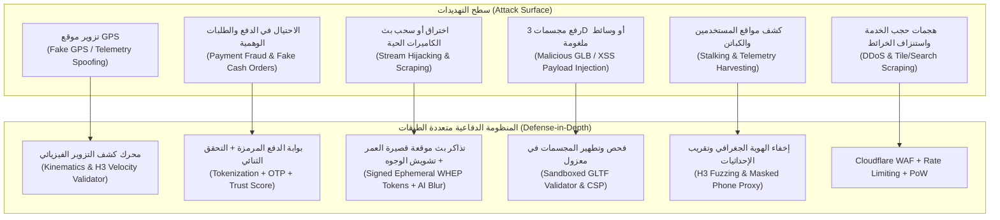

# 06 — وثيقة الأمان الوقائي، مكافحة الاحتيال، وحماية الخصوصية (Security, Anti-Fraud & Privacy Specification)
## منظومة SOCIALMAP — معمارية انعدام الثقة (Zero-Trust)، حماية الرحلات والمدفوعات، وأمن البث المباشر

> **معرف الوثيقة:** `SM-DOC-06`  
> **الإصدار المعماري:** `v11.0-SOCIALMAP-BLUEPRINT`  
> **الوكيل المسؤول:** `[صارم - @sareem-security] (22)` بالتعاون مع `[عماد - @emad-api-shield] (16)`  
> **النطاق:** تأمين كافة طبقات منصة **SOCIALMAP** ضد هجمات الويب، تزوير المواقع الجغرافية (`GPS Spoofing`)، الاحتيال المالي في الطلبات والرحلات، اختراق بث الكاميرات الحية، وتسريب البيانات الشخصية.

---

## 1. نموذج التهديدات الشامل لمنظومة SOCIALMAP (Comprehensive Threat Matrix)

نظراً لدمج الخرائط مع النقل اللوجستي والتجارة الإلكترونية والبث الحي، يواجه النظام 6 فئات حرجة من التهديدات التي صُممت لها دفاعات استباقية صارمة:



---

## 2. مصادقة الهوية وإدارة الجلسات (Authentication & Zero-Trust Access Control)

1. **المصادقة متعددة العوامل (`MFA / OTP`):**
   - تسجيل الدخول للمستخدمين والكباتن والتجار يتم عبر رقم الهاتف الموثق (`SMS / WhatsApp OTP`) مع دعم `WebAuthn / Passkeys` للبصمة والتعرف على الوجه على الهواتف الحديثة.
2. **رموز الوصول المزدوجة (`Short-Lived Access JWT + Rotating Refresh Tokens`):**
   - `Access Token (JWT ES256)`: صلاحيته **15 دقيقة فقط**، يُحفظ في الذاكرة الحية (`In-Memory`) ويُمنع حفظه في `localStorage` لتفادي سرقته عبر أي ثغرة `XSS`.
   - `Refresh Token`: يُحفظ في كوكي محمي (`HttpOnly; Secure; SameSite=Strict`) مع تدوير تلقائي (`Token Rotation`) وكشف فوري لإعادة الاستخدام (`Reuse Detection`).
3. **نظام الصلاحيات القائم على الأدوار والنطاق المكاني (`Spatial RBAC + ABAC`):**
   - `ROLE_USER`: تصفح الخريطة، طلب التكسي، الشراء من المنيو، ومشاهدة الكاميرات العامة.
   - `ROLE_DRIVER`: استقبال طلبات النقل/التوصيل ضمن خليته الجغرافية فقط، دون القدرة على رؤية رقم هاتف العميل الحقيقي.
   - `ROLE_MERCHANT`: تعديل المنيو والأسعار ورفع المجسمات 3D وحالة الكاميرات الخاصة بمتجره المسجل حصراً.
   - `ROLE_DISPATCH_ADMIN`: مراقبة العمليات وحالات الطوارئ (`SOS`) مع تسجيل كل حركة في سجل تدقيق غير قابل للتعديل (`Immutable Audit Log`).

---

## 3. مكافحة تزوير الموقع الجغرافي (Anti-GPS Spoofing & Telemetry Integrity)

لمنع الكباتن أو المستخدمين من استخدام تطبيقات تزييف الموقع (`Fake GPS`) للتلاعب بأسعار الرحلات أو رسوم التوصيل:

1. **فحص الفيزياء الحركية (`Kinematic Plausibility Check`):**
   - يحسب الخادم السرعة والتسارع اللحظي بين كل نقطتي `Telemetry` متتاليتين:
     $$v = \frac{\text{Haversine}(P_{t-1}, P_t)}{\Delta t}$$
   - إذا تجاوزت السرعة المحسوبة `180 km/h` داخل المدن أو حدثت قفزة مكانية (`Teleportation Jump > 500m in 1s`)، يُرفض التحديث فوراً ويُسجل إنذار احتيال (`SPOOF_FLAG`).
2. **مطابقة المسار الفعلي (`Map-Matching Validation`):**
   - تُقارن إحداثيات الكابتن أثناء الرحلة بشبكة الطرق الفعلية عبر `OSRM Match Service`؛ الإحداثيات التي تسير بخط مستقيم عبر المباني والأنهار تُصنف كموقع مزيف.
3. **بصمة الحساسات المتعددة (`Multi-Sensor Consistency`):**
   - مقارنة اتجاه البوصلة (`Compass Heading`) مع زاوية الحركة الفعلية (`GPS Course Bearing`) ومستوى دقة الإشارة (`accuracyMeters`).

---

## 4. أمان المدفوعات ومنع الاحتيال التجاري (Payment Security & Order Anti-Fraud)

1. **الامتثال لمعيار `PCI-DSS` وعدم تخزين بيانات البطاقات:**
   - لا يمر أي رقم بطاقة مصرفية أو رمز `CVV` عبر خوادم `SOCIALMAP`؛ تتم جميع عمليات الدفع عبر نوافذ مشفرة أو رموز دفع (`Payment Tokens`) صادرة مباشرة من بوابات `ZainCash`، `QiCard`، و `FIB`.
2. **التحقق من التوقيع الرقمي للإشعارات المالية (`Webhook HMAC Verification`):**
   - كل إشعار دفع وارد من بوابة الدفع يجب أن يحمل ترويسة `X-Signature-HMAC-SHA256` موقعة بالمفتاح السري المشترك، مع طابع زمني لا يتجاوز `300 ثانية` لمنع هجمات الإعادة (`Replay Attacks`).
3. **حماية التسعير في السلة والرحلات (`Server-Side Price Authority`):**
   - لا يثق الخادم أبداً بأي سعر مرسل من واجهة المستخدم (`Client UI`)؛ يتم إعادة حساب أسعار القطع، الإضافات، الضرائب، وأجور التوصيل والرحلات بالكامل داخل الخادم قبل إنشاء الفاتورة.
4. **مكافحة الطلبات النقدية الوهمية (`Cash-on-Delivery Abuse Shield`):**
   - حسابات المستخدمين الجديدة تخضع لسقف مالي للطلبات النقدية (`Cash Limit`)، ويرتفع السقف تدريجياً مع إتمام الطلبات الناجحة، مع طلب تأكيد `OTP` عند تجاوز مبلغ معين.

---

## 5. أمان البث المباشر للكاميرات والخصوصية العامة (Live Camera Stream Security & Privacy)

1. **عزل عناوين الكاميرات الأصلية (`RTSP/ONVIF Source Isolation`):**
   - لا تظهر عناوين `IP` أو روابط `RTSP` الخاصة بكاميرات المحلات أو الشوارع في متصفح المستخدم نهائياً؛ تتصل الكاميرات ببوابة البث الوسيطة (`MediaMTX Edge Relay`) عبر نفق مشفر (`RTSPS / WireGuard`).
2. **تذاكر المشاهدة المؤقتة الموقعة (`Signed Ephemeral Playback Tokens`):**
   - عند ضغط المستخدم على زر **`🔴 بث مباشر`**، يصدر الخادم رابط `WHEP / LL-HLS` موقعاً برمز `HMAC` مرتبط بـ `IP` المستخدم وينتهي تلقائياً بعد **15 دقيقة** لمنع نسخ الروابط أو تضمينها في مواقع خارجية (`Hotlinking Protection`).
3. **حماية الخصوصية بالذكاء الاصطناعي على الحافة (`Edge Privacy Masking`):**
   - تدعم بوابة البث فلتر تعتيم تلقائي (`Real-time Face & License Plate Blur`) للكاميرات العامة وكاميرات الكاشير لضمان رؤية مستوى الازدحام والنشاط العام للمكان دون انتهاك خصوصية الأفراد.
4. **مفتاح الإيقاف الفوري للتاجر (`Merchant Instant Kill-Switch`):**
   - يمتلك صاحب المطعم أو المتجر زراً فورياً لإيقاف البث أو تفعيل وضع الضبابية (`Privacy Fog Mode`) بلمسة واحدة في أي لحظة.

---

## 6. أمان المجسمات ثلاثية الأبعاد وحماية الواجهة (WebGL/3D Asset Security & CSP)

1. **فحص وتطهير ملفات `.glb` / `.gltf`:**
   - تُقبل صيغة `.glb` الثنائية الموحدة فقط بعد فحصها عبر أداة `gltf-validator` في بيئة معزولة للتأكد من خلوها من أي مراجع خارجية (`External URI References`) أو نصوص برمجية مضمنة.
2. **سياسة أمان المحتوى الصارمة (`Content-Security-Policy — CSP`):**
   ```http
   Content-Security-Policy:
     default-src 'self';
     script-src 'self';
     style-src 'self' 'unsafe-inline' https://fonts.googleapis.com;
     img-src 'self' data: blob: https://*.basemaps.cartocdn.com https://*.tile.openstreetmap.org https://server.arcgisonline.com https://cdn.socialmap.iq;
     media-src 'self' blob: https://stream.socialmap.iq;
     connect-src 'self' https://*.socialmap.iq wss://realtime.socialmap.iq https://nominatim.openstreetmap.org https://photon.komoot.io https://overpass-api.de https://geocode.arcgis.com;
     worker-src 'self' blob:;
     object-src 'none';
     base-uri 'self';
     frame-ancestors 'none';
   ```
3. **منع ثغرات `XSS` في بيانات الخريطة والمنيو:**
   - جميع أسماء الأماكن، مراجعات المستخدمين، أوصاف الوجبات، وملاحظات التوصيل تمر عبر دالة تطهير صارمة (`escapeHTML` / `DOMPurify`) وتُحقن عبر `textContent` حصراً.

---

## 7. منظومة أمان الركاب والكباتن (`Passenger & Captain Physical Safety`)

1. **رمز التحقق الرباعي للرحلة (`Ride Verification PIN`):** لا تبدأ الرحلة فعلياً على النظام إلا بعد إدخال الكابتن للرمز الرباعي الظاهر في شاشة الراكب للتأكد من ركوب الشخص الصحيح في السيارة الصحيحة.
2. **إخفاء أرقام الهواتف (`Masked Number Calling & In-App Chat`):** التواصل بين الراكب والكابتن أو مندوب التوصيل يتم عبر مكالمات صوتية داخل التطبيق أو أرقام افتراضية مقنعة دون كشف الرقم الشخصي لأي طرف.
3. **زر الطوارئ الحي (`Live SOS Shield`):** ضغطة مطولة لمدة ثانيتين تفتح قناة طوارئ تشارك الموقع الحي والصوت وتفاصيل المركبة مع غرفة العمليات وجهات الاتصال الموثوقة للمستخدم.
