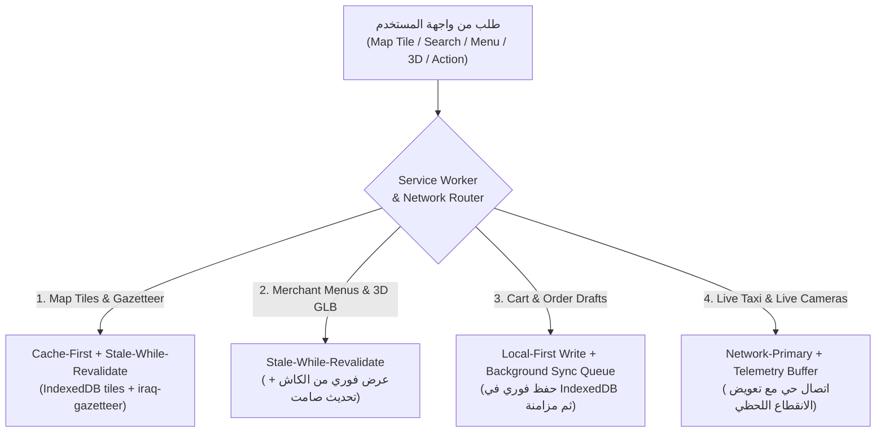

# 07 — استراتيجية العمل الهجين أوفلاين والتخزين المؤقت الذكي (Offline, PWA & Multi-Tier Cache Strategy)
## منظومة SOCIALMAP — استمرارية الخرائط، الدليل الجغرافي، المنيو، المجسمات 3D، وطابور المزامنة

> **معرف الوثيقة:** `SM-DOC-07`  
> **الإصدار المعماري:** `v11.0-SOCIALMAP-BLUEPRINT`  
> **الوكيل المسؤول:** `[عماد - @emad-api-shield] (16)` بالتعاون مع `[ناظم - @data-modeler] (06)` و `[مُقَسِّم - @stream-partitioner] (07)`  
> **النطاق:** ضمان عمل تطبيق **SOCIALMAP** بكفاءة فائقة في ظروف ضعف الإنترنت أو انقطاعه المؤقت في مختلف مناطق العراق، مع إدارة ذكية لذاكرة المتصفح (`Service Worker + IndexedDB + Cache API`).

---

## 1. فلسفة الصمود الشبكي (`Network-Resilient Spatial Architecture`)

في بيئة الاستخدام الواقعية أثناء التنقل بالسيارة أو داخل المولات والأسواق، قد تتذبذب شبكة الهاتف (`4G/3G/Offline`). لذلك صُممت منظومة **SOCIALMAP** بمعمارية **`Offline-First Core + Graceful Online Degradation`**؛ بحيث لا يواجه المستخدم أبداً شاشة بيضاء أو توقفاً في الخريطة أو ضياعاً لسلة مشترياته أو مسار رحلته الحالية.

---

## 2. مصفوفة سلوك الميزات حسب حالة الاتصال (Connectivity Behavior Matrix)

| النظام الفرعي (Subsystem) | متصل بالإنترنت (`Online 4G/Wi-Fi`) | اتصال ضعيف (`Slow 3G / High Latency`) | غير متصل (`Offline Mode`) |
|---|---|---|---|
| **الخريطة الأساسية (2D/3D Map)** | تحميل مباشر للبلاطات مع تخزين تلقائي في `IndexedDB` | عرض البلاطات المخزنة فوراً وتأجيل تحميل الطبقات الثقيلة | عرض كامل للبلاطات المحملة مسبقاً للمحافظات والمناطق المزارة |
| **البحث الجغرافي (`Search`)** | بحث رباعي المحركات (Gazetteer + ArcGIS + Nominatim + Photon + Overpass) | أولوية فورية للدليل المحلي (`660+` موقع) مع مهلة `3s` للشبكة | بحث فوري `0ms` في الدليل المحلي المدمج والأماكن المحفوظة في الكاش |
| **طلب سيارة أجرة (`Pin-to-Ride`)** | تسعير حي، مطابقة فورية، وتتبع `1Hz` عبر `WebSocket` | ضغط حزم الموقع (`Compact Binary Telemetry`) وتمديد فترة النبض | السماح بتحديد الدبوس وحفظ المسار محلياً وإرسال الطلب فور عودة الإشارة (أو عرض خيار الطلب عبر `SMS Gateway` للطوارئ) |
| **تصفح المنيو والسلة (`Menus & Cart`)** | جلب أحدث الأسعار وحالة التوفر والصور والمجسمات 3D | عرض المنيو المخزن مسبقاً مع صور مضغوطة `WebP/AVIF` | تصفح كامل للمنيوهات المفتوحة سابقاً وتعديل السلة محلياً دون فقدان أي قطعة |
| **المجسمات ثلاثية الأبعاد (`3D GLB`)** | تحميل نسخة `HIGH_LOD` مع إضاءة كاملة | تحميل نسخة `LOW_LOD` المضغوطة بـ `Draco` (`< 350 KB`) | عرض المجسمات المحفوظة في مخزن `sm_3d_assets_lru` |
| **الكاميرات الحية (`🔴 Live Cams`)** | بث حي `WebRTC WHEP` بزمن تأخير `< 800ms` | التحول التلقائي إلى `LL-HLS 480p` أو تحديث لقطات متتالية (`1fps Snapshot Mode`) | عرض آخر لقطة مسجلة (`Last Known Snapshot`) مع طابعها الزمني وإشعار انقطاع الشبكة |

---

## 3. سياسات التخزين المؤقت وإدارة الحصص (`Storage Quota & Eviction Policies`)

لتفادي امتلاء ذاكرة هاتف المستخدم، يطبق النظام مدير حصص ذكي (`Smart Quota Manager`) يعتمد خوارزمية **`LRU (Least Recently Used)`** مع أولويات حماية:

| المخزن (`Store Name`) | الحد الأقصى للحجم | مدة البقاء (`TTL`) | سياسة الإخلاء (`Eviction Policy`) |
|---|---|---|---|
| `sm_map_tiles_v11` | `250 MB` | `30 Days` | حذف البلاطات الأقدم استخداماً مع **حماية دائمة** لبلاطات المستويات `Zoom 5–12` للعراق بالكامل |
| `sm_3d_assets_lru` | `150 MB` | `14 Days` | الاحتفاظ بآخر 60 مجسماً ثلاثي الأبعاد تم فتحها (مباني، سيارات، وجبات) |
| `sm_menus_cache` | `50 MB` | `24 Hours` | الاحتفاظ بآخر 100 منيو مطعم أو كتالوج متجر مع تحديث الأسعار فور الاتصال |
| `sm_places_hub_cache` | `40 MB` | `7 Days` | الاحتفاظ ببطاقات الأماكن الشاملة التي زارها المستخدم أو بحث عنها |
| `sm_active_session` | `10 MB` | `Persistent` | **محمي من الحذف التلقائي:** يضم سلة التسوق النشطة، المسارات المفضلة، وحالة الرحلة الجارية |

---

## 4. طابور المزامنة الخلفية ومخزن التتبع (`Background Sync & Telemetry Ring Buffer`)

1. **مخزن التتبع الدائري للكباتن والركاب (`Telemetry Ring Buffer`):**
   - عندما يدخل الكابتن أو الراكب في نفق أو منطقة ضعيفة التغطية، يستمر حساس `GPS` في الهاتف بتسجيل الإحداثيات كل ثانية داخل مصفوفة دائرية في `IndexedDB` (تستوعب حتى `1,800 نقطة` أي 30 دقيقة).
   - فور عودة الاتصال، تُرسل النقاط المجمعة في حزمة مضغوطة (`Batch Sync`) لتحديث سجل المسار الفعلي بدقة 100%.
2. **حماية سلة المشتريـات (`Resilient Cart State`):**
   - كل عملية إضافة أو حذف أو تعديل لقطعة في المنيو تُحفظ لحظياً في `IndexedDB` قبل إرسالها للخادم، مما يضمن بقاء السلة سليمة حتى لو أُغلق المتصفح أو نفدت بطارية الهاتف.
