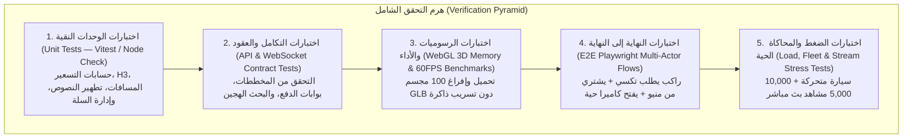

# 08 — خطة الفحص الشامل، ضمان الجودة، ومحاكاة الأسطول والبث (Testing, QA & Simulation Master Plan)
## منظومة SOCIALMAP — اختبارات الوحدات، التكامل، محاكاة الكباتن، أداء WebGL 3D، واختبارات البث الحي

> **معرف الوثيقة:** `SM-DOC-08`  
> **الإصدار المعماري:** `v11.0-SOCIALMAP-BLUEPRINT`  
> **الوكيل المسؤول:** `[باهر - @baher-qa] (19)` بالتعاون مع `[مهندس الاختبار - @test-engineer] (31)` و `[مدقق الأداء - @perf-auditor] (32)`  
> **النطاق:** وضع معايير القبول الصارمة، سيناريوهات الاختبار الآلي واليدوي، ومحاكي الأسطول الجغرافي لجميع أنظمة **SOCIALMAP** قبل اعتماد أي إصدار.

---

## 1. هرم الاختبارات متعددة الطبقات (SOCIALMAP Testing Pyramid)

---

## 2. مصفوفة سيناريوهات الاختبار الوظيفي الحرجة (Critical Test Cases Matrix)

### 2.1 اختبارات الخريطة، البحث، والبطاقة المكانية الشاملة (`TC-MAP` & `TC-HUB`)
| معرف الاختبار | السيناريو | خطوات التنفيذ | النتيجة المتوقعة (Pass Criteria) |
|---|---|---|---|
| `TC-MAP-01` | البحث عن حي أو زقاق محلي (مثل "العطيشي" أو "مجموعة العميد") | إدخال النص في شريط البحث | ظهور الاقتراحات خلال `< 150ms`، وعند الاختيار تطير الكاميرا للموقع ويظهر دبوس مخصص وتفتح بطاقة المكان الشاملة |
| `TC-MAP-02` | التقريب الأقصى (`Zoom 22`) دون انقطاع الخريطة | التكبير المستمر على أي شارع في العراق | استمرار ظهور الخريطة عبر `maxNativeZoom: 18/19` وتمديد البلاطات رقمياً حتى `Zoom 22` دون ظهور رسالة "البيانات غير متوفرة" |
| `TC-HUB-01` | النقر المباشر على أي بناية أو مطعم في الخريطة | النقر على موقع مطعم أو مول | فتح `Universal Place Hub` محتوية على الأزرار الأربعة: (اطلب تكسي، عرض المنيو، مجسم 3D/صور، بث مباشر) |

### 2.2 اختبارات طلب سيارة الأجرة والتوصيل (`TC-TAXI`)
| معرف الاختبار | السيناريو | خطوات التنفيذ | النتيجة المتوقعة (Pass Criteria) |
|---|---|---|---|
| `TC-TAXI-01` | دورة حياة طلب تكسي كاملة من الدبوس (`Pin-to-Ride E2E`) | النقر على مكان ← ضغط `اطلب سيارة أجرة` ← اختيار الفئة ← `تأكيد الطلب` | رسم المسار، ظهور التسعيرة بالدينار العراقي، إسناد كابتن، توليد رمز `PIN` رباعي، وتحرك مجسم السيارة 3D بسلاسة على الخريطة |
| `TC-TAXI-02` | انتهاء صلاحية التسعيرة (`Quote Expiration`) | ترك نافذة التسعيرة مفتوحة لأكثر من 90 ثانية ثم الضغط على تأكيد | تنبيه المستخدم بانتهاء صلاحية التسعيرة وتحديثها تلقائياً بضغطة واحدة دون إغلاق النافذة |
| `TC-TAXI-03` | اختبار انقطاع اتصال الكابتن المؤقت | قطع اتصال `WebSocket` عن محاكي الكابتن لمدة 15 ثانية ثم إعادته | استمرار حركة السيارة على خريطة الراكب عبر الاستيفاء التنبؤي (`Dead Reckoning`) ثم التصحيح السلس عند عودة الإشارة |

### 2.3 اختبارات المنيو، السلة، والشراء المكاني (`TC-COMMERCE`)
| معرف الاختبار | السيناريو | خطوات التنفيذ | النتيجة المتوقعة (Pass Criteria) |
|---|---|---|---|
| `TC-COM-01` | تصفح منيو مطعم وإضافة وجبات مخصصة للسلة | فتح مطعم على الخريطة ← فتح المنيو ← اختيار وجبة ← تحديد الحجم والإضافات ← إضافة للسلة | تحديث فوري لعداد السلة والمجموع الكلي بالدينار العراقي وحفظ السلة في `IndexedDB` |
| `TC-COM-02` | تعارض المتاجر في السلة (`Multi-Merchant Guard`) | وجود عناصر من "مطعم أ" في السلة ثم محاولة إضافة عنصر من "مطعم ب" | إظهار حوار واضح يخير المستخدم بين (إفراغ السلة الحالية والبدء بطلب جديد) أو (إكمال الطلب الأول أولاً) |
| `TC-COM-03` | التكرار الآمن لعملية الدفع (`Checkout Idempotency`) | الضغط المزدوج السريع على زر `إتمام الشراء` أو انقطاع الشبكة أثناء الإرسال | إنشاء طلب واحد فقط في قاعدة البيانات وعدم تكرار الخصم المالي بفضل `X-Idempotency-Key` |

### 2.4 اختبارات الوسائط والمجسمات ثلاثية الأبعاد (`TC-MEDIA3D`)
| معرف الاختبار | السيناريو | خطوات التنفيذ | النتيجة المتوقعة (Pass Criteria) |
|---|---|---|---|
| `TC-3D-01` | فتح وتدوير مجسم 3D لمكان أو وجبة | الضغط على زر `🧊 مجسم 3D` داخل البطاقة أو المنيو | تحميل المجسم خلال `< 1.8s`، استجابة التدوير والتكبير بسرعة `60 FPS`، وعمل زر الإغلاق بلمسة واحدة |
| `TC-3D-02` | اختبار عدم تسريب ذاكرة `GPU` (`WebGL Context Leak Test`) | فتح وإغلاق 50 مجسماً ثلاثي الأبعاد متتالياً | ثبات استهلاك ذاكرة الرسوميات بفضل استدعاء `geometry.dispose()` و `material.dispose()` عند كل إغلاق |

### 2.5 اختبارات الكاميرات والبث المباشر (`TC-LIVECAM`)
| معرف الاختبار | السيناريو | خطوات التنفيذ | النتيجة المتوقعة (Pass Criteria) |
|---|---|---|---|
| `TC-CAM-01` | تشغيل البث المباشر والتبديل بين الكاميرات | الضغط على `🔴 بث مباشر` ← اختيار الكاميرا 1 ثم الكاميرا 2 | بدء البث خلال `< 1.5s`، ظهور شارة `LIVE` وعداد المشاهدين، والتبديل بين الزوايا دون تجميد للخريطة |
| `TC-CAM-02` | وضع الصورة داخل صورة (`PiP Floating Cam`) | تفعيل وضع التصغير أثناء مشاهدة البث ثم فتح المنيو أو طلب تكسي | بقاء نافذة البث المصغرة عائمة وقابلة للسحب في زوايا الشاشة أثناء إتمام طلب التكسي أو الشراء |

---

## 3. بوابات التحقق الإلزامية قبل النشر (Mandatory Release Gates)

لا يُسمح بدمج أو نشر أي مرحلة تنفيذية إلا بعد اجتياز البوابات الخمس التالية بنسبة **100%**:
1. **بوابة سلامة الكود (`Syntax & Module Gate`):** `node --check` و `ESLint` بصفر أخطاء.
2. **بوابة الأنواع والعقود (`Type & Schema Gate`):** تطابق كافة حمولات `API` و `WebSocket` مع مخططات `JSON Schema`.
3. **بوابة الأداء البصري (`60FPS & Lighthouse Gate`):** تحقيق `> 90` في الأداء والوصولية، وبقاء معدل الإطارات فوق `55 FPS` أثناء تحريك الخريطة والسيارات.
4. **بوابة التوافق مع الهواتف (`Mobile Viewport Gate`):** فحص آلي على أبعاد `360×800` (Android) و `390×844` (iPhone) للتأكد من عدم خروج أي عنصر عن الشاشة (`Horizontal Overflow = 0px`).
5. **بوابة الفحص الأمني (`@sareem-security Gate`):** اجتياز قائمة الفحص الأمني (`SECURITY: PASS`).
