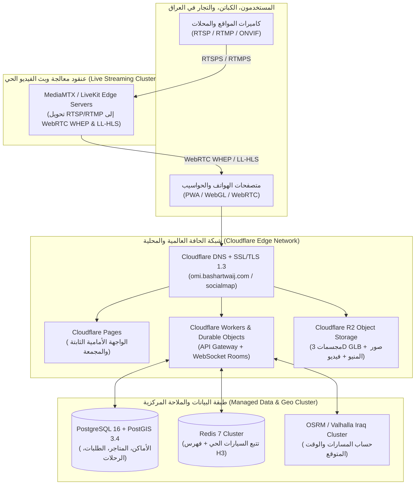
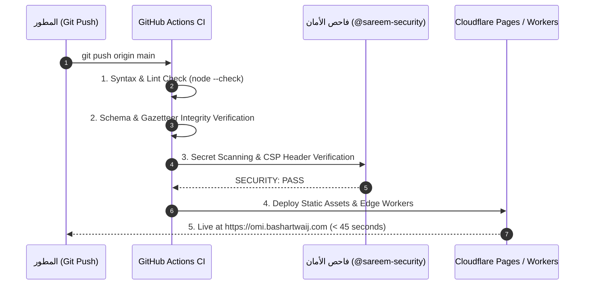

# 09 — البنية التحتية السحابية، النشر المستمر، وشبكة البث والتخزين (Cloud Infrastructure, CI/CD & Edge Deployment)
## منظومة SOCIALMAP — Cloudflare Edge، قواعد البيانات الجغرافية، خوادم البث الحي، وتوزيع المجسمات 3D

> **معرف الوثيقة:** `SM-DOC-09`  
> **الإصدار المعماري:** `v11.0-SOCIALMAP-BLUEPRINT`  
> **الوكيل المسؤول:** `[مُستَمِر - @cicd-automator] (17)` بالتعاون مع `[عماد - @emad-api-shield] (16)`  
> **النطاق:** معمارية الاستضافة السحابية عالية التوافر (`99.95% SLA`)، شبكة توصيل المحتوى (`CDN`)، تخزين المجسمات ثلاثية الأبعاد، وعناقيد البث المباشر للكاميرات.

---

## 1. المخطط العام للبنية التحتية السحابية (Global & Iraq-Edge Cloud Topology)

تعتمد منصة **SOCIALMAP** بنية حافة موزعة (`Edge-First Cloud Architecture`) تقرب البيانات والصور والمجسمات ثلاثية الأبعاد وبث الكاميرات إلى أقرب نقطة حضور (`PoP`) للمستخدم داخل العراق والشرق الأوسط (بغداد، أربيل، البصرة، النجف) لضمان زمن استجابة منخفض للغاية.

---

## 2. بيئات التشغيل والنطاقات (Environments & Domain Matrix)

| البيئة | النطاق (Domain) | الغرض | آلية الترقية (Deployment Trigger) |
|---|---|---|---|
| **بيئة التطوير المحلي (`Local Dev`)** | `http://localhost:8765` | التطوير السريع، محاكاة الأسطول، واختبار المجسمات 3D | فورية مع `Hot Reload` |
| **بيئة المعاينة (`Preview / Staging`)** | `https://staging-socialmap.pages.dev` | اختبار الميزات الجديدة ومراجعة الجودة قبل الإطلاق | تلقائياً عند فتح أي `Pull Request` على GitHub |
| **بيئة الإنتاج الحية (`Production`)** | `https://omi.bashartwaij.com` | المنصة الرسمية المتاحة لجميع المستخدمين | تلقائياً بعد دمج فرع `main` واجتياز بوابات الفحص |

---

## 3. خط أنابيب معالجة وضغط المجسمات ثلاثية الأبعاد (`3D Asset Ingestion Pipeline`)

لضمان تحميل المجسمات ثلاثية الأبعاد للمطاعم، الوجبات، المباني، والسيارات بسرعة فائقة على هواتف المستخدمين، يمر كل ملف `.glb` عبر خط معالجة آلي عند رفعه إلى السحابة:

1. **التحقق من السلامة (`Validation`):** فحص هندسة المجسم وعدد المضلعات (`Max Triangles <= 80,000` للمباني و `<= 25,000` للوجبات والمنتجات).
2. **توليد 3 مستويات تفصيل (`Auto-LOD Generation`):**
   - `LOD0 (High)`: دقة كاملة للمعاينة المقربة داخل مسرح 3D.
   - `LOD1 (Medium)`: دقة متوسطة (`50% polygons`) للعرض السريع داخل بطاقة المنيو.
   - `LOD2 (Low)`: دقة خفيفة (`20% polygons`) للعرض المباشر فوق الخريطة.
3. **الضغط المزدوج (`Draco + KTX2 Compression`):**
   - ضغط الهندسة الفراغية باستخدام `Draco Mesh Compression` (تقليص الحجم بنسبة `75%`).
   - تحويل الخامات اللونية (`Textures`) إلى صيغة `KTX2 / Basis Universal` الجاهزة للعرض المباشر في ذاكرة `GPU`.
4. **التوزيع عبر `Cloudflare R2 + CDN`:** مع ترويسة تخزين طويلة الأمد `Cache-Control: public, max-age=31536000, immutable`.

---

## 4. خط أنابيب التكامل والنشر المستمر (`GitHub Actions + Cloudflare CI/CD`)

