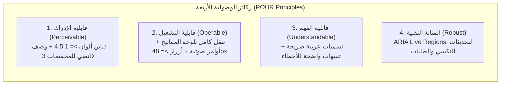

# 10 — معايير الوصولية الشاملة، التدويل، والتوطين العراقي (Accessibility WCAG 2.2 AA, RTL & Localization Spec)
## منظومة SOCIALMAP — دعم اللغات، التوجيه الصوتي، هندسة الأقواس العربية، وتجربة شاملة للجميع

> **معرف الوثيقة:** `SM-DOC-10`  
> **الإصدار المعماري:** `v11.0-SOCIALMAP-BLUEPRINT`  
> **الوكيل المسؤول:** `[مدقق الوصولية - @a11y-auditor] (33)` بالتعاون مع `[بَليغ - @balegh-docs] (23)`  
> **النطاق:** ضمان سهولة استخدام منصة **SOCIALMAP** من قبل كافة فئات المجتمع (بما في ذلك ذوي الإعاقة البصرية أو الحركية وكبار السن)، ودعم اللغات المتعددة واتجاهات النصوص ثنائية الاتجاه (`BiDi Text`).

---

## 1. معمارية التدويل والتوطين متعدد اللغات (`Multi-Locale & BiDi Architecture`)

صُممت منصة **SOCIALMAP** لتعمل أصلياً باللغة العربية (`ar-IQ` — الاتجاه `RTL`) مع قابلية التبديل الفوري دون إعادة تحميل الصفحة إلى:
1. **العربية (العراق — `ar-IQ`):** اللغة الافتراضية، مع دعم المصطلحات المحلية المألوفة في البحث (مثل: "كراج"، "فلكة"، "محلة"، "زقاق"، "مول"، "تمن وقيمة"، "كاهي وكيمر").
2. **الكردية (السورانية — `ckb-IQ`):** اتجاه `RTL` مع دعم كامل للحروف الكردية الخاصة (`گ`, `چ`, `پ`, `ژ`, `ڤ`, `ڕ`, `ڵ`, `ێ`, `ۆ`) في البحث والخرائط والمنيو.
3. **الإنجليزية (`en-US`):** اتجاه `LTR` للسياح والشركات الأجنبية والمستخدمين الدوليين.

---

## 2. الهندسة الصارمة للنصوص ثنائية الاتجاه والأقواس العربية (`BiDi Text & Bracket Integrity`)

لمنع مشكلة انقلاب الأقواس أو تداخل الأرقام والرموز الإنجليزية مع الحروف العربية في تسميات المدن والمحلات والأسعار، تطبق المنصة القواعد الإلزامية التالية:

1. **المسافة العازلة حول الأقواس (`Non-Touching Bracket Rule`):**
   - يُمنع ملامسة القوس للحرف العربي مباشرة في التسميات المركبة؛ تُكتب التسميات دائماً بصيغة:
     `الرمادي ( مركز الأنبار )` بدلاً من الصيغ الملتصقة التي تسبب انعكاس القوس في محركات رسم الخرائط (`Canvas/SVG Text Renderer`).
2. **العزل الاتجاهي الصريح (`Unicode BiDi Isolates & CSS unicode-bidi`):**
   - تُحاط النصوص الفرعية والأرقام والرموز البرمجية (مثل أرقام اللوحات `BG-48291` أو الأسعار `5,000 د.ع`) بخصائص `dir="auto"` أو `unicode-bidi: isolate` لضمان عدم تشوه ترتيب الجملة العربية.
3. **تنسيق العملة العراقية (`IQD Currency Formatting`):**
   - تُعرض جميع الأسعار في التكسي والمنيو والسلة بفواصل آلاف واضحة ووحدة عملة صريحة: **`4,500 د.ع`** (وبالأرقام العربية المشرقية أو الغربية حسب تفضيل المستخدم).

---

## 3. الامتثال لمعيار الوصولية العالمي (`WCAG 2.2 Level AA Compliance`)

### 3.1 الوصولية السمعية والبصرية لقارئات الشاشة (`Screen Reader & ARIA Live Regions`)
- **منطقة الإعلانات الحية (`#smAriaLivePolite` & `#smAriaLiveAssertive`):**
  - عند تغير حالة سيارة الأجرة (مثلاً: *"وصل الكابتن أحمد إلى نقطة الانطلاق، رقم اللوحة 48291"* أو *"أصبح طلبك من مطعم الصمد قيد التوصيل ويبعد 5 دقائق"*)، ينطق قارئ الشاشة (`VoiceOver` / `TalkBack`) التحديث تلقائياً دون حاجة المستخدم للنظر إلى الخريطة.
- **وصف المجسمات ثلاثية الأبعاد (`3D Model Accessible Fallback`):**
  - كل عنصر `<canvas>` خاص بمجسم `3D` يحمل سمة `role="img"` مع `aria-label` تفصيلي يصف أبعاد وشكل المجسم (المبنى أو الوجبة) للمكفوفين وضعاف البصر.

### 3.2 الأوامر الصوتية والبحث الصوتي (`Voice-First Navigation & Ordering`)
- عبر زر الميكروفون (`🎙️`) باستخدام `Web Speech API (ar-IQ)`:
  - يمكن للمستخدم قول: *"ابحث عن مطعم في الكرادة"* أو *"اطلب تكسي إلى مول المنصور"* أو *"افتح الكاميرا المباشرة في كربلاء"* ليقوم النظام بتحويل الصوت إلى أمر تنفيذي مباشر على الخريطة.

### 3.3 احترام تفضيلات الحركة والتباين (`Reduced Motion & High Contrast`)
- عند تفعيل `prefers-reduced-motion: reduce` في جهاز المستخدم:
  - يتم استبدال حركات الطيران الطويلة (`flyTo 2.5s`) بانتقالات هادئة قصيرة (`0.3s`)، وإيقاف التدوير التلقائي للمجسمات ثلاثية الأبعاد لتفادي الدوار البصري.
