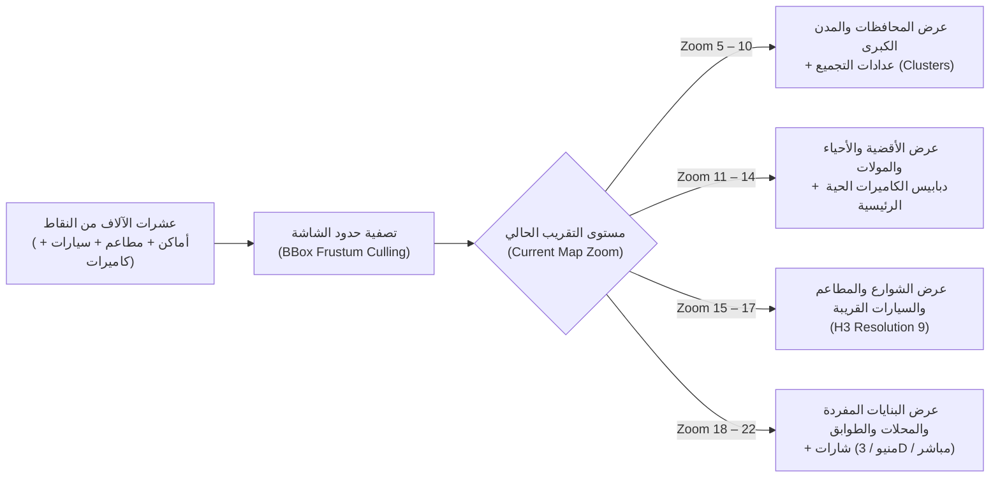

# 11 — هندسة الأداء الفائق، الفهرسة المكانية، وتحسين الرسوميات (Performance, H3 Indexing & WebGL Optimization)
## منظومة SOCIALMAP — ميزانية الـ 60 إطاراً/ثانية، تجميع الدبابيس، ضغط المجسمات 3D، والبث المتكيف

> **معرف الوثيقة:** `SM-DOC-11`  
> **الإصدار المعماري:** `v11.0-SOCIALMAP-BLUEPRINT`  
> **الوكيل المسؤول:** `[مدقق الأداء - @perf-auditor] (32)` بالتعاون مع `[@motion-coder] (15)` و `[مُقَسِّم - @stream-partitioner] (07)`  
> **النطاق:** ضمان عمل الخريطة التفاعلية، والسيارات المتحركة، والمنيوهات التجارية، والمجسمات ثلاثية الأبعاد، والبث المباشر للكاميرات بسرعة `60 FPS` دون استنزاف المعالج أو البطارية.

---

## 1. ميزانيات الأداء الصارمة (Strict Performance Budgets)

| المؤشر التقني (Metric) | الهدف القياسي (Target Budget) | الحد الأقصى المسموح (Hard Ceiling) | أداة القياس |
|---|---|---|---|
| **زمن رسم الخريطة الأول (`FCP / Map Ready`)** | `<= 0.9 ثانية` | `1.5 ثانية` | Lighthouse / Performance API |
| **معدل الإطارات أثناء التحريك (`Map Pan/Zoom FPS`)** | `60 FPS` (`16.6ms / frame`) | `>= 50 FPS` | Chrome DevTools FPS Meter |
| **استجابة البحث المحلي (`Local Gazetteer Search`)** | `<= 12 ملي ثانية` | `35 ملي ثانية` | `performance.now()` |
| **زمن فتح بطاقة المكان الشاملة (`Place Hub Open`)** | `<= 80 ملي ثانية` | `150 ملي ثانية` | User Timing API |
| **حجم المجسم ثلاثي الأبعاد للوجبة/المنتج (`3D Item GLB`)** | `350 KB - 900 KB` | `1.8 MB` | Network Payload Audit |
| **استهلاك ذاكرة الرسوميات (`WebGL GPU Memory`)** | `<= 180 MB` على الهاتف | `300 MB` | `WEBGL_debug_renderer_info` |

---

## 2. الفهرسة المكانية السداسية والتجميع الذكي (`Uber H3 Spatial Indexing & Supercluster`)

لتمكين عرض آلاف المطاعم والأسواق والمولات والسيارات والكاميرات في العراق دون إغراق شجرة `DOM`:

1. **الإلغاء الفوري خارج مجال الرؤية (`Viewport Frustum Culling`):**
   - لا يتم إنشاء أي عنصر `DOM` أو مجسم `Three.js` لأي مكان أو سيارة تقع خارج المستطيل المرئي الحالي للشاشة (`map.getBounds().pad(0.15)`).
2. **تحريك السيارات والمندوبين عبر `Interpolated Canvas / CSS3D`:**
   - بدلاً من إعادة إنشاء الدبوس عند كل إحداثية جديدة، يتم تحريك السيارة بدالة استيفاء خطي وكروي (`LERP` للإحداثيات + `SLERP` لزاوية الدوران) داخل حلقة `requestAnimationFrame` موحدة.

---

## 3. إدارة دورة حياة ذاكرة الرسوميات الثلاثية الأبعاد (`WebGL / Three.js Context Pooling`)

نظراً لأن المتصفحات تحدد عدد سياقات `WebGLRenderingContext` النشطة في الصفحة (عادةً 8 إلى 16 سياقاً كحد أقصى)، يطبق النظام **مجمع سياقات موحد (`Shared WebGL Renderer Pool`)**:

1. **مُصيِّر مخصص للخريطة (`Map 3D Overlay Renderer`):** مسؤول عن الشخصية ثلاثية الأبعاد والسيارات المحيطة على الخريطة.
2. **مُصيِّر مخصص لمسرح المعاينة (`Stage 3D Inspector Renderer`):** يُنشأ عند فتح مجسم 3D لمبنى أو وجبة في المنيو، وعند إغلاق النافذة يتم استدعاء:
   - `scene.traverse(obj => { obj.geometry?.dispose(); obj.material?.dispose(); })`
   - تفريغ الخامات اللونية (`texture.dispose()`) لإبقاء ذاكرة الهاتف نظيفة 100%.
3. **إيقاف التصيير التلقائي عند السكون (`On-Demand Rendering`):**
   - إذا لم يكن المستخدم يحرك المجسم ثلاثي الأبعاد ولم يكن التدوير التلقائي مفعلاً، يتوقف `requestAnimationFrame` فوراً لتوفير `0% GPU` وبطارية الهاتف، ويُستأنف فور لمس الشاشة.

---

## 4. البث المباشر المتكيف وتقليل استهلاك البيانات (`Adaptive Bitrate Streaming — ABR`)

1. **التحميل الكسول للبث (`Strict Click-to-Play Live Streams`):**
   - لا تفتح أي قناة فيديو في الخلفية تلقائياً؛ الدبابيس الحمراء على الخريطة تعرض نبضة `CSS` خفيفة وعدد المشاهدين فقط، ولا يبدأ تدفق الفيديو الفعلي إلا عندما يضغط المستخدم زر **`🔴 بث مباشر`**.
2. **التكيف التلقائي للجودة (`ABR Profile Switching`):**
   - يبدأ البث بدقة سريعة `720p` لفتح الصورة في أقل من ثانية (`Instant First Frame`)، ثم يرتفع تلقائياً إلى `1080p 60fps` على الشبكات السريعة أو ينخفض إلى `480p` على شبكات الهاتف الضعيفة دون تقطيع.
