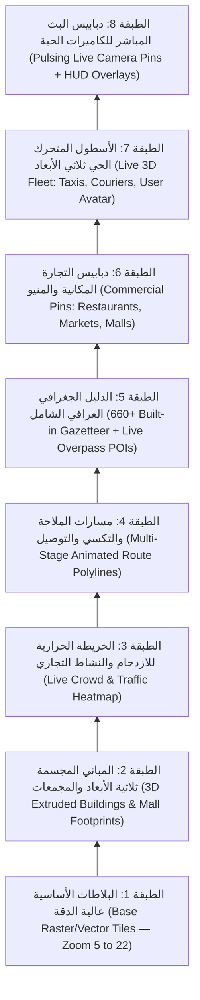

# 12 — معمارية طبقات الخريطة المتعددة والبيانات الجغرافية (Multi-Layer Map Architecture & Spatial Data Spec)
## منظومة SOCIALMAP — البلاطات الهجينة، المباني ثلاثية الأبعاد، طبقة الأسطول المتحرك، دبابيس المنيو، ونبضات الكاميرات

> **معرف الوثيقة:** `SM-DOC-12`  
> **الإصدار المعماري:** `v11.0-SOCIALMAP-BLUEPRINT`  
> **الوكيل المسؤول:** `[راصد - @rased-explorer] (03)` بالتعاون مع `[بيانات - @data-engineer] (25)` و `[@motion-coder] (15)`  
> **النطاق:** التوصيف الهندسي الدقيق لطبقات الخريطة الثمانية في **SOCIALMAP**، مصادر البيانات الجغرافية للعراق، نظام التقريب الفائق حتى `Zoom 22`، وآلية تفاعل الدبابيس الذكية.

---

## 1. هرم طبقات الخريطة الثمانية (The 8 Spatial Layers Stack)

---

## 2. حل مشكلة التقريب الأقصى (`Ultra-Zoom 22 Overzoom Architecture`)

لضمان قدرة المستخدم على التقريب إلى أقصى درجة فوق أي زقاق أو بناية أو محل داخل العراق دون ظهور مربعات رمادية أو رسالة *"Map data not yet available"*:

| مزود الخريطة (Basemap Layer) | الحد الأقصى للبلاطات الأصلية (`maxNativeZoom`) | الحد الأقصى للتقريب في الواجهة (`maxZoom`) | آلية المعالجة البصرية عند التقريب الفائق (`Zoom 19 - 22`) |
|---|---|---|---|
| **الخريطة التفصيلية النهارية (`OSM Standard`)** | `19` | `22` | تمديد رقمي فائق النعومة للبلاطة `19` مع إظهار طبقة البنايات والمحلات الحية فوقها بدقة متجهية (`Vector SVG`) |
| **القمر الصناعي المدمج (`Esri World Imagery + Places`)** | `18` | `22` | دمج صور الأقمار الصناعية مع طبقة `Reference Overlay` وتسميات الأحياء والبنايات العراقية |
| **الخريطة الداكنة والرمادية (`Carto Dark / Light`)** | `19` | `22` | مثالية لإبراز مسارات التكسي النيون ونبضات الكاميرات الحية والمجسمات ثلاثية الأبعاد |
| **الخريطة الطبوغرافية (`OpenTopoMap`)** | `17` | `22` | عرض التضاريس والارتفاعات مع التكبير الرقمي المستمر |

---

## 3. التصميم البصري والتفاعلي للدبابيس الذكية (Interactive Smart Pins Taxonomy)

يُمنع في **SOCIALMAP** تغطية الخريطة بفقاعات نصية ضخمة تحجب الشوارع؛ بدلاً من ذلك يعتمد النظام **التكشف التدريجي حسب مستوى التقريب (`Progressive Zoom Disclosure`)** مع دبابيس متجهية (`SVG Pins`) تحمل شارات وظيفية دقيقة:

1. **دبوس موقع المستخدم (`User Hollow-Center Pin`):**
   - دبوس خريطة أنيق بمنتصف مفرغ وهالة اتجاهية حقيقية تتبع البوصلة (`True Heading Cone`) بدون أي دوران عشوائي، مع إمكانية التبديل إلى إحدى الشخصيات العشر ثلاثية الأبعاد (`سهم`، `مستكشف`، `إنسان`، `سيارة`، `روبوت`، `طائرة`، `دراجة هوائية`، `حصان`، `ثعلب`، `فلامينغو`).
2. **دبوس المطاعم والأسواق المزودة بمنيو (`Commercial Menu Pin`):**
   - أيقونة متجر زمردية/برتقالية يظهر بجانبها عند التقريب (`Zoom >= 15`) اسم المكان وشارة صغيرة `🛍️ منيو`؛ وبالنقر عليها تفتح البطاقة المكانية الشاملة مع زر المنيو المباشر.
3. **دبوس المعالم والمباني المزودة بمجسم ثلاثي الأبعاد (`3D Landmark Pin`):**
   - يحمل شارة مكعب بنفسجي `🧊 3D`؛ وعند تفعيل الوضع ثلاثي الأبعاد للخريطة يظهر المجسم الفعلي للمبنى منتصباً على الخريطة بأبعاده الحقيقية.
4. **دبوس البث المباشر للكاميرات (`🔴 Live Camera Pulsing Pin`):**
   - دبوس أحمر محاط بحلقتي نبض موجي (`Sonar Ripple Animation`) مع عداد مصغر لعدد المشاهدين الحاليين (مثلاً `🔴 240`)؛ النقر عليه يفتح البث الحي للكاميرا مباشرة أو يعرض بطاقة المكان.
5. **مجسمات سيارات الأجرة والمندوبين المتحركة (`Live Fleet 3D Markers`):**
   - سيارات أجرة ودراجات توصيل تتحرك على الشوارع الفعلية بزاوية دوران مطابقة لاتجاه الشارع (`Bearing Alignment`)، وعند النقر على أي سيارة متاحة يمكن طلبها فوراً.

---

## 4. محرك الإثراء الجغرافي الشامل للعراق (`4-Tier Iraq Spatial Discovery Engine`)

لضمان ظهور أصغر البنايات، المجمعات التعليمية (مثل *"مجموعة العميد التعليمية"*)، الأحياء (مثل *"العطيشي"* و*"حي الحسين"*)، المولات، والمحلات عند البحث أو التقريب:

1. **الطبقة الأولى (فورية `0ms`):** قاعدة البيانات المدمجة (`iraq-data.js` + `iraq-gazetteer.js`) التي تضم أكثر من `660+` مدينة، قضاء، ناحية، حي، ومعلم في المحافظات الـ 18.
2. **الطبقة الثانية (بحث عالمي وعربي ذكي):** الدمج المتوازي بين `ArcGIS World Geocoder` + `Nominatim OSM` + `Photon Komoot` مع توسيع نطاق الاقتراحات وإزالة التكرار.
3. **الطبقة الثالثة (استكشاف البنايات والمحلات الحية عند التقريب `Zoom >= 15`):** استعلام `Overpass API` المزدوج الذي يجلب كافة النقاط المسماة (`node/way/relation["name"]`) بالإضافة إلى المباني والمحلات في الشارع المرئي ويرسمها بدبابيس تفاعلية نظيفة.
4. **الطبقة الرابعة (قاعدة بيانات التجار المسجلين في `SOCIALMAP`):** بيانات المتاجر والمطاعم والكاميرات المسجلة مباشرة في المنصة مع منيوهاتها ومجسماتها ثلاثية الأبعاد.

---

## 5. طبقات قسم الخريطة ثلاثية الأبعاد الحية بأسلوب CityRT للعراق (`CityRT 3D Live Procedural Layers`)

عند الانتقال إلى قسم الخريطة ثلاثية الأبعاد، يتم تفعيل الطبقات الإجرائية الست التالية فوق بيانات العراق الحية:

1. **طبقة التضاريس وحفر الأنهار بـ SDF (`Iraq River & Canal SDF Layer`):**
   - نحت مجاري نهر دجلة والفرات وشط العرب والروافد باستخدام `Signed Distance Fields` مع مياه متحركة ورغوة شاطئية.
2. **طبقة الجسور المقوسة التلقائية (`Procedural Arched Bridges Layer`):**
   - بناء جسور حجرية ومعدنية مقوسة مع أرصفة وأعمدة إنارة عند كل تقاطع لطريق عراقي مع نهر أو قناة.
3. **طبقة البنايات العراقية المبثوقة والواجهات (`Real Footprint Procedural Buildings Layer`):**
   - بثق مضلعات البنايات الحقيقية (`ExtrudeGeometry`) وتوليد النوافذ والشناشيل والمشربيات والقباب على كل ضلع عبر `THREE.InstancedMesh`.
4. **طبقة أطلس اللافتات المعمارية الملتصقة (`Layer 0 — 2048×8192 Dynamic Signboard Atlas`):**
   - تثبيت لافتات ثلاثية الأبعاد تحمل الاسم العربي الحقيقي للبناية أو المؤسسة على أطول ضلع مواجه للشارع مع توهج ليلي.
5. **طبقة التسميات الهوائية الحادة المعزولة (`Layer 2 — Crisp Floating Map Labels`):**
   - تسميات المعالم والمؤسسات موضوعة على `camera.layers.enable(2)` فوق قمم المباني (`+4m`) لتبقى حادة 100% وغير متأثرة بفلتر الرسم الهندسي (`NPR Sketch Shader`).
6. **طبقة المرور الحي والمشاة والقوارب (`Spline Traffic, Taxis & Citizens Layer`):**
   - حركة السيارات والتكسيات والحافلات على منحنيات `CatmullRomCurve3` للشوارع الحقيقية، وحركة المشاة على الأرصفة والحدائق.
