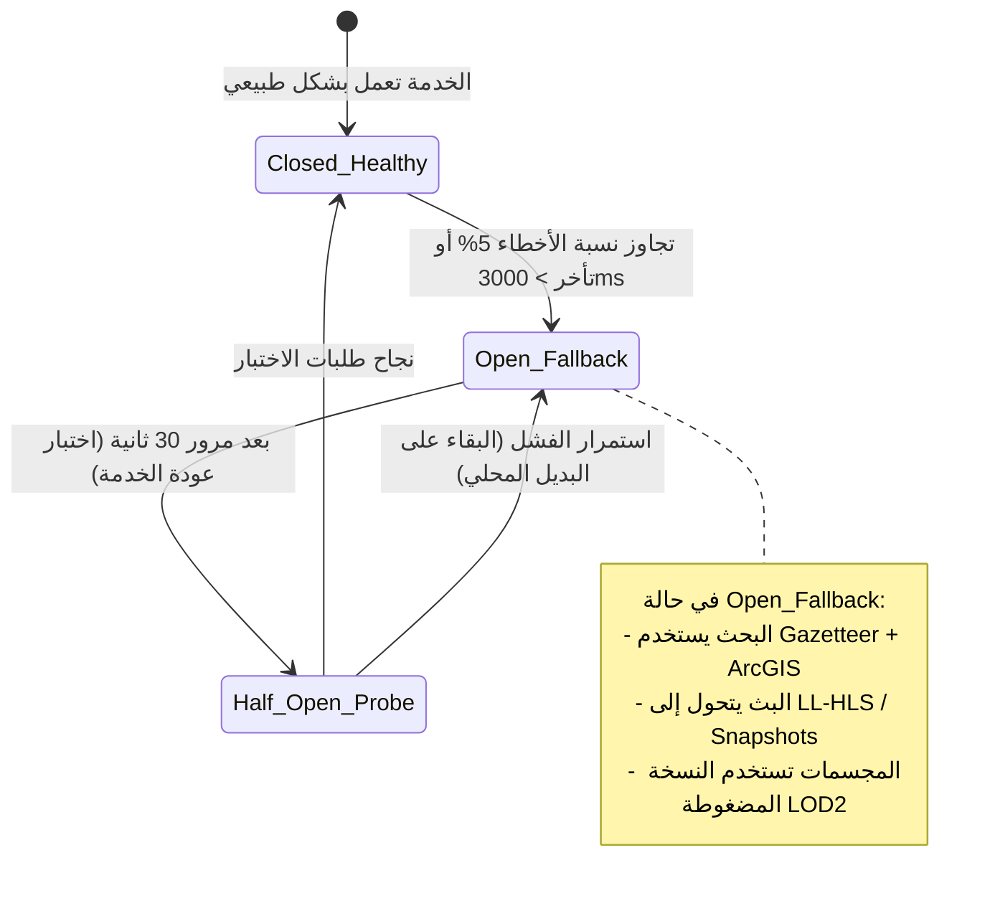

# 13 — سجل المخاطر التقنية والتشغيلية وخطط التخفيف الاستباقية (Risk Assessment & Mitigation Matrix)
## منظومة SOCIALMAP — إدارة مخاطر الخرائط، الأسطول، المدفوعات، الرسوميات 3D، والبث المباشر

> **معرف الوثيقة:** `SM-DOC-13`  
> **الإصدار المعماري:** `v11.0-SOCIALMAP-BLUEPRINT`  
> **الوكيل المسؤول:** `[ثاقب - @risk-assessor] (10)` بالتعاون مع `[محقق الحوادث - @incident-detective] (35)`  
> **النطاق:** تحليل كافة نقاط الفشل المحتملة (`Single Points of Failure`) في منظومة **SOCIALMAP**، وتحديد القواطع الآلية (`Circuit Breakers`) والحلول البديلة الفورية (`Automated Fallbacks`).

---

## 1. مصفوفة تقييم المخاطر الشاملة (Comprehensive Risk & Mitigation Matrix)

| الرمز | فئة الخطر | وصف الخطر المحتمل | الاحتمالية | الأثر | استراتيجية التخفيف والبديل الآلي (Automated Mitigation & Fallback) |
|---|---|---|---|---|---|
| `RSK-01` | **الرسوميات 3D (`WebGL`)** | فقدان سياق الرسوميات (`webglcontextlost`) أو بطء الهواتف الاقتصادية عند عرض الخريطة 3D مع مجسمات الوجبات والمباني | متوسطة | عالٍ | تفعيل مراقب معدل الإطارات (`FPS Watchdog`)؛ إذا هبط الأداء دون `30 FPS` لثلاث ثوانٍ يتم خفض دقة الظلال وتفعيل `LOD2` تلقائياً، مع معالج استعادة فوري لحدث `webglcontextrestored`. |
| `RSK-02` | **البث المباشر (`Live Cams`)** | ارتفاع مفاجئ في عدد المشاهدين لكاميرا مكان مزدحم (مثل مول أو معلم ديني) مما يضغط على خادم البث | عالية | متوسط | التحول التلقائي من `WebRTC Direct` إلى `Cloudflare CDN Cached LL-HLS` عند تجاوز عدد المشاهدين المتزامنين للكاميرا الواحدة `500 مشاهد`، مما يسمح بخدمة `100,000+` مشاهد دون سقوط الخادم. |
| `RSK-03` | **حجز التكسي (`Ride Dispatch`)** | قبول كابتنين لنفس الطلب في نفس الجزء من الثانية أو تأخر استجابة الكابتن | متوسطة | عالٍ | استخدام أقفال موزعة ذرية في `Redis` (`SETNX ride_lock:{rideId}`) بصلاحية `15 ثانية`؛ الكابتن الأول الذي يثبت القفل يحصل على الرحلة، وإن لم يستجب خلال 15 ثانية ينتقل الطلب تلقائياً للكابتن التالي. |
| `RSK-04` | **تغير الأسعار والمخزون (`Menu Sync`)** | قيام مستخدم بإضافة وجبة للسلة ونفادها من المطعم قبل ضغط زر الدفع | عالية | متوسط | تنفيذ فحص إلزامي (`POST /v1/cart/validate`) لحظة فتح نافذة الدفع؛ إذا نفد صنف، يظهر تنبيه فوري مع اقتراح بدائل مشابهة من نفس المنيو دون مسح باقي السلة. |
| `RSK-05` | **محركات البحث الجغرافي (`Geocoding`)** | فرض قيود معدل الاستخدام (`Rate Limit 429`) من قبل خادم `Nominatim` أو `Overpass` العام | متوسطة | متوسط | معمارية التبديل التلقائي الرباعي (`4-Engine Failover`): البحث أولاً في الدليل المحلي (`660+` موقع) + الكاش، ثم التوزيع المتوازي بين `ArcGIS` و `Photon` و `Nominatim` مع تخزين النتائج لمدة 7 أيام. |
| `RSK-06` | **الشبكة والمدفوعات (`Payment Drop`)** | انقطاع الإنترنت في هاتف المستخدم لحظة خصم المبلغ في بوابة الدفع (`ZainCash / QiCard`) | متوسطة | حرج | الاعتماد على إشعار `Server-to-Server Webhook` من بوابة الدفع إلى خادم `SOCIALMAP` مباشرة؛ حتى لو انقطع هاتف المستخدم، يتم تأكيد الطلب وإرسال رسالة `SMS` للمستخدم وتحديث حالة الطلب فور عودة اتصاله. |
| `RSK-07` | **خصوصية الكاميرات (`Camera Privacy`)** | بث محتوى غير ملائم أو انتهاك خصوصية عبر إحدى الكاميرات المربوطة | منخفضة | حرج | فرض شروط ترخيص صارمة للكاميرات التجارية والعامة فقط، تفعيل التعتيم الآلي للوجوه ولوحات السيارات، وتوفير زر إيقاف فوري (`Kill-Switch`) للمشرفين والتجار. |

---

## 2. مخطط القاطع الآلي والتعافي الذاتي (`Self-Healing Circuit Breaker Flow`)

