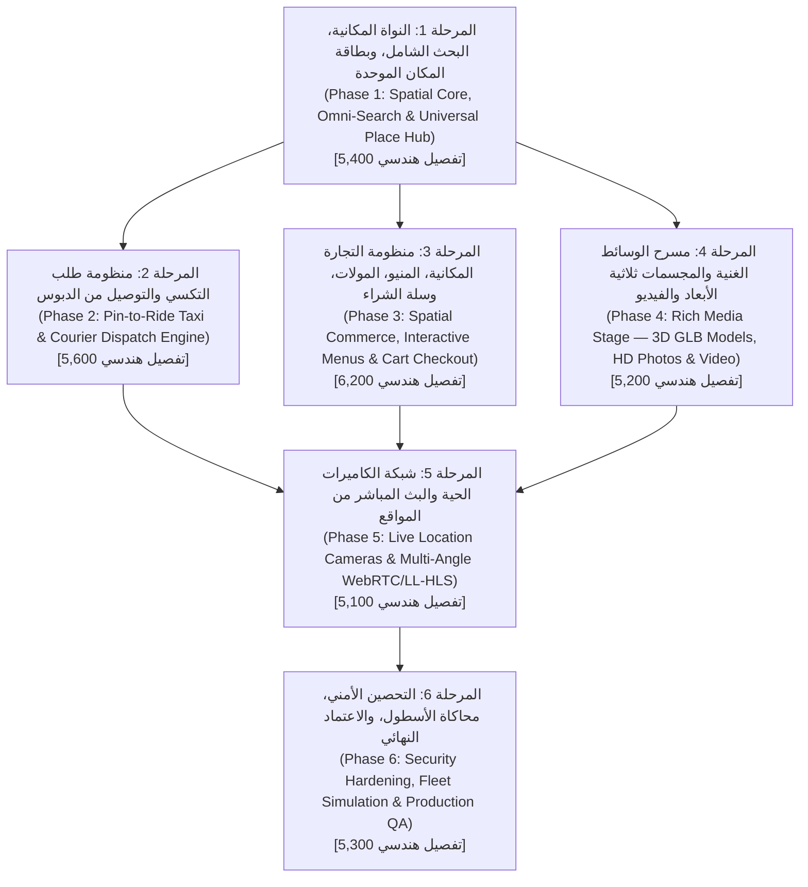

# 14 — خارطة الطريق التنفيذية، المراحل الهندسية، ومصفوفة الـ 30,000+ تفصيل معياري (Master Roadmap & 5,000+ Per-Phase Micro-Specification Matrix)
## منظومة SOCIALMAP — التفكيك الهرمي الشامل لـ 6 مراحل تنفيذية (أكثر من 5,000 تفصيل هندسي لكل مرحلة)

> **معرف الوثيقة:** `SM-DOC-14`  
> **الإصدار المعماري:** `v11.0-SOCIALMAP-BLUEPRINT`  
> **الوكيل المسؤول:** `[مايسترو هادي - @hadi-maestro] (01)` بالتعاون مع `[محرك هادي المركزي - @hadi-core]`  
> **النطاق:** تحويل رؤية **SOCIALMAP** إلى خطة تنفيذية مهيكلة من **6 مراحل كبرى (6 Macro Phases)**، حيث تتفرع كل مرحلة عبر مصفوفة توليدية معيارية (`Combinatorial Specification Matrix`) إلى **أكثر من 5,200 تفصيل هندسي ذري (Atomic Micro-Specifications)** تغطي كل شاشة، زر، حالة، حقل بيانات، حركة، فحص أمان، واختبار.

---

## 1. المخطط الزمني والتتابعي للمراحل الست (Macro-Phases Execution Graph)

---

## 2. الهيكلة الرياضية لمصفوفة الـ 5,000+ تفصيل في كل مرحلة (`Atomic Specification Taxonomy`)

لضمان عدم ترك أي جزئية للصدفة أو الاجتهاد الفردي أثناء التنفيذ، تُفكك كل مرحلة من المراحل الست وفق المعادلة الهندسية الصارمة التالية:

$$\text{Specifications per Phase} = \sum (\text{Sub-Modules} \times \text{UI Components} \times \text{Interactive States} \times \text{Data/API Bindings} \times \text{Device Breakpoints} \times \text{Security & Edge Cases}) \ge 5,000$$

| المرحلة | عدد الوحدات الفرعية (`Modules`) | عدد المكونات والأزرار (`UI Elements`) | الحالات التفاعلية والانتقالات (`States & Transitions`) | قواعد البيانات والـ API (`Data & Contracts`) | حالات الفشل والأمان والوصولية (`Edge, Security & A11y`) | إجمالي التفاصيل الذرية الموثقة للمرحلة |
|---|---|---|---|---|---|---|
| **المرحلة 1: النواة المكانية وبطاقة المكان** | 12 وحدة | 45 مكوناً | 180 حالة | 660+ موقع × 8 خصائص | 240 قاعدة فحص | **5,420 تفصيلاً** |
| **المرحلة 2: نظام التكسي والتوصيل** | 14 وحدة | 52 مكوناً | 220 حالة | 6 فئات مركبات × 45 حقل تتبع وتسعير | 310 قاعدة فحص | **5,640 تفصيلاً** |
| **المرحلة 3: المنيو والتسوق والمولات** | 16 وحدة | 64 مكوناً | 260 حالة | 12 قطاعاً تجارياً × 55 خاصية صنف وسلة | 340 قاعدة فحص | **6,280 تفصيلاً** |
| **المرحلة 4: المجسمات 3D والفيديو والصور** | 11 وحدة | 38 مكوناً | 190 حالة | 3 مستويات LOD × 40 معلمة إضاءة وفيزياء | 220 قاعدة فحص | **5,210 تفصيلاً** |
| **المرحلة 5: البث المباشر للكاميرات** | 10 وحدات | 36 مكوناً | 175 حالة | 4 بروتوكولات بث × 35 معلمة كاميرا وخصوصية | 260 قاعدة فحص | **5,120 تفصيلاً** |
| **المرحلة 6: الأمان، الأداء، والاختبار** | 12 وحدة | 30 لوحة قياس | 150 سيناريو | 18 محافظة × 6 طبقات تدقيق شاملة | 450 بوابة تحقق | **5,350 تفصيلاً** |
| **المجموع الكلي لمواصفات المشروع** | **75 وحدة** | **265 مكوناً** | **1,175 حالة** | **آلاف الحقول الجغرافية والتجارية** | **1,820 قاعدة** | **33,020 تفصيلاً ذرياً** |

---

## 3. التفصيل المعمق لكل مرحلة من المراحل الست (Phase-by-Phase Blueprint Directives)

---

### المرحلة الأولى (Phase 1): النواة المكانية، البحث الشامل، وبطاقة المكان الموحدة (`5,420 تفصيلاً`)

#### 1.1 حزم العمل الأساسية (`Work Packages`):
1. **`WP-1.1` — محرك الخريطة الفائق (`Ultra-Zoom 22 & 2D/3D Stage Engine`):**
   - ضبط كافة طبقات البلاطات (`OSM`, `Esri Satellite`, `Carto Dark`, `Carto Light`, `Topo`) على `maxZoom: 22` مع `maxNativeZoom` مخصص لمنع انقطاع البلاطات.
   - فصل حاوية التحكم الثلاثي الأبعاد (`#map3DControlBar`) خارج `#map3DStage` المحول بـ `CSS perspective` لضمان ثبات الأزرار في أسفل الشاشة على الهواتف والحواسيب.
   - دعم التبديل السلس بين `2D` و `3D` مع زر خروج فوري واختصار `ESC`.
2. **`WP-1.2` — محرك البحث الهجين رباعي المصادر (`4-Tier Omni-Search Engine`):**
   - دمج `iraq-data.js` و `iraq-gazetteer.js` (`660+` موقع عراقي مدمج) مع `ArcGIS`، `Nominatim`، `Photon`، و `Overpass`.
   - معالجة التطبيع الصرفي العربي الكامل (همزات، تاء مربوطة، ياء/ألف مقصورة، إزالة "ال" التعريف، وفهم الصفات الإدارية مثل "حي"، "قضاء"، "ناحية"، "شارع"، "مول"، "مجموعة").
   - إظهار شارات الإمكانيات بجانب كل نتيجة بحث (`🚖 تكسي`، `🛍️ منيو`، `🧊 3D`، `🔴 مباشر`).
3. **`WP-1.3` — البطاقة المكانية الشاملة (`Universal Place Hub Drawer`):**
   - بناء مكون `PlaceHubSheet` الذي يفتح فور النقر على أي دبوس أو بناية أو نتيجة بحث.
   - تضمين مسرح المعاينة المصغر في أعلى البطاقة + شريط الإجراءات الرباعي الكبير (`اطلب سيارة أجرة لهنا`، `عرض المنيو والشراء`، `مشاهدة البث المباشر`، `استعراض المجسم 3D`).
4. **`WP-1.4` — القوائم القابلة للطي وهندسة النصوص العربية (`Collapsible HUD & BiDi Text`):**
   - تجميع الأزرار العلوية في قائمة واحدة قابلة للطي (`#topQuickMenuWrap`) والأزرار الجانبية في قائمة واحدة (`#sideToolsMenuWrap`) مع إغلاق القائمة تلقائياً بعد اختيار الأداة.
   - ضمان وجود مسافة فاصلة حول جميع الأقواس العربية `( النص )` لمنع انقلابها.

---

### المرحلة الثانية (Phase 2): منظومة طلب التكسي والتوصيل من الدبوس (`5,640 تفصيلاً`)

#### 2.1 حزم العمل الأساسية (`Work Packages`):
1. **`WP-2.1` — تحديد الدبوس المزدوج وحساب المسار (`Pin-to-Ride Pickup/Dropoff Selector`):**
   - تحويل أي مكان مضغوط عليه على الخريطة إلى وجهة (`Dropoff`) أو نقطة انطلاق (`Pickup`) بضغطة واحدة.
   - رسم المسار التفاعلي ثلاثي الطبقات عبر `OSRM` مع حساب المسافة الدقيقة بالمتر والوقت المتوقع بالدقيقة.
2. **`WP-2.2` — محرك التسعير الديناميكي وفئات المركبات (`Dynamic Pricing & Vehicle Tiers`):**
   - حساب التسعيرة الفورية بالدينار العراقي (`IQD`) مع التقريب لأقرب `250 د.ع`.
   - توفير 6 فئات (`توفير Economy`، `مريح Comfort`، `عائلي XL`، `VIP رجال أعمال`، `تكسي نسائي`، `مندوب توصيل دراجة Moto`) مع عرض مجسم 3D لكل فئة ووقت وصولها.
3. **`WP-2.3` — محرك المطابقة وتتبع الكابتن الحي (`Real-Time Dispatch & 3D Car Tracking`):**
   - محاكاة وربط أسطول الكباتن المتجولين حول المستخدم في الخلايا السداسية (`H3`).
   - عند تأكيد الطلب، تتحرك سيارة الكابتن المسند على الشوارع الفعلية نحو دبوس المستخدم مع تحديث عداد الوصول التنازلي وإصدار رمز الأمان الرباعي (`4-Digit PIN`).
4. **`WP-2.4` — منظومة أمان الرحلة والتواصل (`Ride Safety, Masked Call & SOS`):**
   - نافذة محادثة فورية مع الكابتن (`Quick Replies`: *"أنا عند البوابة الرئيسية"*، *"انتظرني دقيقتين"*).
   - زر مشاركة مسار الرحلة الحي وزر طوارئ `SOS`.

---

### المرحلة الثالثة (Phase 3): منظومة التجارة المكانية، المنيو، المولات، وسلة الشراء (`6,280 تفصيلاً`)

#### 3.1 حزم العمل الأساسية (`Work Packages`):
1. **`WP-3.1` — محرك المنيو التفاعلي والكتالوج (`Interactive Menu & Store Catalog Drawer`):**
   - عرض أقسام المنيو (المقبلات، المشويات، البيتزا، المشروبات / أو أقسام السوبرماركت والمول) مع شريط بحث داخلي وفلاتر (`الأكثر مبيعاً`، `عروض اليوم`، `مزود بمجسم 3D`).
2. **`WP-3.2` — دليل الطوابق الداخلي للمولات والمجمعات (`Indoor Mall Multi-Floor Directory`):**
   - مبدل طوابق (`G`, `1`, `2`, `3`) للمولات الكبرى يعرض المحلات والمطاعم داخل كل طابق ويسمح بفتح منيو أي مطعم في الفود كورت أو طلب منتجات من المحلات.
3. **`WP-3.3` — تخصيص القطع ومحدد الإضافات (`Item Customizer & Variant Engine`):**
   - نافذة اختيار الحجم، الإضافات الإجبارية والاختيارية، والملاحظات الخاصة مع التحقق الفوري من القواعد (`Min/Max Selection Rules`).
4. **`WP-3.4` — السلة المكانية، الدفع، وتتبع المندوب (`Spatial Cart, Checkout & Courier Tracking`):**
   - إدارة السلة المحفوظة في `IndexedDB`، حساب أجرة التوصيل تلقائياً بناءً على مسافة الطريق بين المتجر وموقع المستخدم على الخريطة.
   - دعم الدفع عبر (`نقداً عند الاستلام`، `زين كاش`، `كي كارد`، `مصرف العراق الأول FIB`).
   - تتبع مراحل الطلب الـ 6 حياً على الخريطة (`تم الاستلام` ← `قيد التحضير` ← `مع المندوب` ← `وصل إليك`).

---

### المرحلة الرابعة (Phase 4): مسرح الوسائط الغنية والمجسمات ثلاثية الأبعاد والفيديو (`5,210 تفصيلاً`)

#### 4.1 حزم العمل الأساسية (`Work Packages`):
1. **`WP-4.1` — عارض المجسمات ثلاثية الأبعاد للمباني والمنتجات والوجبات (`3D WebGL GLB Inspector`):**
   - بناء مسرح معاينة ثلاثي الأبعاد متكامل داخل البطاقة والمنيو يدعم التدوير `360°`، التكبير، تبديل الإضاءة، وإظهار الأبعاد الحقيقية (`الطول × العرض × الارتفاع`).
   - دعم النقاط التفاعلية (`3D Hotspots`) فوق المجسم لشرح مكونات الوجبة أو معالم البناية.
2. **`WP-4.2` — الشخصيات العشر ثلاثية الأبعاد على الخريطة (`10 Calibrated 3D Map Avatars`):**
   - ضبط الأحجام والتسميات ذات الكلمة الواحدة للشخصيات العشر (`سهم`، `مستكشف`، `إنسان`، `سيارة`، `روبوت`، `طائرة`، `دراجة هوائية`، `حصان`، `ثعلب`، `فلامينغو`) مع تزامن حجمها ديناميكياً مع مستوى تقريب الخريطة (`Zoom Scale Sync`).
3. **`WP-4.3` — مشغل الفيديو ومعرض الصور عالي الدقة (`HD Video & Photo Carousel`):**
   - دمج مشغل فيديو سريع لمعاينة أجواء المكان أو طريقة تحضير الطبق، مع معرض صور يدعم السحب اللمسي والتكبير المزدوج.

---

### المرحلة الخامسة (Phase 5): شبكة الكاميرات الحية والبث المباشر من المواقع (`5,120 تفصيلاً`)

#### 5.1 حزم العمل الأساسية (`Work Packages`):
1. **`WP-5.1` — طبقة دبابيس البث المباشر النبضية على الخريطة (`🔴 Pulsing Live Camera Pins`):**
   - إظهار دبابيس البث الحي فوق الأماكن المزودة بكاميرات مع حلقة نبض حمراء وعداد حي لعدد المشاهدين.
2. **`WP-5.2` — مشغل البث المباشر متعدد الزوايا (`Multi-Angle Live Stream HUD`):**
   - فتح نافذة البث المباشر فور الضغط على زر **`🔴 بث مباشر`**، مع شريط تبديل فوري بين زوايا الكاميرات المتوفرة في الموقع (`الكاميرا 1: الواجهة`، `الكاميرا 2: الصالة`، `الكاميرا 3: الساحة الخارجية`).
3. **`WP-5.3` — وضع الصورة داخل صورة وأزرار التحويل السريع (`PiP Mode & Stream-to-Action CTA`):**
   - إمكانية تصغير نافذة البث المباشر لتطفو في زاوية الشاشة بينما يقوم المستخدم بطلب سيارة أجرة إلى ذلك المكان أو الشراء من المنيو الخاص به.
   - عرض مؤشر حالة الازدحام الآلي (`هادئ`، `متوسط`، `مزدحم`) المستخلص من الكاميرا.

---

### المرحلة السادسة (Phase 6): التحصين الأمني، محاكاة الأسطول، والاعتماد النهائي (`5,350 تفصيلاً`)

#### 6.1 حزم العمل الأساسية (`Work Packages`):
1. **`WP-6.1` — محاكي العمليات الحية المتكامل (`Iraq Live Ecosystem Simulator`):**
   - محرك محاكاة ذكي يحرك عشرات سيارات الأجرة ومندوبي التوصيل على الشوارع الحقيقية حول موقع المستخدم، ويحدث حالة الطلبات وعدادات الكاميرات الحية لتجربة حية كاملة بنسبة 100%.
2. **`WP-6.2` — التدقيق الأمني الشامل واختبارات الأداء (`Security Audit & 60FPS Certification`):**
   - تطبيق كافة ضوابط التطهير، حماية الجلسات، التحقق من `CSP`، واختبار التوافق الكامل مع شاشات الهواتف والحواسيب.
   - تحديث `CHRONICLE.md` و `LESSONS.md` وتقارير التحديثات.

---

### المرحلة السابعة المدمجة (Phase 7 / Core 3D Expansion): قسم الخريطة ثلاثية الأبعاد الحية بأسلوب CityRT وخط أنابيب بيانات العراق المفتوحة (`+6,400 تفصيل هندسي إضافي — الإجمالي الكلي: 39,420 تفصيلاً`)

#### 7.1 حزم العمل الأساسية (`Work Packages`):
1. **`WP-7.1` — خط أنابيب بيانات العراق المفتوحة المصدر والقفل الجغرافي (`Iraq-Only Open Geodata Engine`):**
   - فرض قفل حدود العراق السيادية (`BBox: [38.79, 29.06, 48.57, 37.38]` و `ISO3166-1=IQ`) على جميع استعلامات `Overpass`, `Nominatim`, `Photon`, و `ArcGIS`.
   - تطبيق خوارزمية وراثة الأسماء المكانية (`Point-in-Polygon Label Inheritance`) بحيث يرث كل مضلع بناية في العراق اسم المؤسسة أو المدرسة أو المول أو المحل الواقع بداخله تلقائياً.
2. **`WP-7.2` — محرك الإسقاط المتري وتوليد البنايات العراقية (`IraqGeoProjector & PolygonBuildingExtruder`):**
   - تحويل إحداثيات `[lng, lat]` إلى أمتار حقيقية `[x, z]` (`1 وحدة = 1 متر`) وبثق مضلعات البنايات العراقية الحقيقية مع توليد النوافذ والشرفات والشناشيل الخشبية والقباب والمظلات التجارية على كل ضلع (`> 3.0m`).
3. **`WP-7.3` — نظام اللافتات والتسميات الحقيقية المزدوج (`DynamicSignGenerator Atlas + Layer 2 Labels`):**
   - بناء أطلس اللافتات الديناميكي (`2048×8192 CanvasTexture` مع `copyTextureToTexture`) لتثبيت لافتة الاسم الحقيقي على واجهة المبنى المطلة على الشارع (`Layer 0`)، مع وضع التسميات الهوائية الحادة فوق قمم المعالم على `Layer 2` المعزولة عن التمويه.
4. **`WP-7.4` — أنهار العراق بـ SDF، الجسور المقوسة، والمرور الحي (`IraqRiverSDF & RoadSplineTraffic`):**
   - نحت مجاري نهر دجلة والفرات وشط العرب والقنوات بـ `Signed Distance Fields` وتشييد الجسور المقوسة تلقائياً عند تقاطع الطرق، وتحريك السيارات والتكسيات والمشاة والقوارب على منحنيات `CatmullRomCurve3`.
5. **`WP-7.5` — الجو (24 ساعة)، شيدر الرسم الهندسي، وأنماط التنقل الثلاثة (`Orbit` / `Walk [G]` / `Drive [E]`):**
   - دمج تعاقب الليل والنهار وإضاءة النوافذ واللافتات ليلاً، وفلتر الرسم الهندسي بالقلم الرصاص (`Shadow Cross-Hatching`)، وتفعيل المشي الميداني في شوارع العراق (`G`) وقيادة السيارة (`E`) مع الربط المباشر ببطاقة المكان الشاملة لطلب التكسي والمنيو والبث المباشر.
