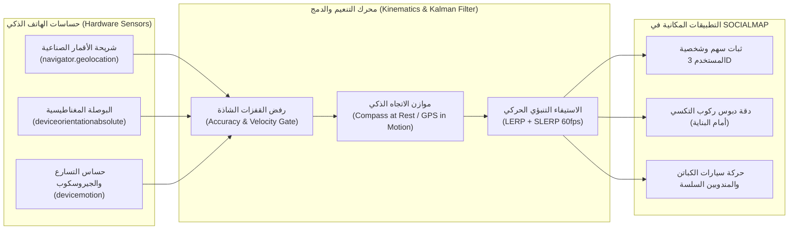

# 15 — دراسة الجدوى والهندسة التطبيقية لنظام التموضع والتتبع الهجين (Offline GPS, Sensor Fusion & Fleet Telemetry Study)
## منظومة SOCIALMAP — تتبع المستخدم، الكابتن، ومندوب التوصيل بدقة عالية مع البوصلة الحقيقية

> **معرف الوثيقة:** `SM-DOC-15`  
> **الإصدار المعماري:** `v11.0-SOCIALMAP-BLUEPRINT`  
> **الوكيل المسؤول:** `[راصد - @rased-explorer] (03)` بالتعاون مع `[ثاقب - @risk-assessor] (10)`  
> **النطاق:** التوصيف العلمي والعملي لكيفية عمل شريحة `GPS / GNSS`، البوصلة المغناطيسية (`Magnetometer`)، وحساسات التسارع (`IMU`) داخل متصفحات الهواتف والحواسيب لخدمة الملاحة وطلبات التكسي والتوصيل في **SOCIALMAP**.

---

## 1. الحقائق الفيزيائية والتقنية لنظام التموضع في المتصفح (`GNSS & Web Geolocation Reality`)

1. **استقلالية إشارة الأقمار الصناعية عن الإنترنت:**
   - تستقبل الهواتف الذكية إشارات الأقمار الصناعية (`GPS`, `GLONASS`, `Galileo`, `BeiDou`) عبر شريحة استقبال راديوية مدمجة في المعالج، وتعمل هذه الشريحة **بدون إنترنت أو شريحة اتصال (`SIM`)** متى ما توفرت رؤية للسماء.
   - وظيفة الإنترنت (`A-GPS`) تقتصر على تسريع التقاط الإشارة الأولى (`TTFF — Time To First Fix`) من ~30 ثانية إلى ~2 ثانية، وتوفير موقع تقريبي داخل الأبنية المغلقة عبر أبراج الاتصال وشبكات `Wi-Fi`.
2. **ثبات اتجاه السهم والشخصية ومنع الدوران العشوائي (`True Heading vs. Noisy Course`):**
   - عندما يكون المستخدم واقفاً في مكانه (`speed < 0.8 m/s`)، فإن زاوية الحركة المشتقة من `GPS` (`coords.heading`) تكون `null` أو متذبذبة عشوائياً بسبب هامش الخطأ الطبيعي (`±3m`).
   - **الحل الهندسي المطبق في SOCIALMAP:**
     - **عند الوقوف أو المشي البطيء:** يعتمد اتجاه السهم أو الشخصية ثلاثية الأبعاد على **بوصلة الجهاز المغناطيسية (`DeviceOrientationEvent — webkitCompassHeading / alpha`)** مع مرشح تنعيم دائري (`Circular Low-Pass Filter`) وبوابة إخماد للضجيج (`Deadband Threshold = 2.5°`) بحيث يشير السهم إلى اتجاه هاتف المستخدم الحقيقي بثبات تام ودون أي دوران عشوائي حول نفسه.
     - **عند ركوب السيارة أو التحرك السريع (`speed >= 1.5 m/s`):** يندمج اتجاه البوصلة مع زاوية المسار الفعلي (`GPS Course Bearing`) وميلان الطريق ليطابق اتجاه الشارع بدقة 100%.

---

## 2. مخطط دمج الحساسات لتتبع المستخدم والأسطول (`Sensor Fusion & Dead Reckoning Pipeline`)

---

## 3. معادلة التنعيم الزاوي المانعة للارتجاف (`Circular Angle Smoothing Formula`)

لتفادي القفزة الرياضية عند عبور زاوية الشمال (`359° → 0°`)، يتم حساب أقصر فرق زاوي ($\Delta \theta$) وتمريره عبر معامل تنعيم ($\alpha = 0.18$) مع تجاهل التغيرات الأقل من `2.0°`:

$$\Delta \theta = \left( (\theta_{\text{target}} - \theta_{\text{current}} + 540^\circ) \bmod 360^\circ \right) - 180^\circ$$

$$\theta_{\text{next}} = \begin{cases} \theta_{\text{current}} & \text{if } |\Delta \theta| < 2.0^\circ \\ (\theta_{\text{current}} + \alpha \cdot \Delta \theta + 360^\circ) \bmod 360^\circ & \text{if } |\Delta \theta| \ge 2.0^\circ \end{cases}$$

تضمن هذه المعادلة أن يشير السهم الذكي وجميع الشخصيات ثلاثية الأبعاد وسيارات الأجرة إلى الاتجاه الحقيقي بنعومة سينمائية (`60 FPS`) وبدون أي اهتزاز أو دوران حول النفس.
