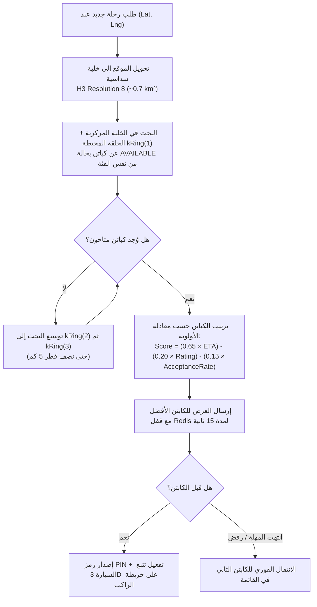

# 16 — المواصفات الهندسية التفصيلية لمنظومة طلب سيارات الأجرة والتوصيل (Ride-Hailing, Taxi Dispatch & Logistics Specification)
## منظومة SOCIALMAP — الطلب من الدبوس (`Pin-to-Ride`)، معادلات التسعير العراقي، المطابقة المكانية، والتتبع ثلاثي الأبعاد

> **معرف الوثيقة:** `SM-DOC-16`  
> **الإصدار المعماري:** `v11.0-SOCIALMAP-BLUEPRINT`  
> **الوكيل المسؤول:** `[عماد - @emad-api-shield] (16)` بالتعاون مع `[ناظم - @data-modeler] (06)` و `[@motion-coder] (15)`  
> **النطاق:** التوصيف الهندسي الكامل لنظام النقل والتوصيل المدمج داخل خريطة **SOCIALMAP**؛ بحيث يتحول أي مكان يضغط عليه المستخدم أو يبحث عنه إلى وجهة أو نقطة انطلاق لطلب سيارة أجرة أو مندوب توصيل فوراً.

---

## 1. مسارات طلب السيارة من الخريطة (`3 Instant Pin-to-Ride Entry Modes`)

يوفر **SOCIALMAP** ثلاث طرق بديهية لطلب سيارة أجرة مباشرة عبر الدبابيس على الخريطة (وليس عبر قوائم معقدة منفصلة):

1. **الوضع الأول: النقر على أي مكان أو معلم أو مطعم (`Place Pin → Request Taxi`):**
   - يضغط المستخدم على أي مكان على الخريطة (أو يختاره من البحث) ← تفتح البطاقة المكانية الشاملة ← يضغط زر **`🚖 اطلب سيارة أجرة لهنا`** ← يتم تعيين موقع المستخدم الحالي كنقطة انطلاق (`Pickup`) والمكان المضغوط عليه كوجهة (`Dropoff`) فوراً.
2. **الوضع الثاني: النقر المطول أو وضع الدبوس الحر على أي رصيف (`Free Map Pin → Request Taxi`):**
   - يضغط المستخدم على أي نقطة في أي شارع أو زقاق على الخريطة ← يظهر دبوس مكاني مفرغ الوسط مع زر سريع **`🚖 تكسي إلى هذه النقطة`** أو **`📍 اجعلها نقطة انطلاقي`**.
3. **الوضع الثالث: طلب سيارة للعودة من المكان الحالي (`Ride From Current Place`):**
   - إذا كان المستخدم موجوداً بالفعل داخل مول أو جامعة (مثل *"مجموعة العميد التعليمية"*)، يتعرف النظام على وجوده داخل مضلع المكان ويقترح تلقائياً: **`🚖 اطلب تكسي من البوابة الرئيسية إلى وجهتك`**.

---

## 2. فئات المركبات ومواصفاتها ومعادلات التسعير بالدينار العراقي (`Vehicle Tiers & IQD Fare Matrix`)

تُحسب أجرة الرحلة بشفافية كاملة قبل الطلب بناءً على المسافة الفعلية للطريق (`OSRM Route Distance`) والوقت المتوقع (`Duration`) ومعامل الذروة (`Surge`):

$$\text{RawFare}_{\text{IQD}} = \max\Big(\text{MinFare}, \; \big(\text{BaseFare} + (\text{Distance}_{\text{km}} \times \text{Rate}_{\text{km}}) + (\text{Duration}_{\text{min}} \times \text{Rate}_{\text{min}})\big) \times \text{SurgeMultiplier}\Big)$$

$$\text{FinalFare}_{\text{IQD}} = \text{ roundToNearest250 }\big(\text{RawFare}_{\text{IQD}}\big)$$

| رمز الفئة (`Tier ID`) | الاسم في الواجهة | السعة | فتحة العداد (`BaseFare`) | تسعيرة الكيلومتر (`Rate/km`) | تسعيرة الدقيقة (`Rate/min`) | الحد الأدنى للرحلة (`MinFare`) | المجسم ثلاثي الأبعاد (`3D Model`) |
|---|---|---|---|---|---|---|---|
| `ECONOMY` | **توفير (Economy)** | 4 ركاب | `1,500 د.ع` | `350 د.ع` | `75 د.ع` | `3,000 د.ع` | سيارة سيدان اقتصادية بيضاء/صفراء |
| `COMFORT` | **مريح (Comfort)** | 4 ركاب | `2,000 د.ع` | `450 د.ع` | `100 د.ع` | `4,000 د.ع` | سيارة سيدان حديثة مكيفة |
| `FAMILY_XL` | **عائلي (Family XL)** | 6-7 ركاب | `2,500 د.ع` | `600 د.ع` | `125 د.ع` | `5,000 د.ع` | سيارة دفع رباعي عائلية كبيرة (`SUV`) |
| `VIP_EXEC` | **درجة أولى (VIP)** | 4 ركاب | `3,500 د.ع` | `800 د.ع` | `150 د.ع` | `7,500 د.ع` | سيارة فارهة سوداء |
| `LADY_TAXI` | **تكسي نسائي (آمن)** | 4 ركاب | `2,000 د.ع` | `450 د.ع` | `100 د.ع` | `4,000 د.ع` | سيارة سيدان بشارة وردية مخصصة للعائلات والنساء |
| `MOTO_FAST` | **مندوب سريع (توصيل)** | طرد ≤ 15 كغم | `1,000 د.ع` | `250 د.ع` | `50 د.ع` | `2,500 د.ع` | دراجة توصيل سريعة |

---

## 3. خوارزمية المطابقة المكانية وإسناد الكابتن (`H3 Spatial Dispatch Algorithm`)

---

## 4. التتبع الحي ثلاثي الأبعاد للسيارة أثناء الرحلة (`Real-Time 3D Vehicle Telemetry & Camera Choreography`)

1. **المرحلة الأولى (الكابتن في الطريق إلى الراكب — `DRIVER_EN_ROUTE`):**
   - يظهر مسار متقطع متحرك بلون كهرماني من موقع سيارة الكابتن إلى دبوس الراكب.
   - يتحرك مجسم السيارة ثلاثي الأبعاد على الشارع الفعلي مع دوران الإطارات والهيكل باتجاه الزاوية الحقيقية للطريق (`Bearing`).
   - تعرض البطاقة السفلية عداداً تنازلياً حياً: *"الكابتن علي يصل خلال 3 دقائق (يبعد 950 متر)"*.
2. **المرحلة الثانية (وصول الكابتن — `ARRIVED_PICKUP`):**
   - يصدر التطبيق تنبيهاً صوتياً واهتزازاً لمسياً مع إظهار هالة نبضية خضراء حول سيارة الكابتن على الخريطة.
   - يظهر رمز الأمان الرباعي بخط كبير واضح (`PIN: 4829`) ليطابقه الراكب مع الكابتن.
3. **المرحلة الثالثة (الرحلة جارية نحو الوجهة — `IN_PROGRESS`):**
   - تتحول الكاميرا تلقائياً إلى زاوية ملاحة مائلة (`Pitch 55°`) تتبع السيارة على المسار الأزرق المتجه إلى المكان المقصود، مع إظهار الوقت المتبقي للوصول.
   - يمكن للراكب أثناء جلوسه في السيارة الضغط على بطاقة المكان المقصود (مثلاً المطعم المتجه إليه) لطلب وجبته من المنيو مسبقاً أو فتح الكاميرا المباشرة للمكان!

