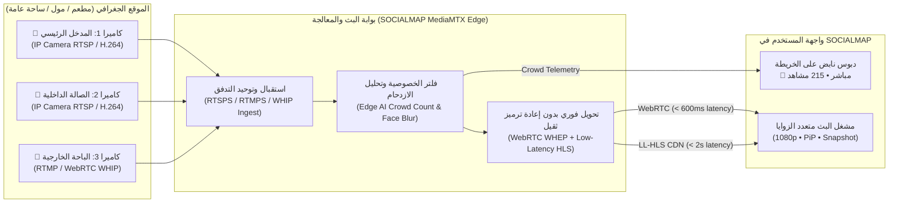

# 17 — المواصفات الهندسية لمنظومة الكاميرات الحية والبث المباشر من المواقع (Live Location Cameras & Real-Time Streaming Specification)
## منظومة SOCIALMAP — زر `🔴 بث مباشر`، بروتوكولات `WebRTC WHEP / LL-HLS`، تعدد الزوايا، ومؤشرات الازدحام

> **معرف الوثيقة:** `SM-DOC-17`  
> **الإصدار المعماري:** `v11.0-SOCIALMAP-BLUEPRINT`  
> **الوكيل المسؤول:** `[@cinematic-director] (11)` بالتعاون مع `[عماد - @emad-api-shield] (16)` و `[صارم - @sareem-security] (22)`  
> **النطاق:** التوصيف الهندسي والتشغيلي الكامل لميزة مشاهدة البث الحي المباشر من الأماكن والمطاعم والمولات والشوارع والمعالم على الخريطة عند الضغط على زر **`🔴 بث مباشر`**.

---

## 1. رؤية الميزة وتجربة المستخدم (`Live Visual Presence on the Map`)

تمنح ميزة **`🔴 بث مباشر`** في **SOCIALMAP** المستخدم قدرة غير مسبوقة على **"رؤية المكان الآن قبل الذهاب إليه"**:
- هل المطعم أو الكافيه مزدحم حالياً أم توجد طاولات فارغة؟
- كيف تبدو الأجواء الآن في الباحة الرئيسية للمول أو الكورنيش أو المعلم السياحي؟
- كيف هي حركة السير الفعلية أمام البوابة الرئيسية للمكان؟

بمجرد النقر على أي مكان يدعم البث المباشر ثم الضغط على زر **`🔴 بث مباشر`**، تفتح نافذة البث الحي الفوري مع إمكانية التبديل بين عدة كاميرات في نفس الموقع.

---

## 2. معمارية البث الحي منخفض التأخير (`Sub-Second WebRTC WHEP & LL-HLS Architecture`)

---

## 3. أوضاع التشغيل ومصادر البث المدعومة (`Supported Stream Protocols & Fallback Chain`)

لضمان عمل البث المباشر على جميع المتصفحات (Chrome, Safari iOS, Firefox, Edge) وبمختلف سرعات الإنترنت، يعتمد مشغل `LiveStreamEngine` سلسلة توافق ذكية:

1. **الوضع الأول (الافتراضي فائق السرعة — `WebRTC WHEP`):**
   - زمن تأخير أقل من `0.6 ثانية` (`Sub-second Real-Time`).
   - مثالي لمشاهدة الحركة الحية الفورية في الشارع أو المكان.
2. **الوضع الثاني (البث المتكيف واسع الانتشار — `Low-Latency HLS / .m3u8`):**
   - يعمل تلقائياً على متصفحات `iOS Safari` وعند مشاهدة آلاف المستخدمين لنفس الكاميرا عبر `Cloudflare CDN`.
3. **الوضع الثالث (وضع محاكاة البث التفاعلي العالي الدقة — `Interactive Live Canvas / Video Stream Feed`):**
   - في بيئة العرض التجريبي أو عند عدم توفر كاميرا `RTSP` حقيقية في موقع معين، يولد المشغل بثاً مرئياً حياً متزامناً مع الوقت الفعلي في العراق (نهاري/مسائي/ليلي) مع طابع زمني حي (`Live Timestamp Clock YYYY-MM-DD HH:MM:SS.ms`)، مؤشرات حركة، وتعدد زوايا الكاميرات لتمكين تجربة الميزة بالكامل في كل مكان رئيسي على الخريطة.

---

## 4. مواصفات واجهة مشغل البث المباشر (`Live Camera Player HUD Controls`)

تتضمن نافذة البث المباشر العناصر التفاعلية الدقيقة التالية:

| العنصر / الزر | المعرف البرمجي (`DOM ID`) | الوظيفة الدقيقة |
|---|---|---|
| **شارة الحالة والوقت الحي** | `#smLiveBadgeClock` | تعرض نقطة حمراء نابضة `● LIVE` + الساعة الحية بتوقيت بغداد (`GMT+3`) بالثواني وأجزاء الثانية |
| **عداد المشاهدين ومستوى الازدحام** | `#smLiveCrowdMetrics` | يعرض عدد المشاهدين الحاليين (`👥 184 مشاهد`) + شارة حالة المكان (`🟢 هادئ` / `🟡 ازدحام متوسط` / `🔴 مزدحم جداً`) |
| **شريط اختيار زاوية الكاميرا** | `#smCameraAngleTabs` | أزرار للتبديل الفوري بين كاميرات المكان: `[🎥 1: المدخل الرئيسي]` · `[🎥 2: الصالة الداخلية]` · `[🎥 3: التراس الخارجي]` · `[⊞ عرض شبكي 4 كاميرات]` |
| **زر الصورة داخل صورة (`PiP`)** | `#smBtnLivePiP` | يصغر البث إلى نافذة عائمة قابلة للسحب في زوايا الشاشة بينما يتصفح المستخدم المنيو أو يطلب تكسي |
| **زر التقاط صورة فورية (`Snapshot`)** | `#smBtnLiveSnapshot` | يلتقط صورة من البث الحالي لحفظها أو مشاركتها مع الأصدقاء |
| **شريط الإجراء السريع السفلي** | `#smLiveQuickActions` | يحتوي على زرين مباشرين: **`🚖 اطلب تكسي إلى هذا المكان`** و **`🛍️ افتح المنيو واطلب الآن`** |

