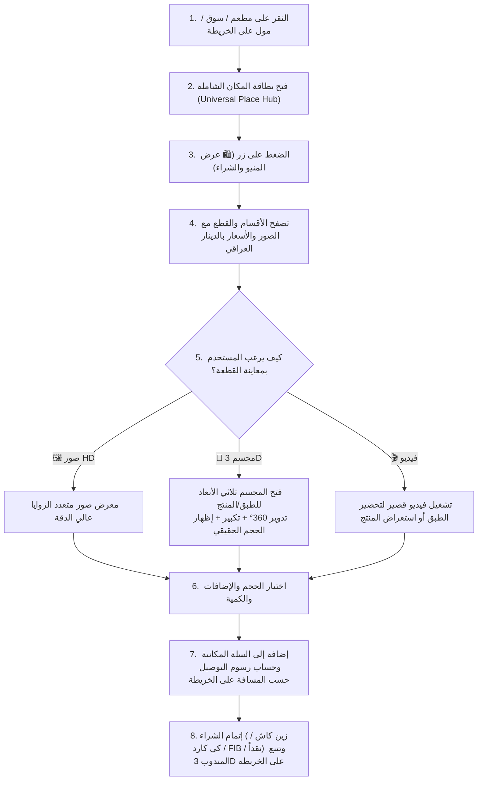

# 18 — المواصفات الهندسية للتجارة المكانية، المنيو التفاعلي، المجسمات 3D، والمولات (Spatial Commerce, 3D Menus & Mall Directory Specification)
## منظومة SOCIALMAP — تصفح منيو المطاعم والأسواق والمولات من الخريطة، معاينة القطع بـ 3D/فيديو، والشراء المباشر

> **معرف الوثيقة:** `SM-DOC-18`  
> **الإصدار المعماري:** `v11.0-SOCIALMAP-BLUEPRINT`  
> **الوكيل المسؤول:** `[صانع المنتج - @product-shaper] (26)` بالتعاون مع `[@design-system-master] (12)` و `[عماد - @emad-api-shield] (16)`  
> **النطاق:** التوصيف الهندسي الكامل لمنظومة التسوق وطلب الطعام والمنتجات مباشرة من الخريطة؛ بحيث يمكن للمستخدم عند الضغط على أي مطعم أو سوق أو مول استعراض المنيو/الكتالوج الخاص به، مشاهدة صور ومجسمات ثلاثية الأبعاد وفيديو لكل قطعة، وإتمام الشراء والتوصيل.

---

## 1. القطاعات التجارية المدعومة على خريطة SOCIALMAP (`Supported Spatial Commerce Sectors`)

عند البحث أو النقر على أي مكان تجاري في الخريطة، يتكيف درج المنيو والكتالوج (`Commerce Drawer`) تلقائياً مع طبيعة القطاع:

| القطاع التجاري | تسمية الزر الرئيسي في البطاقة | تصنيفات الكتالوج / المنيو | طبيعة المجسم ثلاثي الأبعاد (`3D Item Preview`) | خيارات التنفيذ (`Fulfillment`) |
|---|---|---|---|---|
| **المطاعم والكافيهات والحلويات** | `🍽️ عرض المنيو وطلب الطعام` | المشويات، الأكلات العراقية، البيتزا، البرغر، المقبلات، الحلويات، المشروبات | مجسم 3D واقعي للطبق على الطاولة يوضح الحجم الحقيقي والمكونات | توصيل للموقع · استلام من الفرع · طلب لطاولة داخل المطعم |
| **السوبرماركت والأسواق الغذائية** | `🛒 تصفح الأقسام والتسوق` | الفواكه والخضار، الألبان، اللحوم، المخبوزات، المعلبات، المنظفات | مجسم 3D للعبوة أو المنتج مع إمكانية تدويره لقراءة المكونات | توصيل فوري (`Express 20m`) · استلام |
| **المولات والمجمعات التجارية الكبرى** | `🏬 دليل طوابق المول والمتاجر` | الطابق الأرضي `G`، الطابق الأول `1`، الفود كورت `Food Court`، السينما والترفيه | مجسم 3D معماري لطوابق المول + مجسمات 3D لمنتجات المحلات (ملابس، عطور، إلكترونيات) | توصيل موحد من عدة متاجر في المول أو طلب تكسي إلى بوابة المول |
| **الصيدليات والمستلزمات الطبية** | `💊 تصفح الأدوية والمستلزمات` | العناية الشخصية، الفيتامينات، الأجهزة الطبية، مسكنات وأدوية عامة | مجسم 3D للعبوة الطبية والجهاز | توصيل صيدلاني سريع على مدار الساعة |
| **الإلكترونيات والأجهزة والمتاجر المتخصصة** | `🛍️ عرض الكتالوج والشراء` | الهواتف، الحواسيب، الإكسسوارات، الأجهزة المنزلية | مجسم 3D دقيق للجهاز بجميع ألوانه المتاحة (`Color Swatch 3D Switcher`) | توصيل مؤمن مع ضمان أو حجز للاستلام |

---

## 2. رحلة المستخدم داخل المنيو المكاني ومسرح الـ 3D (`Spatial Menu & 3D Dish/Product Journey`)

---

## 3. المواصفات الدقيقة لبطاقة القطعة / الوجبة (`Menu Item Card & 3D Viewer Spec`)

كل عنصر داخل المنيو أو الكتالوج يلتزم ببنية البيانات والعرض التالية:

1. **البيانات الأساسية للقطعة:**
   - الاسم بالعربية والإنجليزية (مثال: *"مسكوف عراقي على الحطب"* / *" كباب أربيل ملكي"* / *"قهوة مختصة V60"*).
   - السعر الأساسي بالدينار العراقي (`18,000 د.ع`) والسعر بعد الخصم إن وجد.
   - شارات توضيحية: `[🔥 الأكثر طلباً]` · `[🧊 متوفر بمجسم 3D]` · `[🎬 فيديو تحضير]` · `[⏱️ 20 دقيقة]`.
2. **معاينة المجسم ثلاثي الأبعاد للقطعة (`Interactive 3D Item Stage`):**
   - عند الضغط على زر **`🧊 عرض 3D`** على أي وجبة أو قطعة:
     - يتحول إطار العرض إلى مسرح `WebGL` يعرض الطبق أو المنتج بأبعاده الحقيقية (`مثلاً: قطر البيتزا 32 سم` أو `حجم العبوة 500 مل`).
     - يتيح للمستخدم تدوير الطبق `360°` من جميع الجوانب ومن الأعلى، وتبديل الحجم (`صغير S` ← `وسط M` ← `كبير L`) ليرى تغير حجم المجسم أمام عينيه مباشرة!
3. **نظام خيارات التخصيص والإضافات (`Modifier Groups Engine`):**
   - **مجموعات الاختيار الأحادي الإجباري (`Radio Group — Required`):** مثل اختيار الحجم أو نوع الخبز أو درجة الاستواء.
   - **مجموعات الاختيار المتعدد الاختياري (`Checkbox Group — Optional`):** مثل الإضافات الجانبية والصلصات مع جمع سعر كل إضافة تلقائياً إلى سعر القطعة.

---

## 4. معادلة حساب فاتورة السلة وأجرة التوصيل المكانية (`Spatial Cart & Delivery Fee Formula`)

ترتبط سلة التسوق في **SOCIALMAP** بمحرك الخرائط مباشرة؛ حيث تُحسب أجرة التوصيل بناءً على المسافة الفعلية للطريق بين موقع المتجر على الخريطة وموقع استلام المستخدم:

$$\text{DeliveryFee}_{\text{IQD}} = \text{MerchantBaseDelivery} + \max(0, \; \text{RouteDistance}_{\text{km}} - 2.0) \times 500\text{ IQD}$$

$$\text{OrderTotal}_{\text{IQD}} = \sum_{i=1}^{n} \Big( (\text{ItemBasePrice}_i + \sum \text{Modifiers}_i) \times \text{Qty}_i \Big) + \text{DeliveryFee}_{\text{IQD}} + \text{PackagingFee}_{\text{IQD}} - \text{PromoDiscount}_{\text{IQD}}$$

---

## 5. التتبع الحي للطلب على الخريطة بعد الشراء (`Live Order & Courier Map Tracking`)

فور ضغط المستخدم على **`إتمام الشراء وتأكيد الطلب`**:
1. ينتقل التطبيق إلى وضع **تتبع الطلب الحي على الخريطة (`Active Order Map HUD`)**.
2. يظهر دبوس المطعم/المتجر بنبض كهرماني أثناء مرحلة **`👨‍🍳 جاري تحضير طلبك في المطبخ`** (مع إمكانية فتح كاميرا البث المباشر للمطعم إن كانت متاحة!).
3. فور استلام المندوب للطلب (`🛵 المندوب في الطريق إليك`)، يظهر مجسم دراجة أو سيارة المندوب ثلاثي الأبعاد متحركاً على المسار المرسوم على الخريطة من المتجر إلى باب منزل المستخدم مع عداد تنازلي للوصول بالثواني والدقائق.

