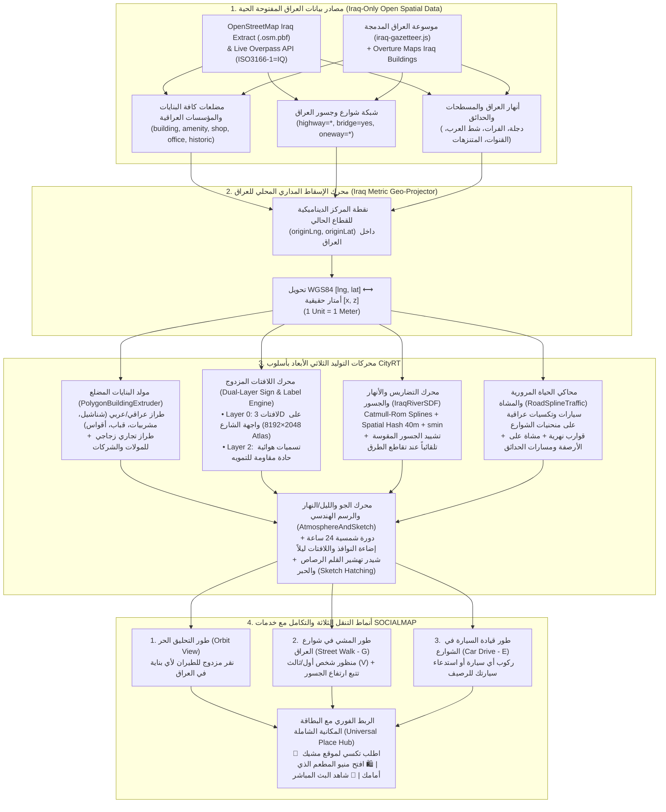
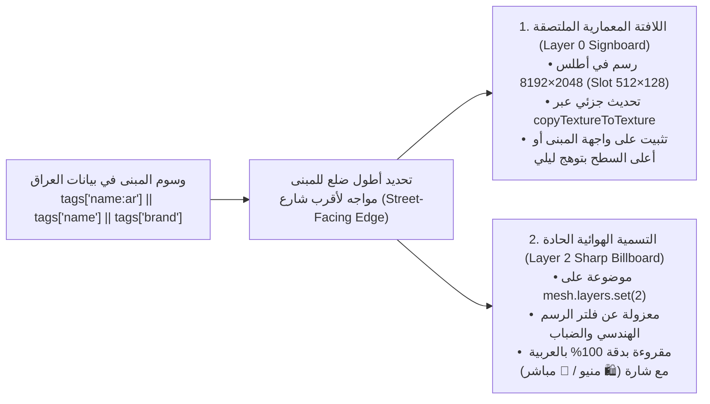
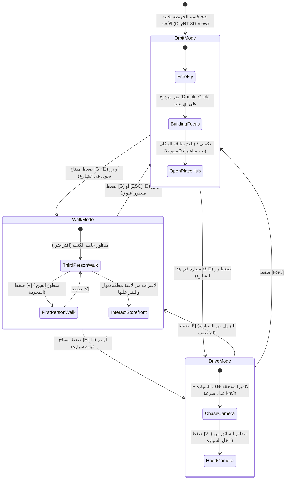

# 19 — المواصفات الهندسية والخوارزمية لقسم الخريطة ثلاثية الأبعاد الحية بأسلوب CityRT للعراق (CityRT 3D Live Iraq Map Engine Specification)
## منظومة SOCIALMAP — تحويل بيانات خرائط العراق الحية إلى مدينة ثلاثية الأبعاد تفاعلية باللافتات العربية، الأنهار، المرور، والتجول الميداني

> **معرف الوثيقة:** `SM-DOC-19`  
> **الإصدار المعماري:** `v11.5-SOCIALMAP-CITYRT-IRAQ`  
> **الوكلاء المسؤولون:** `[مايسترو هادي - @hadi-maestro] (01)`، `[معمار - @integrative-architect] (09)`، `[@motion-coder] (15)`، `[@cinematic-director] (11)`، `[مُقَسِّم - @stream-partitioner] (07)`، `[@design-system-master] (12)`، `[راصد - @rased-explorer] (03)`  
> **النطاق الجغرافي الحصري:** **جمهورية العراق فقط (`ISO 3166-1: IQ` — خطوط الطول `38.79°E – 48.57°E` ودوائر العرض `29.06°N – 37.38°N`)**.  
> **الهدف:** دمج بيئة **CityRT (`skylines-sketch`)** التفاعلية ثلاثية الأبعاد كقسم محوري داخل خريطة **SOCIALMAP**، بحيث تتحول البنايات، المؤسسات، الأسواق، الطرق، الأنهار (دجلة والفرات وشط العرب)، والجسور الحقيقية في العراق إلى عالم ثلاثي الأبعاد حي يحمل الأسماء الحقيقية للبنايات على لافتاتها، ويدعم أنماط التنقل الثلاثة (`Orbit`, `Walk [G]`, `Drive [E]`) مع الربط الكامل بطلب التكسي والمنيو والبث المباشر.

---

## 1. مصفوفة المهارات والوكلاء المفعلة لدمج بيئة CityRT مع خرائط العراق (Skills & Agents Execution Matrix)

| # | المهارة (Skill) والوكيل | المسار المرجعي في النظام | الدور الهندسي الدقيق في قسم الخريطة ثلاثية الأبعاد للعراق |
|---|---|---|---|
| **1** | **`threejs-webgl-mastery`** `@motion-coder (15)` | `C:\Users\070425\.gemini\config\skills\threejs-webgl-mastery\SKILL.md` | تحويل مضلعات بنايات العراق الحقيقية (`GeoJSON Polygon / MultiPolygon`) من إحداثيات `WGS84 [lng, lat]` إلى مجسمات ثلاثية الأبعاد (`ExtrudeGeometry` + واجهات إجرائية على كل ضلع)، وربط كاميرا `Three.js` مع محرك الخريطة، وفصل طبقات الرندر (`Layer 0` للمجسمات و`Layer 2` للتسميات العربية الحادة). |
| **2** | **`creative-kinetic-shaders`** `@cinematic-director (11)` | `C:\Users\070425\.gemini\config\skills\creative-kinetic-shaders\SKILL.md` | كتابة شيدرات `GLSL` الخاصة بـ: (أ) حفر مجاري أنهار العراق الحقيقية (دجلة والفرات والروافد) بـ `Signed Distance Fields (SDF)`، (ب) شيدر المياه المتحركة مع رغوة الشواطئ وانعكاسات الشمس، (ج) فلتر الرسم الهندسي (`Shadow Cross-Hatching + Paper Grain NPR`) مع استثناء طبقة أسماء البنايات (`Layer 2`) من التمويه. |
| **3** | **`stream-partitioner-bigdata`** `@stream-partitioner (07)` | `C:\Users\070425\.gemini\config\skills\07_stream_partitioner\SKILL.md` | تقسيم بيانات خريطة العراق الضخمة إلى قطاعات مكانية (`Spatial Hash / Tile Chunks 500m×500m`)، وتفريغ المضلعات البعيدة عن الكاميرا (`Frustum & Distance Culling`)، وتجميع الأشجار وأعمدة الإنارة والنوافذ في `THREE.InstancedMesh` و `BatchedMesh` للحفاظ على سرعة `60 FPS`. |
| **4** | **`design-system-master-hsl`** `@design-system-master (12)` | `C:\Users\070425\.gemini\config\skills\12_design_system_master\SKILL.md` | توليد لوحات ألوان الواجهات والأسقف ديناميكياً حسب تصنيف المبنى العراقي (`mosque/shrine`, `commercial/mall`, `hospital`, `school/university`, `residential`)، وتصميم أطلس اللافتات والتسميات العربية والإنجليزية والكردية (`DynamicSignGenerator`). |
| **5** | **`frontend-clean-coder-js`** `@nadif-clean-code` | `C:\Users\070425\.gemini\config\skills\15_frontend_clean_coder\SKILL.md` | بناء معمارية الكود النظيفة (`IraqGeoProjector`, `PolygonBuildingExtruder`, `LiveSignAtlas`, `IraqRiverSDF`, `RoadSplineTraffic`, `CityNavigationController`) مع الالتزام ببوابات التحقق (`node --check`, `lint`, `build`). |
| **6** | **`reverse-engineer-anything`** `@rased-explorer (03)` | `C:\Users\070425\.gemini\config\skills\reverse-engineer-anything\SKILL.md` | استخلاص الأنماط الخوارزمية الدقيقة من محرك `CityRT` (`skylines-sketch`) ومواءمتها مع طبقات البنايات والطرق والمؤسسات العراقية المستخرجة من المصادر المفتوحة. |

---

## 2. المخطط المعماري الشامل لدمج CityRT 3D داخل منظومة SOCIALMAP

---

## 3. الخوارزميات التنفيذية التفصيلية لقسم الخريطة ثلاثية الأبعاد (Core Engineering Algorithms)

### 3.1 نظام الإسقاط الجغرافي المتري المعاير للعراق (`Iraq Metric Geo-Projector`)
لكي تعمل أبعاد النوافذ (`2.2m`)، عرض الشوارع، ارتفاع الطوابق (`3.3m – 3.6m`)، وفيزياء المشي (`5.4 m/s`) والقيادة بالمتر الحقيقي الدقيق في جميع محافظات العراق الـ 18 (من زاخو عند دائرة عرض `37.14°N` إلى الفاو عند `29.97°N`)، يقوم المحرك بضبط مركز القطاع النشط `(originLng, originLat)` وحساب معامل انكماش خط الطول $\cos(\text{lat}_0)$:

$$\Delta x_{\text{meters}} = (\text{lng} - \text{originLng}) \times \frac{\pi}{180} \times 6378137 \times \cos\left(\text{originLat} \times \frac{\pi}{180}\right)$$

$$\Delta z_{\text{meters}} = -(\text{lat} - \text{originLat}) \times \frac{\pi}{180} \times 6356752.3$$

- **إعادة التمركز السلس (`Floating Origin Shifting`):** عندما يبتعد المستخدم (أثناء الطيران أو قيادة السيارة بين المدن) أكثر من `2,500 متر` عن نقطة الأصل، ينتقل `originLng, originLat` تلقائياً لمنع اهتزاز الفاصلة العائمة (`32-bit Float Jitter`) في `WebGL`.

---

### 3.2 توليد البنايات العراقية الحقيقية وتفاصيل واجهاتها (`Real Iraqi Footprint Procedural Buildings`)

تُقرأ مضلعات البنايات الحقيقية (`GeoJSON Polygon / MultiPolygon`) مع جميع وسومها (`tags`) وتُحول إلى عمارة ثلاثية الأبعاد غنية بالتفاصيل وفق القواعد التالية:

#### أ. مصفوفة استنتاج الارتفاع والطراز المعماري العراقي (`Iraqi Architectural Style Classifier`)

| فئة المبنى في الخريطة (`OSM Tags`) | الطراز المعماري المولد (`CityRT Iraq Style`) | عدد الطوابق الافتراضي (إن لم يوجد `building:levels`) | العناصر المعمارية الإجرائية المولدة على المضلع |
|---|---|---|---|
| **المساجد، المراقد، الكنائس، والمعالم التاريخية** (`amenity=place_of_worship`, `historic=*`, `building=mosque/shrine`) | `iraqi_heritage_sacred` | `2 – 4` طوابق (`8m – 14m`) + القبة والمئذنة | قبة فيروزية أو مذهبة، بوابة إيوان مرتفعة بالقاشاني الأزرق (`Pishtaq Portal`)، مئذنة أسطوانية بشرفة، وأقواس إسلامية |
| **البيوت التراثية، الخانات، والأسواق المسقوفة** (`historic=caravanserai`, `shop=bazaar`, أزقة بغداد وكربلاء والنجف والموصل القديمة) | `baghdadi_shanasheel` | `2 – 3` طوابق (`6.5m – 10m`) | **شناشيل ومشربيات خشبية بارزة** (`0.55m` للخارج) من الخشب المنقوش، فناء داخلي (`Riad Courtyard`) للمباني ذات المساحة `> 220m²`، وسترة سطح مزخرفة |
| **المولات، الفنادق، الأبراج التجارية، والمصارف** (`shop=mall`, `building=commercial/office/hotel`, `amenity=bank`) | `modern_commercial_glass` | `5 – 14` طابقاً (`18m – 50m`) | واجهات زجاجية عاكسة (`metalness: 0.75`)، طابق أرضي تجاري مرتفع مع مظلات محلات (`Storefront Awnings`)، شرائط إضاءة ليلية، ووحدات تكييف وخزانات على السطح |
| **الجامعات، المدارس، المستشفيات، والدوائر الحكومية** (`amenity=university/school/hospital/townhall`, `office=government`) | `iraqi_institutional` | `3 – 6` طوابق (`11m – 22m`) | كتل معمارية رصينة بالحجر الجيري العراقي الدافئ (`#e8d5b5`)، بوابة دخول رسمية بارزة، أعمدة واجهة، وسياج خارجي مع بوابة حراسة |
| **المنازل والشقق السكنية الحديثة** (`building=residential/house/apartments/detached`) | `iraqi_residential` | `2 – 4` طوابق (`6.6m – 13.5m`) | شرفات أمامية (`Balconies`)، نوافذ مضاءة ليلاً بنسب دافئة (`#ffe4a0`), سترة سطح (`Parapet Roof`)، وخزانات مياه علوية |

#### ب. خوارزمية توزيع النوافذ والشناشيل والمحلات على أضلاع المضلع غير المنتظم (`Edge-Aligned Facade Instancing`)
لكل ضلع $E_i = P_i \to P_{i+1}$ في مضلع المبنى الحقيقي يتجاوز طوله `3.0 متر`:
1. يُحسب طول الضلع $L_i = \text{hypot}(\Delta x, \Delta z)$ ومتجهه العمودي المتجه للخارج $\vec{n}_i = (\Delta z / L_i, -\Delta x / L_i)$ وزاوية دورانه $\theta_y = \text{atan2}(n_x, n_z)$.
2. يُقسّم الضلع إلى أعمدة معمارية بعرض `2.3m`، وتُحقن مصفوفات التحويل (`Matrix4`) للنوافذ والشرفات والشناشيل مباشرة في `THREE.InstancedMesh` مشترك لكل قطاع، مما يتيح رسم `50,000+` نافذة وشرفة في المدينة بطلب رسم واحد (`1 Draw Call`).

---

### 3.3 نظام اللافتات المعمارية والتسميات الحقيقية المزدوج (`Dual-Layer Real Iraqi Building Names`)

لضمان ظهور اسم كل بناية، مدرسة، جامعة (مثل *"مجموعة العميد التعليمية"*)، مستشفى، مول، مطعم، أو دائرة حكومية في موقعه الحقيقي فوق المبنى ثلاثي الأبعاد بوضوح فائق، يطبق المحرك نظامين متكاملين:

#### أ. ألوان وهوية اللافتات حسب تصنيف المؤسسة العراقية (`Semantic Signboard Palette`):
- **المطاعم والكافيهات والأفران (`restaurant / cafe / bakery`):** خلفية عنابية دافئة `#7a2e22`، إطار ذهبي `#e2b858`، مع توهج نيون ليلي وشارة `🍽️`.
- **الصيدليات والمستشفيات والعيادات (`pharmacy / hospital / clinic`):** خلفية خضراء طبية `#1b5e3a` للصيدليات أو بيضاء/حمراء `#b82929` للمستشفيات مع شارة `🏥 / 💊`.
- **الجامعات والمدارس والمعاهد (`university / school / college`):** خلفية كحلية أكاديمية `#1b3b5c`، نص ذهبي/أبيض ناصع `#fcefb4`، وتُثبت اللافتة بحجم كبير (`6.0m × 1.5m`) أعلى واجهة المبنى الرئيسي.
- **المولات والأسواق والمصارف (`mall / supermarket / bank`):** خلفية داكنة فاخرة `#16263b` مع إطار نيون سيان أو ذهبي `#00f5d4 / #d4af37`.
- **المساجد والمراقد والدوائر الرسمية (`mosque / shrine / government`):** خلفية فيروزية تراثية `#1e4d42` بإطار مذهب `#d4af37`.

---

### 3.4 الأنهار العراقية، القنوات، والجسور المقوسة عبر حقول المسافة الموقعة (`Iraq Rivers SDF & Arched Bridges`)

1. **نحت مجاري أنهار العراق الحقيقية (`waterway=river | canal | stream`):**
   - تُستخرج الإحداثيات الحقيقية لنهر دجلة، نهر الفرات، شط العرب، نهر ديالى، الزاب الأعلى والأسفل، شط الحلة، شط الكوفة، ونهر الحسينية من بيانات الخريطة.
   - تُحوّل خطوط الأنهار إلى منحنيات `CatmullRomCurve3` متصلة مع عرض النهر الحقيقي (`width`)، وتُفهرس في **`Spatial Hash Grid`** بحجم خلية `40m × 40m` لحساب المسافة الموقعة `waterSDF(x, z)` في زمن ثابت $O(1)$.
   - كل نقطة أرضية تحقق `waterSDF(x, z) < 0` تُحفر تلقائياً لتكوين قاع النهر وضفافه المتدرجة، وتُكسى بسطح مياه متحرك ذي تموجات ورغوة شاطئية (`Animated Shoreline Foam`).
2. **تشييد الجسور الحقيقية تلقائياً (`Automatic Bridge Deck & Pier Builder`):**
   - كل طريق يحمل وسم `bridge=yes` في بيانات العراق (مثل *جسر الجادرية*، *جسر الجمهورية*، *جسر الصرافية*، *جسر الأئمة*، *جسر الضريبة*، *جسر العباس*...) أو يتقاطع مساره الهندسي مع `waterSDF(x, z) < 0`:
   - يقوم المحرك برفع سطح الطريق والرصيف على قوس انسيابي (`Arched Bridge Deck`) يعلو سطح النهر، مع بناء دعامات حجرية/خرسانية في الماء، سياج حديدي جانبي، وأعمدة إنارة كلاسيكية مضيئة على جانبي الجسر.
   - تعود دالة `getWalkableHeightAt(x, z)` بارتفاع سطح الجسر بحيث تسير السيارات ويمشي المستخدم فوق الجسر بسلاسة تامة دون السقوط في النهر.

---

### 3.5 محاكاة حركة السير الحية، المشاة، والقوارب على شوارع وأنهار العراق (`Spline Road Graph Traffic & Citizens`)

1. **تحويل الشوارع الحقيقية إلى مسارات حركة (`Road LineString to Dual-Lane Splines`):**
   - كل شارع حقيقي في الخريطة (`highway=motorway | trunk | primary | secondary | tertiary | residential`) يُحوّل إلى منحنى `CatmullRomCurve3` مع مسارين متعاكسين (`±2.3m` عن محور الشارع، أو مسار واحد إذا كان `oneway=yes`).
   - تسير المركبات (سيارات صالون، سيارات أجرة عراقية صفراء/بيضاء، حافلات نقل، شاحنات، وسيارات نجدة) على الشوارع الفعلية وتتوقف خلف بعضها لمنع التصادم (`Adaptive Spacing Collision Avoidance`).
2. **دمج أسطول تكسي ومندوبي `SOCIALMAP` داخل المشهد ثلاثي الأبعاد:**
   - سيارات الأجرة المتاحة في منطقتك تظهر كسيارات ثلاثية الأبعاد تسير في شوارع المشهد؛ وعندما تطلب سيارة أجرة، ترى السيارة الفعلية تأتي عبر الشارع وتتوقف أمام الرصيف الذي تقف عليه!
3. **حركة المشاة والقوارب النهرية:**
   - يتحرك المشاة (`Pedestrians`) على الأرصفة الجانبية (`Sidewalks`) وفي المتنزهات والحدائق العامة (`leisure=park` مثل متنزه الزوراء أو حديقة سامي عبد الرحمن)، بينما تبحر الزوارق والقوارب السياحية على طول منحنى نهر دجلة والفرات وشط العرب.

---

### 3.6 أنماط التنقل الثلاثة داخل خريطة العراق ثلاثية الأبعاد وربطها بخدمات SOCIALMAP

#### تفاصيل التكامل التفاعلي بين التجول الثلاثي الأبعاد وخدمات `SOCIALMAP`:
1. **في طور التحليق (`Orbit View`):**
   - النقر المزدوج على أي مبنى في الخريطة ثلاثية الأبعاد يطير بالكاميرا إليه بنعومة ويفتح **البطاقة المكانية الشاملة (`Universal Place Hub`)** لطلب تكسي إليه أو فتح المنيو أو مشاهدة البث المباشر.
2. **في طور المشي الميداني في شوارع العراق (`Street Walk Mode — G`):**
   - يمكنك النزول للمشي على قدميك في شارع المتنبي، أو شارع 14 رمضان في المنصور، أو بين الحرمين في كربلاء، أو قرب قلعة أربيل، أو كورنيش شط العرب!
   - أثناء المشي، ترى البنايات الحقيقية على يمينك ويسارك وعليها لافتاتها العربية المضيئة؛ وبمجرد النقر على واجهة أي مطعم أو متجر أمامك في الشارع، يفتح لك **المنيو الثلاثي الأبعاد** الخاص به أو **البث المباشر للكاميرا** بداخله، أو يمكنك ضغط زر **`🚖 اطلب تكسي إلى موقع وقوفي الحالي`** لتأتي سيارة الأجرة وتتوقف أمامك على الرصيف.
3. **في طور قيادة السيارة (`Car Drive Mode — E`):**
   - بضغطة واحدة على مفتاح `E` (أو زر القيادة على شاشة الهاتف مع عجلة قيادة لمسية وأزرار بنزين ومكابح)، تركب أقرب سيارة وتقودها بنفسك عبر الشوارع الحقيقية والجسور فوق نهر دجلة والفرات مع عداد سرعة حي (`km/h`) وأصوات محرك ومكابح وبوق (`H`) مولدة إجرائياً عبر `Web Audio API`.

