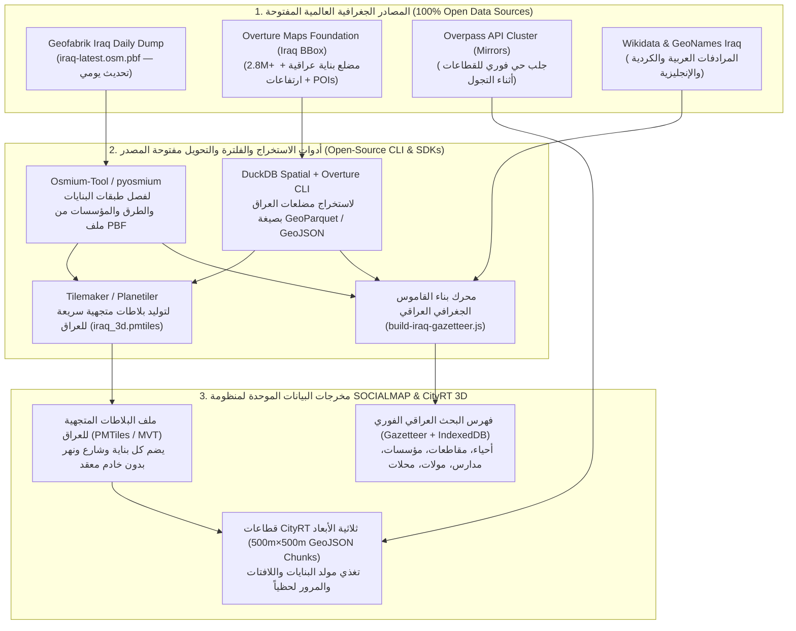

# 20 — المواصفات الهندسية لخط أنابيب جلب وفهرسة البيانات الجغرافية المفتوحة للعراق حصراً (Iraq-Only Open-Source Geodata Ingestion & Indexing Specification)
## منظومة SOCIALMAP — استخراج وتوحيد أسماء ومضلعات كافة البنايات، الطرق، المؤسسات، الأحياء، والأسواق في محافظات العراق الـ 18

> **معرف الوثيقة:** `SM-DOC-20`  
> **الإصدار المعماري:** `v11.5-SOCIALMAP-CITYRT-IRAQ`  
> **الوكلاء المسؤولون:** `[بيانات - @data-engineer] (25)`، `[ناظم - @data-modeler] (06)`، `[راصد - @rased-explorer] (03)`، `[مُقَسِّم - @stream-partitioner] (07)`، `[مبتكر - @mubtakir-tools] (20)`  
> **النطاق الجغرافي الصارم:** **دولة العراق حصراً (`ISO 3166-1 alpha-2: IQ` | `OSM Relation ID: 304934` | `Area ID: 3600304934`)**.  
> **الهدف:** بناء منظومة مفتوحة المصدر بالكامل (`100% Free & Open-Source Toolchain`) لجلب، تنظيف، تعريب، وفهرسة أسماء ومضلعات جميع البنايات بكافة أنواعها، وشبكات الطرق، والمؤسسات الرسمية والأهلية، والجامعات، والمدارس، والمستشفيات، والمولات، والمحلات في العراق لضمان تغطية شاملة في الخريطة ثنائية وثلاثية الأبعاد (`CityRT 3D`).

---

## 1. القفل الجغرافي الصارم على حدود جمهورية العراق (`Strict Iraq Spatial Boundary Lock`)

لضمان تركيز النظام وموارده وسرعة بحثه بنسبة **100% على دولة العراق فقط** ومنع تسرب أي نتائج بحث أو بلاطات خارج العراق، تُطبق القيود الجغرافية التالية في جميع المحركات والواجهات:

1. **مستطيل الإحاطة الجغرافي الرسمي للعراق (`IRAQ_BOUNDING_BOX`):**
   - خط الطول الغربي الأدنى (`minLng / West`): `38.7900° E` (القائم / الرطبة).
   - دائرة العرض الجنوبية الدنيا (`minLat / South`): `29.0600° N` (الفاو / سفوان).
   - خط الطول الشرقي الأقصى (`maxLng / East`): `48.5700° E` (الفاو / الشلامجة).
   - دائرة العرض الشمالية القصوى (`maxLat / North`): `37.3800° N` (زاخو / العمادية).
2. **قفل الدولة في كافة محركات البحث والاستعلام (`Country Code & Area Locks`):**
   - **في `Overpass API`:** استخدام معرف منطقة العراق السيادية `area["ISO3166-1"="IQ"]->.iraq;` (أو `area(3600304934)->.iraq;`).
   - **في `Nominatim API`:** فرض معامل `countrycodes=iq` و `bounded=1` و `viewbox=38.79,37.38,48.57,29.06`.
   - **في `ArcGIS Geocoder`:** فرض معامل `countryCode=IRQ` و `searchExtent=38.79,29.06,48.57,37.38`.
   - **في `Photon Komoot`:** فرض فلتر `bbox=38.79,29.06,48.57,37.38` والتحقق البرمجي من أن `properties.countrycode === 'IQ'` أو وقوع الإحداثية داخل مضلع العراق.

---

## 2. مكدس الأدوات مفتوحة المصدر لاستخراج بيانات العراق الشاملة (`Open-Source Iraq Geodata Toolchain`)



---

## 3. تصنيف البيانات المستخرجة للعراق (`Comprehensive Iraq Feature Extraction Taxonomy`)

يستخرج خط الأنابيب خمس طبقات رئيسية تغطي كل شبر في المحافظات العراقية الـ 18:

### 3.1 طبقة المؤسسات، البنايات العامة، والمجمعات التعليمية والصحية (`Institutions & Public Buildings`)
- **التعليم (`Education`):** جميع الجامعات الحكومية والأهلية، الكليات، المعاهد، المدارس الابتدائية والمتوسطة والإعدادية، المجمعات التربوية (مثل *"مجموعة العميد التعليمية"*، *"جامعة بغداد"*، *"جامعة المستنصرية"*، *"جامعة البصرة"*، *"جامعة الموصل"*، *"جامعة كربلاء"*، *"جامعة الكوفة"*، *"جامعة صلاح الدين"*...) ورياض الأطفال (`amenity=university|college|school|kindergarten`).
- **الصحة (`Healthcare`):** المستشفيات التعليمية والعامة والأهلية، المراكز الصحية، العيادات الاستشارية، المذاخر، والصيدليات (`amenity=hospital|clinic|doctors|pharmacy|dentist`).
- **المؤسسات الحكومية والخدمية (`Government & Civic`):** الوزارات، مباني المحافظات، البلديات، القائمقاميات، دوائر الجنسية والبطاقة الموحدة، دوائر الطابو، المحاكم، مراكز الشرطة، والدفاع المدني (`office=government`, `amenity=townhall|police|fire_station|courthouse|post_office`).
- **المعالم الدينية والتراثية (`Religious & Historic`):** العتبات المقدسة، الجوامع، المساجد، الحسينيات، الكنائس، الأديرة، القلاع، الخانات الأثرية (مثل *"خان العطيشي"*، *"خان الربع"*، *"المدرسة المستنصرية"*، *"قلعة أربيل"*)، والمتاحف (`amenity=place_of_worship`, `historic=*`, `tourism=museum`).

### 3.2 طبقة التجارة المكانية، المولات، الأسواق، والمطاعم (`Commercial, Markets, Malls & Dining`)
- **المولات والمجمعات التجارية (`shop=mall | department_store`):** مع استخراج مضلعاتها الدقيقة وعدد طوابقها والمحلات بداخلها.
- **الأسواق الشعبية والتجارية (`amenity=marketplace`, `shop=supermarket|convenience|bakery|butcher|clothes|electronics|jewelry|furniture`).**
- **المطاعم والكافيهات والحلويات (`amenity=restaurant|cafe|fast_food|ice_cream`).**
- **الفنادق والضيافة (`tourism=hotel|motel|guest_house|chalet`).**

### 3.3 طبقة التقسيمات الإدارية، الأحياء، المحلات، والمقاطعات (`Administrative & Neighborhoods`)
- كافة المحافظات الـ 18 (`admin_level=4`)، الأقضية (`admin_level=6`)، النواحي (`admin_level=7`)، الأحياء السكنية والمقاطعات الزراعية (`place=suburb|neighbourhood|quarter|village|hamlet|locality`) مع نظام الترقيم المحلي (`محلة / زقاق / دار`).

### 3.4 طبقة شبكة الطرق، الشوارع، الجسور، والأنفاق (`Road Network & Bridges`)
- الطرق السريعة الدولية (`motorway`)، الشوارع الرئيسية والتجارية (`trunk`, `primary`, `secondary`)، الشوارع الفرعية داخل الأحياء (`tertiary`, `residential`, `living_street`)، ممرات المشاة والأسواق (`pedestrian`, `footway`)، والجسور (`bridge=yes`) مع أسمائها الرسمية والشعبية.

### 3.5 طبقة مضلعات البنايات ثلاثية الأبعاد (`3D Building Footprints & Levels`)
- جميع المضلعات التي تحمل وسم `building=*` في العراق مع خصائص الارتفاع (`height`, `building:levels`, `roof:shape`, `roof:colour`, `building:material`) لتغذية محرك **CityRT 3D (`PolygonBuildingExtruder`)**.

---

## 4. الأوامر والاستعلامات المعيارية المفتوحة المصدر لجلب بيانات العراق (`Standard Open-Source Extraction Queries`)

### 4.1 استعلام `Overpass QL` الشامل لجلب البنايات والمؤسسات والطرق والأنهار لقطاع جغرافي في العراق
يُستخدم هذا الاستعلام الموحد لجلب بيانات أي قطاع (`Bounding Box`) في العراق وتحويله فوراً إلى بيئة **CityRT 3D** مع كافة الأسماء واللافتات:

```overpassql
[out:json][timeout:25][bbox:{{south}},{{west}},{{north}},{{east}}];
(
  // 1. جميع البنايات والمؤسسات والمولات والمحلات (نقاط + مضلعات + علاقات)
  nwr["building"];
  nwr["amenity"];
  nwr["shop"];
  nwr["office"];
  nwr["tourism"];
  nwr["historic"];
  nwr["leisure"];
  nwr["place"];
  // 2. شبكة الطرق والشوارع والجسور الحقيقية لحركة السيارات والمشي
  way["highway"~"^(motorway|trunk|primary|secondary|tertiary|residential|living_street|pedestrian|footway|service)$"];
  // 3. الأنهار والقنوات والمسطحات المائية (دجلة والفرات والروافد) لمحرك SDF
  way["waterway"~"^(river|canal|stream)$"];
  nwr["natural"="water"];
);
out body;
>;
out skel qt;
```

### 4.2 استخراج بيانات العراق الكاملة أوفلاين باستخدام `Osmium` و `Overture Maps CLI` (للتجهيز المسبق على الخادم أو الحاسوب)

1. **تنزيل نسخة العراق الكاملة من Geofabrik واستخراج كافة الأسماء والمؤسسات:**
   ```bash
   # 1. تحميل ملف خريطة العراق الخام المحدث يومياً (حجمه ~110 MB مضغوط)
   curl -L -o iraq-latest.osm.pbf https://download.geofabrik.de/asia/iraq-latest.osm.pbf

   # 2. فلترة كافة البنايات والمؤسسات والأماكن المسماة في العراق باستخدام osmium-tool
   osmium tags-filter iraq-latest.osm.pbf \
     nwr/name nwr/name:ar nwr/building nwr/amenity nwr/shop nwr/office nwr/place nwr/historic \
     -o iraq-buildings-and-places.osm.pbf

   # 3. تحويلها إلى GeoJSON أو بلاطات متجهية PMTiles عالية السرعة
   tilemaker --input iraq-latest.osm.pbf --output iraq-socialmap-3d.pmtiles
   ```

2. **جلب مضلعات وارتفاعات جميع مباني العراق (`2.8+ مليون مبنى`) عبر أداة `Overture Maps` مفتوحة المصدر:**
   ```bash
   # استخراج مضلعات مباني العراق فقط ضمن الإحداثيات السيادية للعراق
   overturemaps download --bbox=38.79,29.06,48.57,37.38 \
     -f geoparquet --type=building -o iraq_buildings_3d.parquet

   # استخراج كافة نقاط الاهتمام والمؤسسات والمحلات في العراق
   overturemaps download --bbox=38.79,29.06,48.57,37.38 \
     -f geojson --type=place -o iraq_places_complete.geojson
   ```

---

## 5. خوارزمية التسمية الذكية للبنايات غير المسماة في العراق (`Smart Iraqi Contextual Label Resolver`)

في بعض الأحيان، يحتوي مضلع مبنى في `OpenStreetMap` على نوع المبنى (`building=school` أو `amenity=pharmacy`) أو يقع بداخله دبوس نقطة (`Node POI`) يحمل الاسم دون أن يكون الاسم مكتوباً على المضلع الخارجي نفسه. يعالج النظام ذلك عبر **خوارزمية الربط المكاني (`Spatial Point-in-Polygon & Nearest-Street Join`)**:

1. **الخطوة 1 (الدمج المكاني `Point-in-Polygon Join`):**
   - إذا وُجدت نقطة (`Node`) تحمل `name` أو `name:ar` (مثل *"مجموعة العميد التعليمية"* أو *"مطعم الصمد"* أو *"صيدلية الحياة"*) داخل مضلع بناية (`Way Polygon`) غير مسمى، يرث المضلع الثلاثي الأبعاد اسم النقطة وتصنيفها تلقائياً ويضع لافتتها الثلاثية الأبعاد على واجهته!
2. **الخطوة 2 (التسمية العربية الوظيفية الاحتياطية `Contextual Arabic Fallback`):**
   - إذا كان المبنى مرفقاً عاماً له وسم وظيفي (`amenity` / `shop` / `building`) بدون اسم علم، يولد له `DynamicSignGenerator` لافتة عربية أنيقة باسم وظيفته واسم الشارع أو الحي (مثال: `مسجد الحي`، `مدرسة`، `مركز صحي`، `صيدلية`، `مخبز`، `سوق تجاري`).
3. **الخطوة 3 (الحفظ التراكمي التلقائي في `IndexedDB`):**
   - كل قطاع في العراق يستكشفه المستخدم يُفهرس تلقائياً في مخزن `sm_places_cache` و `sm_cityrt_chunks_lru` بحيث يصبح متاحاً للبحث الفوري بالاسم في المرات القادمة خلال `< 5ms` حتى بدون إنترنت.

